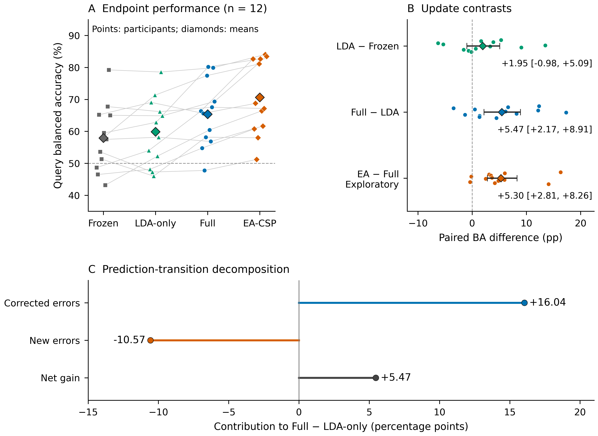
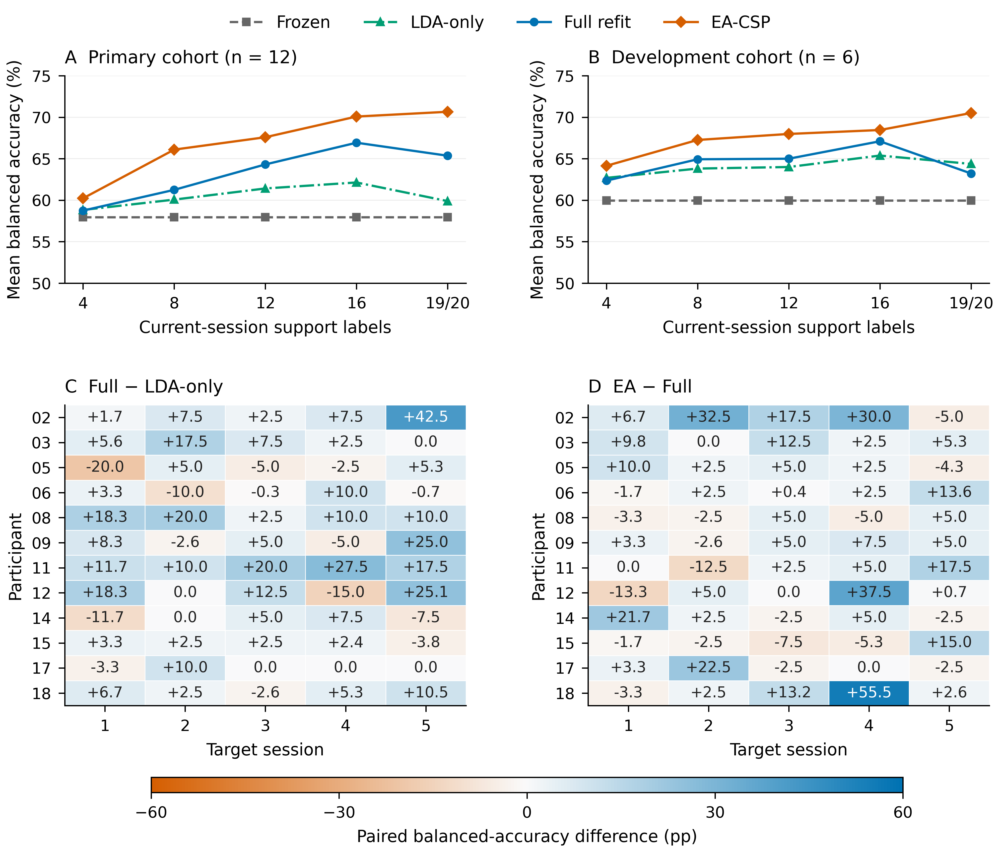
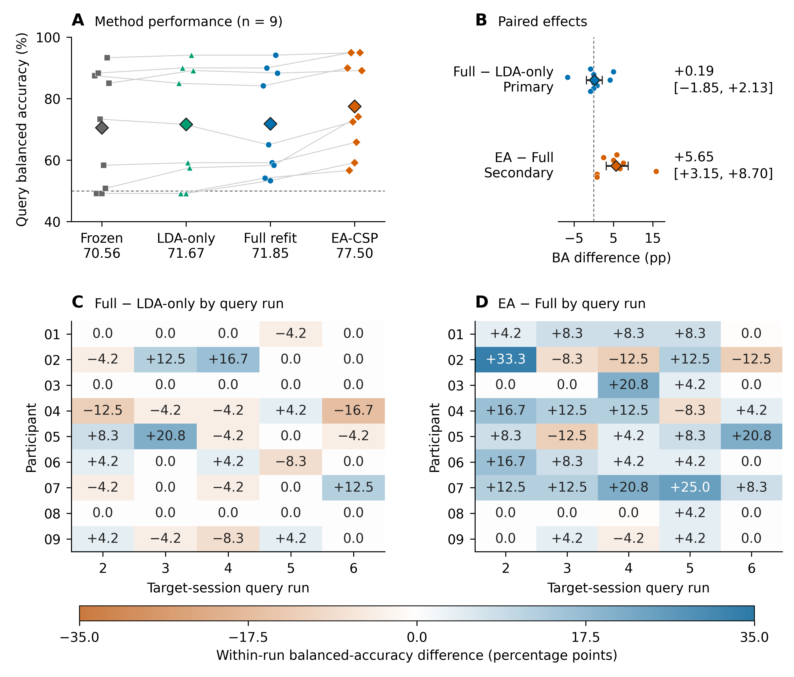

# Disentangling spatial-filter and classifier contributions to limited-label motor-imagery EEG recalibration

**Running head:** Components of limited-label EEG recalibration

**Ziyuan Zhu**\*, **Sihao Liu**, **Haoyang Yu**

College of Artificial Intelligence Medicine, Chongqing Medical University, Jinyun Campus, No. 61 Daxuecheng Middle Road, Shapingba District, Chongqing 401331, China

**\*Corresponding author:** Ziyuan Zhu; zzy2630816871@gmail.com

**Co-author emails:** Sihao Liu, liu3100853087@gmail.com; Haoyang Yu, jiaguca3329@163.com

**ORCID (Ziyuan Zhu):** https://orcid.org/0009-0005-1153-4926

## Abstract

**Objectives:** To quantify the contributions of classifier recalibration, spatial-filter refitting and covariance alignment when a new motor-imagery session provides approximately 20 labels.

**Methods:** We compared frozen common spatial patterns and linear discriminant analysis (CSP/LDA) with three updating pipelines in Kumar2024 (18 participants, six sessions; 12-participant primary cohort). The updates shared source/support labels and query trials. Saved predictions supported error-transition, label-budget and phase-window analyses. A fixed external comparison included nine BNCI2014-001 participants.

**Results:** In Kumar2024, full refitting achieved 65.36% balanced accuracy, improving on frozen decoding by 7.42 percentage points (95% participant-bootstrap interval 2.49–12.48). The secondary spatial-refitting increment beyond LDA-only was 5.47 points (2.17–8.91), or 73.7% of the mean total gain. An exploratory support-only Euclidean-alignment comparison added 5.30 points beyond full refitting (2.81–8.26), reaching 70.66%. In BNCI, alignment added 5.65 points (3.15–8.70; secondary Holm-adjusted p=0.01172), improving all nine participants. Its primary full-minus-LDA-only contrast was 0.19 points (−1.85 to 2.13).

**Conclusions:** Matched-label comparisons locate recalibration gains in specific spatial operations. Spatial refitting supplied the principal component gain in Kumar2024, while support-only alignment added accuracy in both datasets.

**Keywords:** brain–computer interfaces; cross-session decoding; domain adaptation; signal processing; transfer learning

**Abbreviations:** BA, balanced accuracy; BCI, brain–computer interface; CSP, common spatial patterns; EA, Euclidean alignment; EEG, electroencephalography; LDA, linear discriminant analysis.

## Introduction

A short calibration run must support a concrete decision: which parts of a motor-imagery decoder should be updated? A classifier can be recalibrated in its existing feature space, its spatial filters can be relearned together with the classifier, or the recordings can first be aligned across sessions. These actions use the new examples differently. Their value is most clearly measured when they receive the same labels and are evaluated on the same later trials.

Limited-label recalibration is central to repeated use of EEG-based brain–computer interfaces (BCIs) [@lotte2018]. Changes in recording conditions and task-related signals alter the relationship between a trained decoder and a later session. Common spatial patterns (CSP) and linear discriminant analysis (LDA) offer a transparent setting for studying this problem [@ramoser2000; @blankertz2008]. CSP extracts spatial power features that separate two classes; LDA makes decisions in those features. Updating LDA retains the source representation. Full CSP/LDA refitting also estimates a new representation from the available source and target labels.

Classifier adaptation, adaptive spatial filtering and data-space alignment provide established approaches to session variability [@vidaurre2011lda; @song2015acsp; @arvaneh2013dsa; @he2020alignment; @zanini2018alignment]. The acquisition study underlying Kumar2024 used covariance recentering, a Riemannian classifier and supervised prototype updates, and examined a recentering-based CSP extension [@kumar2024; @kumar2024correction]. The practical question is therefore more specific than whether adaptation helps: how much additional accuracy does a spatial update supply after the classifier has already received the same calibration labels?

That question also differs from selecting how long a decoder should retain revealed labels. Label-revealed online benchmarks evaluate expanding, rolling or cold-start update histories [@kozyrskiy2026updates]. Here, each later session starts from the same source training data and a fixed current-session support run. Earlier target labels do not accumulate. This reset makes the current label budget explicit and allows the spatial and classifier contributions to be compared within each participant and session.

We study four conventional pipelines: a frozen source decoder, LDA-only recalibration, full CSP/LDA refitting and full refitting after support-only Euclidean alignment (EA-CSP). The two supervised refits share the same fitting examples. The aligned pipeline also shares those labels, while estimating its target covariance reference from the support signals. Comparing these pipelines separates a new decision rule, a relearned spatial projection and a change in the coordinates presented to that projection.

The contribution is a quantitative decomposition of familiar decoder updates under matched labels. First, we measure the added spatial-refitting increment under matched source and target labels. Second, we reconstruct that increment through corrected and newly introduced prediction errors and locate it across participants, sessions and calibration budgets. Third, we evaluate the additional alignment operation in the same longitudinal cohort and in an independent acquisition with a fixed 20-label support set. Existing neural and geometric experiments provide complementary controls for how other representation updates behave under small support sets.

## Materials and methods

### Public datasets and ethics

We analyzed Kumar2024, NEMAR nm000177/v1.0.5 [@nemar177], and the original BNCI2014-001/BCI Competition IV 2a recordings [@tangermann2012competition]. Kumar2024 contains 18 participant identifiers recorded over six sessions; BNCI2014-001 contains nine participants recorded on two different days. Left- and right-hand imagery defined the binary decoding task in both datasets. Dataset cohorts were analyzed separately.

The Kumar acquisition study reported ethical approval from the University of Texas at Austin, protocol 2020-03-0073, and written informed consent [@kumar2024]. Those statements concern the original Kumar data collection. The inspected BNCI source documents and their reported ethics information are identified separately in the supplementary methods.

This secondary analysis was exempt from additional ethical review under Article 32, item (1), of China's *Measures for Ethical Review of Life Science and Medical Research Involving Human Participants* (2023) [@china2023ethics]. It used lawfully obtained publicly available data, caused no harm to participants, and did not involve sensitive personal information or commercial interests.

The study used coded public records. No participants were recruited or contacted and no re-identification was attempted. Kumar metadata were accessed on 10 October 2026 and the selected recordings retrieved on 11 October 2026; the external BNCI recordings were retrieved on 27 October 2026. Original data-collection information and the regulatory basis for secondary analysis are recorded separately.

### Chronological partitions and signal processing

Kumar2024 provided 360 EDF recordings and 7,200 exported left/right events. Of these, 7,156 had complete five-second windows; 44 reached the end of a recording and were excluded without padding. All partial windows occurred at the final event of an online recording. The cue codes were 769/770, and the original codebook separately identified task-start codes 7691/7701 [@kumarcodebook]. The released cue-anchored convention and documented adapter used a five-second interval [@jayaram2018].

Signals underwent common-average referencing across 22 channels, fourth-order 8–30 Hz zero-phase Butterworth filtering and resampling from 512 to 128 Hz. Each complete window contained 22×640 float32 values in volts. Participants sub-1, 4, 7, 10, 13 and 16 formed the original development group; the remaining 12 formed the primary cohort. Session 0/runs 0–1 supplied 40 source-training examples, run 2 supplied 20 source-validation examples and run 3 supplied source query. In each of the five later sessions, run 0 supplied support and subsequent whole runs supplied query. The complete original query set comprised 360 source and 3,930 target events. Its 30 partial-query exclusions were fixed.

BNCI2014-001 provided six motor-imagery runs per recording day, with 48 four-class trials per run. We retained the first 22 EEG channels and the recorded reference. The one-based MAT trial-start sample preceded the class cue by two seconds. Epochs covered cue time [0,4) seconds at 250 Hz after fourth-order 8–30 Hz zero-phase filtering within each continuous run. Source-day runs 1–4 supplied 96 left/right labels; runs 5–6 were withheld. The first 20 chronological hand trials in target run 1 supplied support, with its remaining four hand trials withheld. Whole runs 2–6 supplied 120 target-query examples, 60 per class.

All paired methods used identical ordered query identities and labels. Support prefixes retained acquisition order rather than being rebalanced using later labels. Learned transforms used source training and the declared current support. Query signals did not estimate an alignment reference, select a model or determine an update rule.

### Matched-label decoder components

Frozen CSP/LDA learned its spatial filters and decision rule from source training alone. LDA-only retained the source CSP filters and refitted LDA on the union of source training and current support. Full refitting estimated both CSP and LDA on that same union. EA-CSP separately aligned the source and current-support signals, then fitted CSP/LDA on their aligned union. The target query was transformed using the support reference already fixed before evaluation.

The Kumar pipelines used four-component CSP with Ledoit–Wolf regularization and log-power features, followed by LDA with automatic shrinkage [@ledoit2004]. The alignment branch represented the common-average signal in 21 orthonormal coordinates, estimated each domain reference as the arithmetic mean of its trial sample covariances, and applied the inverse square root of that reference. Only the 40 source-training examples and the current support prefix entered reference estimation and fitting. The 20 source-validation examples did not enter these conventional fits.

The external comparison reused the separately versioned NumPy implementation: four CSP components, fixed covariance and LDA shrinkage of 0.1, and separate source/support alignment references. The source-label count, referencing and covariance estimators therefore differ across datasets. Within each dataset, all updating methods receive the same source/support examples. Frozen decoding uses zero target labels.

Let B denote participant-level target BA. The four pipelines define the additive contrasts

$$
B_{\mathrm{EA}}-B_{\mathrm{frozen}}
=(B_{\mathrm{LDA}}-B_{\mathrm{frozen}})
+(B_{\mathrm{full}}-B_{\mathrm{LDA}})
+(B_{\mathrm{EA}}-B_{\mathrm{full}}).
$$

The first term measures classifier recalibration, the second the additional spatial refit with its classifier retrained in the revised feature space, and the third alignment beyond full refitting. This is a decomposition of measured pipeline differences. The reported spatial share divides the cohort-average second term by the cohort-average full-minus-frozen gain; it is not a participant-wise ratio.

### Prediction transitions, budgets and longitudinal summaries

We compared saved predictions trial by trial. For true class c, C_c is the proportion changing from an error under method A to a correct prediction under B; E_c is the reverse transition. The class-balanced difference is

$$
B_B-B_A=\tfrac12(C_0+C_1)-\tfrac12(E_0+E_1).
$$

This identity separates corrected errors from newly introduced errors without changing the query set. Class recalls, five target-session means, participant differences and leave-one-participant-out means describe where the component gain occurs.

The completed Kumar budget analysis evaluated chronological prefixes of 4, 8, 12 and 16 labels and the full support run of 19 or 20 labels. Source training and query identities stayed fixed across budgets. All 18 participants had complete five-session endpoints for every method and budget. Full support contained 19 labels in 14 of the 90 participant/session cells and 20 in the other 76. Single-class support prefixes were retained; the binary source-training set supplied both classes. Every scheduled budget is reported, including differences between the 16-label and full-support points.

### Amplitude and phase-window sensitivity

The existing raw peak-to-peak rule of 250 µV flagged 1,512 of the 7,156 complete Kumar windows. The main analysis retained these windows. Saved predictions were matched to the flags by trial identity. The amplitude-restricted analysis required both query classes in every target session; ten primary-cohort participants met that criterion. Training and support data were unchanged.

Recovered task markers additionally supported a paired comparison between cue-anchored five-second windows and task-start two-second windows. Eligibility required a class-matched task end at least two seconds after task start, recording completeness and inclusion in the original complete-window set. The two windows and three original actions shared common eligible query trials. A complete five-session endpoint was available for nine primary-cohort participants; an eight-participant metadata-complete sensitivity excluded the prespecified incomplete-mapping case. Across the original 7,200 events, 980 still lacked original phase mapping. The comparison jointly changes anchor, duration and window-local filtering edges; its estimand is the paired difference between the two complete analysis definitions.

### Participant-level statistics and comparison roles

BA was the mean of the two true-class recalls. For Kumar, target sessions were averaged equally within participant, followed by the participant mean within the fixed cohort. Undefined class or session endpoints remained explicit rather than being imputed. The original full-minus-frozen contrast was primary and full-minus-LDA-only secondary. Their historical 10,000-resample, participant-bootstrap intervals were retained.

The original post-hoc exact sign-flip check used the absolute mean paired difference and preserved the observed magnitudes. Holm adjustment covered four saved contrasts: full-minus-frozen, full-minus-LDA-only and LDA-only-minus-frozen in the 12-person cohort, plus full-minus-frozen in the ten-person eligible amplitude-restricted subset. The historical bootstrap intervals are pointwise; the sign-flip p values use a sign-symmetric reference with that family adjustment.

Kumar EA, budget and phase analyses were completed after earlier outcome exposure and use exploratory pointwise participant-percentile intervals: 10,000 draws, seed 42. Those intervals remain separate from the historical main-analysis intervals. In BNCI, full-minus-LDA-only was the single fixed primary contrast. Full-minus-frozen, LDA-only-minus-frozen and EA-minus-full formed a separate three-test secondary Holm family. Exact tests enumerated all 512 participant sign assignments; paired bootstrap intervals used 10,000 draws, seed 20261027 and participant order 1–9.

Participants are the independent units throughout. Session, method and seed counts describe repeated observations, not additional participants. The original 54 EEGNet source models represented 18 people×three seeds. Neural and geometric follow-ups used the same six previously exposed development participants; their complete outcomes are provided in the supplement. This revision reconstructs the reported endpoints from saved predictions and summaries, with no new model fitting or inference.

## Results

### Spatial refitting supplied most of the original recalibration gain

In the Kumar primary cohort, frozen CSP/LDA achieved 57.94% target BA, LDA-only achieved 59.89% and full refitting 65.36% (Table 1; Figure 1). The original primary full-minus-frozen gain was 7.42 percentage points (95% participant-bootstrap interval 2.49–12.48). Its exact sign-flip p value was 0.01953 and four-test Holm-adjusted p=0.05859. These values accompany the positive pointwise interval and retain the original analysis hierarchy.

The secondary matched-label full-minus-LDA-only gain was 5.47 points (2.17–8.91; exact p=0.01025; Holm p=0.04102). LDA-only minus frozen was 1.95 points (−0.98 to 5.09). The spatial increment accounted for 73.7% of the mean full-minus-frozen gain. Thus, most of the observed mean improvement involved relearning the spatial representation after the classifier had received the same labels.

**Table 1. Four decoder actions at the full current-session label budget.**

| Pipeline | Updated components | Kumar primary cohort, n=12 | BNCI, n=9 | Target labels |
| --- | --- | ---: | ---: | --- |
| Frozen CSP/LDA | None | 57.94% | 70.56% | 0 |
| LDA-only | Decision rule | 59.89% | 71.67% | Same support run |
| Full CSP/LDA | Spatial filters and decision rule | 65.36% | 71.85% | Same support run |
| EA-CSP | Domain alignment, spatial filters and decision rule | 70.66% | 77.50% | Same support run |

BA values average participants, after averaging five target sessions within Kumar participants. Full support is 19/20 labels in Kumar and exactly 20 in BNCI. Kumar source training contains 40 examples; BNCI contains 96. Kumar EA is an exploratory extension of the original comparison. Frozen decoding receives no target labels; the three updating pipelines share source and support identities within each dataset.

### Support-only alignment added accuracy beyond full refitting

The completed Kumar alignment analysis achieved 70.66% BA in the same 12-person cohort. EA-CSP added 5.30 points beyond full refitting (exploratory pointwise interval 2.81–8.26), with positive participant differences in ten of 12 people. Its total gain over frozen decoding was 12.72 points (6.50–19.10). Source and support identity checks confirmed that this additional gain was obtained from the same fitting labels and the same later query trials.

The external comparison also favored the alignment operation (Table 2). EA-CSP achieved 77.50% BA, compared with 71.85% for full refitting, 71.67% for LDA-only and 70.56% for frozen decoding. The secondary EA-minus-full gain was 5.65 points (3.15–8.70; exact p=0.00391; Holm p=0.01172). All nine participant differences were positive, ranging from +0.83 to +15.83 points; the leave-one-out mean ranged from +4.38 to +6.25 points. All five target-query run means favored EA over full refitting.

The external primary full-minus-LDA-only contrast was +0.19 points (−1.85 to 2.13; exact p=0.96875). Three participants improved, three decreased and three were unchanged. These data distinguish an alignment contribution from ordinary spatial refitting under the fixed 20-label budget.

**Table 2. Paired component contrasts and their analysis roles.**

| Dataset and cohort | Contrast and role | Mean difference [95% interval], pp | Exact p | Holm p |
| --- | --- | ---: | ---: | ---: |
| Kumar, 12 | Full − frozen; original primary | +7.42 [2.49, 12.48] | 0.01953 | 0.05859 |
| Kumar, 12 | Full − LDA-only; original secondary | +5.47 [2.17, 8.91] | 0.01025 | 0.04102 |
| Kumar, 12 | EA − Full; exploratory | +5.30 [2.81, 8.26] | — | — |
| BNCI, 9 | Full − LDA-only; fixed primary | +0.19 [−1.85, 2.13] | 0.96875 | — |
| BNCI, 9 | Full − frozen; secondary | +1.30 [−1.76, 3.98] | 0.45312 | 0.68750 |
| BNCI, 9 | LDA-only − frozen; secondary | +1.11 [−0.46, 2.96] | 0.34375 | 0.68750 |
| BNCI, 9 | EA − Full; secondary | +5.65 [3.15, 8.70] | 0.00391 | 0.01172 |

Intervals resample participants and are pointwise. Kumar original intervals retain their historical draws; the EA interval comes from the separate exploratory analysis. Kumar Holm values belong to the four-test original family described in Methods. BNCI secondary values belong to its three-test family; its single primary contrast is outside that secondary adjustment. A dash denotes a test not reported for that role.

{width=100%}

**Figure 1. Contributions to limited-label recalibration.** Four pipeline actions distinguish classifier recalibration, the added spatial refit and support-only alignment. Participant and cohort results retain the original Kumar comparison and its exploratory EA extension. The prediction-transition decomposition shows corrected errors and newly introduced errors underlying the original full-minus-LDA-only gain. Updating pipelines receive the same source and current-support labels; the frozen source decoder receives no target labels.

### Prediction transitions and longitudinal profiles locate the spatial gain

In the original primary cohort, spatial refitting corrected 16.04 BA points of class-balanced errors while introducing 10.57 points of new errors on the same queries. Their difference exactly reconstructs the +5.47-point component endpoint. Mean left- and right-class recall changes were +6.16 and +4.78 points; each class-specific interval included zero, while their class-balanced mean formed the component gain.

The spatial-refitting increment was positive in ten of 12 participant averages and in all five target-session cohort means: +3.52, +5.20, +4.13, +4.18 and +10.33 points. Every single-participant deletion left a positive mean, between +4.39 and +6.28 points. Full refitting improved on frozen decoding for nine of 12 people; the three decreases were −5.82, −0.67 and −0.20 points. Development-cohort full-minus-LDA-only averaged −1.15 points, so the primary and development estimates remain separate in the supplementary tables.

Amplitude-restricted queries retained a spatial gain in the ten eligible primary participants. Full-minus-frozen was +5.96 points (0.99–11.24), and full-minus-LDA-only was +3.82 points (1.11–6.72). This restriction tested the saved predictions on a different query subset while preserving the original source and support signals.

### The value of each update changed across calibration budgets

The complete Kumar curves show how the component contributions evolved as more current-session labels became available (Figure 2). In the 12-person cohort, full-refit BA was 58.74%, 61.25%, 64.31%, 66.93% and 65.36% at budgets 4, 8, 12, 16 and full support. LDA-only values were 58.83%, 60.07%, 61.41%, 62.14% and 59.89%. Their paired spatial increments were −0.08, +1.18, +2.90, +4.79 and +5.47 points.

EA-CSP achieved 60.22%, 66.10%, 67.59%, 70.08% and 70.66% across the same prefixes. EA-minus-full means were +1.48, +4.85, +3.28, +3.15 and +5.30 points. The corresponding pointwise intervals included zero at four labels and were positive at the other scheduled budgets. All prefix results, single-class support cases and individual differences remain in the supplementary tables. The complete curves describe the scheduled label doses rather than selecting a new operating budget from query scores.

{width=100%}

**Figure 2. Calibration budgets and longitudinal participant differences.** A–B: full four-method curves in the original primary and development cohorts, respectively. Support caps are 4, 8, 12, 16 and the full run of 19 or 20 labels. C–D: participant-by-session spatial-refitting and alignment increments in the 12-person primary cohort. Participants define the cohort summaries; all scheduled budgets and session differences are shown.

Figure 3 resolves the external alignment comparison into participant effects and five complete query-run profiles.

{width=100%}

**Figure 3. External comparison under exactly 20 support labels.** A: participant BA; cohort means appear beneath the method names. B: paired participant differences and pointwise 95% bootstrap intervals for the primary full-minus-LDA-only and secondary EA-minus-full contrasts. C–D: participant-by-query-run differences across five complete test runs. Nine participants contributed 120 query trials each. Alignment references used source and current-support signals.

### Paired task-window analysis assessed the cue-anchored endpoint

In the nine-person conditional phase scope, full-minus-frozen was +2.06 points (−3.73 to 8.17) for cue-anchored five-second windows and +3.21 points (0.08–6.56) for task-start two-second windows. Their paired gain change was +1.15 points (−5.55 to 7.22). In the eight-person metadata-complete sensitivity, the corresponding changes were +3.98 points (−0.90 to 9.81), +3.46 points (−0.02 to 7.12) and −0.51 points (−7.30 to 5.23).

The same trial-matched comparisons retained each window's class counts and all undefined cells. Gain-change intervals crossed zero in both scopes. These results evaluate the two defined windows on their common eligible trials; the original complete-window cohort and its primary endpoint remain unchanged.

### Additional representation controls distinguished update operations

The six-participant neural extension compared normalization modes during fixed-budget weight adaptation. At the 20-label cap, fixed-source normalization increased BA by 1.50 points (0.33–2.74) for individual sources and 1.91 points (0.76–3.24) for pooled sources, relative to adaptive normalization. Single-class prediction counts were 8 versus 16 and 0 versus 18 among 90 nested seed/session outcomes. Smaller-budget profiles differed; batch size 16 also changed the number of normalization updates at the final cap.

The geometric candidate's predefined comparison with ordinary tangent refitting was −2.33 points (−4.41 to −0.24). The source-functional constraint changed BA relative to ordinary fixed-normalization adaptation by −0.01 and +0.03 points in its two source regimes. All candidate primary contrasts, ablations, doses, probability scores and simulations are retained in the supplement. These controls examine different representation updates rather than additional independent participant cohorts.

## Discussion

### Matched labels reveal the contribution of the spatial operation

The central result is a component estimate: with the same source and approximately 20 current labels, relearning CSP together with LDA added 5.47 BA points beyond LDA-only recalibration in the Kumar primary cohort. That increment supplied 73.7% of the mean full-refit gain over freezing. A comparison of an updated model with a frozen source model gives the total benefit of new labels and refitting; the matched-label contrast identifies the additional value of changing the spatial representation.

The prediction transitions explain this value at the level of actual decisions. Spatial refitting corrected more class-balanced errors than it introduced. Positive cohort means across all five target sessions and after every single-participant deletion show how the average gain was distributed through the longitudinal sequence. The class-specific and participant results add resolution to the aggregate endpoint, including the observed individual decreases and the separate development-cohort estimate.

These analyses estimate what the same calibration labels contribute at each stage of a familiar decoder. This is useful when the available labels are too few to treat a complete pipeline update as a single unexplained action. The same fitting identities make the comparison reproducible and preserve the distinction between acquiring labels and changing their computational use.

### Alignment supplies an additional contribution under the same labels

Alignment and spatial refitting act at different stages. EA uses an aggregate covariance reference to transform recordings before learning class-discriminative filters. Full refitting then learns the discriminative projection and classifier from the aligned source/support union. The observed EA-minus-full difference therefore quantifies the additional alignment branch within the evaluated implementation.

That branch added 5.30 BA points in Kumar and 5.65 in BNCI. The target reference used current support rather than future query signals in both comparisons. The external result involved every participant and every query-run cohort mean, with a positive secondary contrast after its planned Holm adjustment. Thus, the positive alignment result is supported by repeated-session evidence and a separately fixed comparison in another acquisition.

The component results also differ across datasets: ordinary spatial refitting added 5.47 points beyond LDA-only in Kumar and 0.19 in BNCI. Source-label amounts, references, windows and covariance implementations differed. The useful shared finding is the measured value of support-only alignment, while the ordinary spatial-refitting increment remains specific to its dataset and implementation. Reporting both contrasts makes the actionable update operation clear.

### Calibration dose and signal definition matter

The budget curves identify a changing balance between classifier and spatial updates. In the primary Kumar cohort, LDA-only changed little relative to full refitting at four labels; larger prefixes increased the mean spatial increment. The complete curves also include lower mean BA at full support than at 16 labels for some methods. Because chronological prefixes change label quantity and the actual observed examples together, they describe the finite calibration sequence rather than a universally optimal dose.

The phase-window analysis addresses a different source of interpretation. The released five-second endpoint decodes task labels around the cue; recovered original markers allowed a more restricted, task-start-anchored comparison. The paired gain-change intervals crossed zero, and mapping coverage determined which participants had complete endpoints. The resulting sensitivity is an analysis of anchor, duration and filtering differences on common trials. It supports reporting the exact temporal endpoint alongside a decoder score.

The neural controls likewise separate two uses of the same support examples: weight adaptation with fixed source normalization and adaptation that repeatedly updates normalization. Their cap-20 results favored fixed normalization, with fewer single-class outcomes. Normalization exposure and minibatch structure varied across label caps, reinforcing the value of defining the update action rather than referring to all such procedures simply as fine-tuning.

### Scope and reproducible interpretation

The evidence combines 18 Kumar participants and nine people in a separate BNCI acquisition, with participant-level inference conducted within each cohort. The original primary/secondary hierarchy remains intact. Kumar EA, budget, phase, prediction-transition and later development analyses used previously exposed data and are exploratory. BNCI also had historical use in the first-paper project; its present four-method protocol was fixed before prediction generation. Shared pooled neural sources are an additional information regime, not additional participants.

The original Kumar cue windows can include cue, imagery, feedback or post-task activity, whereas BNCI epochs follow its documented four-second imagery instruction. Partial original task-marker recovery and outcome-dependent duration constrain the phase subset. The amplitude restriction evaluates query sensitivity and leaves possible training/support artifacts unchanged. Both preprocessing pipelines use zero-phase filtering, so the endpoints concern offline decoding.

The public reconstruction separates trial-level predictions, participant endpoints, uncertainty and experiment identity. It retains every scheduled budget, model seed and comparison, including the candidate primary contrasts that motivated the more focused component interpretation. Further longitudinal evaluation can separately control source-label amount and covariance implementation, while neural follow-up can hold labels and minibatches fixed when changing normalization exposure.

## Conclusions

Matched-label analysis separated classifier recalibration, spatial refitting and alignment contributions to limited-label motor-imagery EEG decoding. Spatial refitting added 5.47 BA points beyond classifier-only recalibration in the Kumar primary cohort, accounting for 73.7% of the mean total refitting gain. Support-only alignment added a further 5.30 points in Kumar and 5.65 in BNCI, with improvement in all nine external participants. Prediction transitions, complete budget curves and longitudinal participant summaries explain where these gains arise. The component contrasts provide a practical basis for deciding how a short calibration run should update a decoder.

## Data and code availability

Kumar2024 source EEG is available as NEMAR nm000177/v1.0.5, DOI 10.82901/nemar.nm000177.v1.0.5, under CC BY 4.0 [@nemar177]. Original BNCI2014-001 MAT files are available through the official BNCI directory, with versioned byte hashes in NEMAR nm000139/v1.0.3, under their CC BY-ND 4.0 terms. Code, configurations, saved predictions, participant tables and reconstruction instructions are available at https://github.com/jackzhu119/few-shot-mi-eeg, branch `research/paper2-hpc-v2-20261023`. The supplementary package identifies the fixed result versions. Original code uses MIT; manuscript, figures and original derived results use CC BY 4.0 within LICENSING.md. Source-data and third-party terms remain applicable.

## Acknowledgments

The authors thank the researchers who released Kumar2024 and BCI Competition IV 2a. OpenAI Codex assisted with code revision, GitHub updates, file compilation and organization, manuscript preparation and saved-result checks; OpenAI ChatGPT assisted with grammatical correction. The authors are responsible for verifying sources, scientific claims and the final manuscript.

## References

::: {#refs}
:::

## Supporting information captions

**Supplementary methods and data.** Complete decoder definitions, all calibration budgets, participant and session tables, phase and amplitude sensitivity analyses, neural and geometric controls, simulations, source identities and saved-prediction reconstruction instructions.
