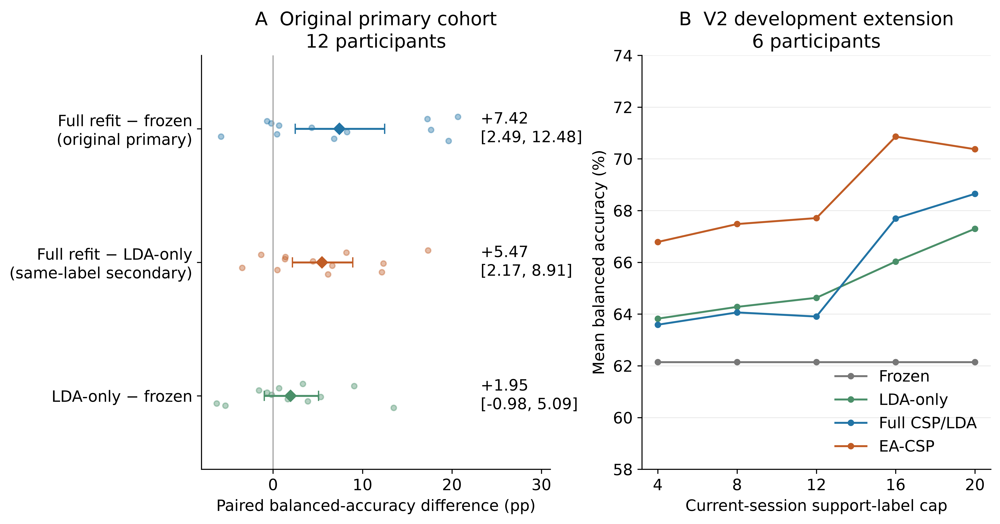
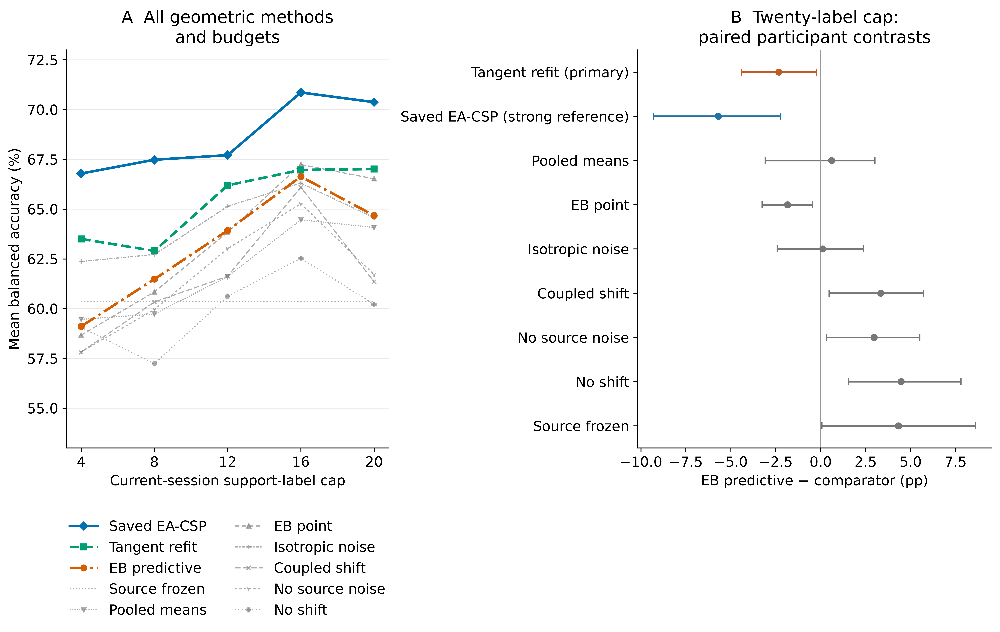
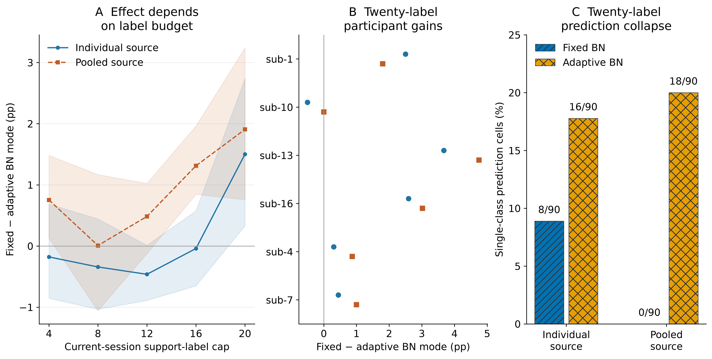
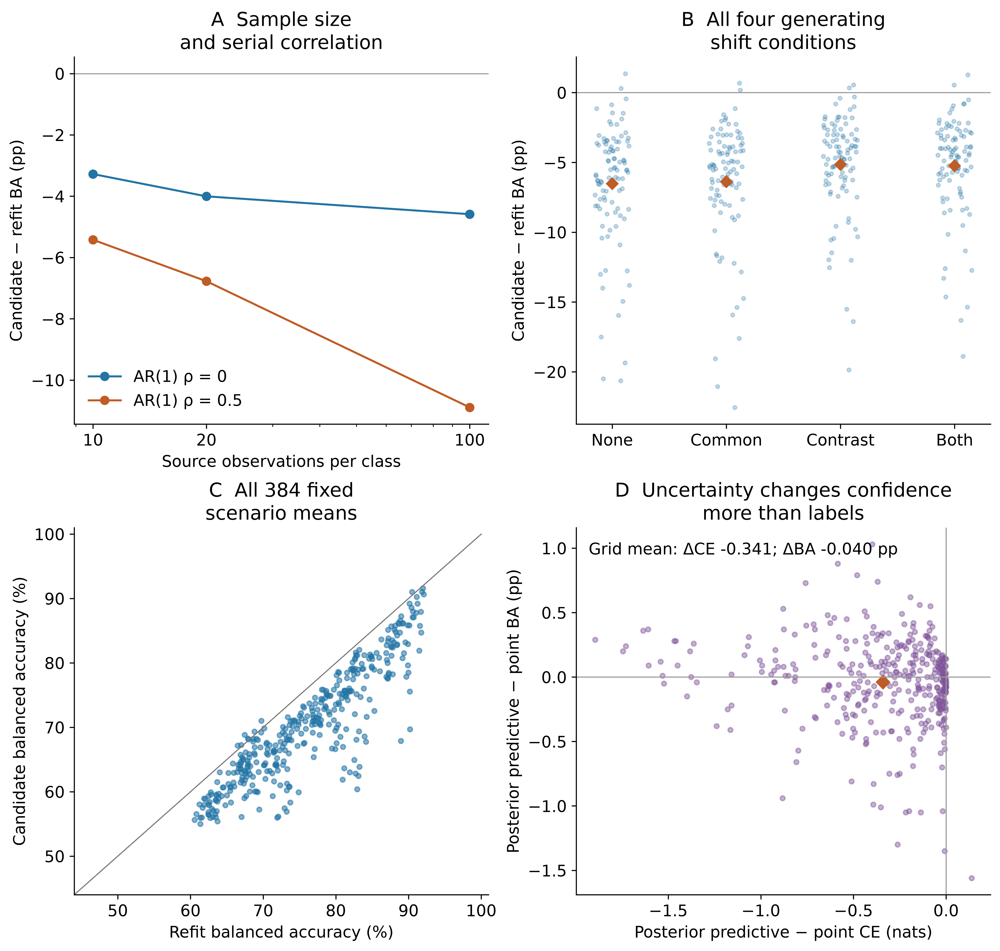

# Matched-label analysis identifies spatial refitting and alignment gains in motor-imagery EEG

**Running head:** Spatial updates with limited calibration labels

**Ziyuan Zhu**\*

College of Artificial Intelligence Medicine, Chongqing Medical University, Jinyun Campus, No. 61 Daxuecheng Middle Road, Shapingba District, Chongqing 401331, China

**\*Corresponding author:** Ziyuan Zhu; zzy2630816871@gmail.com

**ORCID:** https://orcid.org/0009-0005-1153-4926

## Abstract

**Objectives:** To quantify gains from spatial refitting and alignment with up to 20 current-session calibration labels.

**Methods:** We compared frozen common spatial patterns and linear discriminant analysis (CSP/LDA), classifier-only recalibration and full refitting in Kumar2024 (18 participants, six sessions; 12-participant primary cohort). A fixed-budget external comparison in nine BNCI2014-001 participants added support-only Euclidean alignment (EA-CSP). Updating methods received identical labels within each dataset.

**Results:** In the Kumar2024 primary cohort, full refitting achieved 65.36% balanced accuracy, 7.42 percentage points above freezing (95% participant-bootstrap interval 2.49–12.48). The secondary full-minus-classifier-only gain was 5.47 points (2.17–8.91), accounting for 73.7% of the mean total gain. In BNCI, EA-CSP achieved 77.50%, improving on full refitting by 5.65 points in the secondary comparison (3.15–8.70; Holm-adjusted p=0.01172), with gains in all nine participants. Full-minus-classifier-only was 0.19 points (−1.85 to 2.13). Fixed source normalization also reduced single-class neural predictions at the 20-label cap.

**Conclusions:** Spatial refitting in Kumar2024 and support-only alignment in BNCI2014-001 improved recalibration under matched labels.

**Keywords:** batch normalization; brain–computer interfaces; covariance alignment; motor imagery; transfer learning

## Introduction

Recalibrating a motor-imagery brain–computer interface (BCI) from a short labeled run requires deciding which decoder components to update [@lotte2018]. In Kumar2024, a decoder trained in the first session serves five later sessions, each with 19 or 20 complete calibration trials. We compare classifier-only recalibration with refitting both the spatial filters and classifier using the same labels, alongside frozen and aligned decoders.

Common spatial patterns (CSP) and linear discriminant analysis (LDA) make the component question directly testable [@ramoser2000; @blankertz2008]. CSP extracts class-discriminative spatial power features; LDA maps them to decisions. Re-estimating LDA changes classification in the source feature space. Refitting both stages also changes that space. Using identical labels makes their difference a measure of the added spatial update.

Previous research has established classifier adaptation, adaptive CSP, data-space transformations and distribution alignment [@vidaurre2011lda; @arvaneh2013dsa; @song2015acsp; @he2020alignment; @zanini2018alignment]. The Kumar acquisition study combined covariance recentering with a Riemannian classifier, added supervised prototype updates, and examined a recentering-based CSP extension [@kumar2024; @kumar2024correction]. We quantify the additional gain from relearning spatial filters after classifier recalibration has received those same labels.

Kozyrskiy et al. benchmarked label-revealed online updates across four EEG datasets [@kozyrskiy2026updates]. Their prequential procedure predicts a trial, reveals its label, then refits CSP or Riemannian pipelines using expanding, rolling or cold-start histories. Here, each later session is recalibrated from the source-training set and a fixed current-session support run, and full CSP/LDA refitting is compared directly with LDA-only recalibration using identical trial identities.

Neural adaptation introduces further choices. Weight updates can accompany changes in normalization statistics, affine parameters and Dropout. Adaptive batch normalization (BN) is established [@adabn2016], and longitudinal EEG studies have combined fine-tuning with alignment and normalization updates [@wimpff2025continual]. Weight and functional constraints offer other ways to preserve source information [@l2sp2018; @lwf2016; @trpo2015]. We compare normalization modes during weight adaptation and test a constraint on source predictions.

The study combines three analyses:

1. **A controlled spatial-component comparison.** LDA-only recalibration and full CSP/LDA refitting use the same 40 source-training labels, 19 or 20 current-session labels and query trials. Their difference measures the additional spatial update after classifier recalibration. A separate frozen arm measures the total benefit of receiving support labels and refitting.
2. **Prediction-level decomposition across sessions and participants.** Corrected and newly introduced errors reconstruct the component gain. Class recalls, target-session means and participant-deletion summaries show how the gain is distributed across labels, sessions and participants.
3. **An external comparison of spatial updates.** A fixed nine-participant BNCI2014-001 comparison evaluates LDA-only recalibration, full refitting and support-only EA-CSP with exactly 20 target labels. Development-cohort experiments examine neural normalization and geometric estimation across support budgets.

## Materials and methods

### Data source and ethics

We analyzed the public Kumar2024 EEG derivative, NEMAR nm000177/v1.0.5 [@nemar177], associated with the original study and its correction [@kumar2024; @kumar2024correction], and the original BNCI2014-001/BCI Competition IV 2a recordings [@tangermann2012competition]. The Kumar acquisition study reported University of Texas at Austin ethical approval under protocol 2020-03-0073 and written informed consent. These statements concern Kumar data collection. BNCI source documentation and its reported ethics information are identified separately in Supplementary Section S12.

This secondary analysis was exempt from additional ethical review under Article 32, item (1), of China's *Measures for Ethical Review of Life Science and Medical Research Involving Human Participants* (2023) [@china2023ethics]. It used lawfully obtained publicly available data, caused no harm to participants, and did not involve sensitive personal information or commercial interests.

Kumar dataset metadata were accessed on 10 October 2026, and the selected EEG recordings and accompanying metadata were retrieved on 11 October 2026. This secondary analysis used the released coded participant identifiers; no participants were contacted and no re-identification was attempted. The author had no access to information that could identify individual participants during or after data collection. Original collection approval and consent and the regulatory basis for this secondary analysis are documented separately in the retained provenance materials.

### Windows, preprocessing and chronological information access

The derivative contains 18 participant identifiers, six sessions and 360 EDF recordings. Of 7,200 exported left/right events, 7,156 provided complete five-second windows; 44 reached a recording boundary and were excluded without padding. All 44 occurred at the last event of an online recording.

The original codebook assigns 769/770 to left/right cues and 7691/7701 to task starts [@kumarcodebook]; the documented MOABB adapter maps cues to a [0, 5]-second interval [@jayaram2018]. The original procedure included a 1.5-second cue preceding feedback and variable online feedback duration. Our endpoint is therefore task-label decoding over released cue-anchored windows. Original trial-level task-end and feedback markers were unavailable for phase reconstruction.

Preprocessing used common-average referencing across 22 channels, fourth-order 8–30 Hz zero-phase Butterworth filtering, and resampling from 512 to 128 Hz, producing 22×640 float32 values in volts. Learned transforms used training partitions.

Participants sub-1, 4, 7, 10, 13 and 16 formed the development group; the remaining 12 formed the original primary cohort. Session 0/runs 0–1 supplied 40 source-training windows, run 2 supplied 20 source-validation windows, and run 3 supplied source query. In later sessions, run 0 supplied support and subsequent whole runs query; updates used current-session labels without accumulating previous targets. The original query set contained 4,290 complete events, including 360 source and 3,930 target events; 30 partial-query exclusions remained fixed.

The existing 250 µV raw peak-to-peak flag marked 1,512/7,156 complete windows. The main analysis retained them. Sensitivity analysis required both classes in every target session.

### Original component comparison

The conventional decoder used four-component CSP, Ledoit–Wolf regularization and automatic-shrinkage LDA [@ledoit2004]. Frozen decoding used 40 source-training trials. LDA-only retained source CSP and refitted LDA on source training plus current support; full refitting re-estimated both components on that same union. Their difference measures the added spatial update and classifier fit in the revised feature space.

The original EEGNet reference used three fixed seeds per participant, source normalization, 40 training labels and 20 source-validation labels for epoch selection [@lawhern2018; @schirrmeister2017]. All 54 models and seed outcomes were retained. The HPC extension used the separately specified compact architecture below.

Prediction-transition analysis counted errors corrected by method B relative to A and the reverse changes, balancing the two classes. The difference between these contributions equals BA(B)−BA(A) exactly. This post-hoc analysis, class recalls, session profiles and participant-deletion means explain the original component endpoint.

### Extension design and comparison roles

V2 and V3 used the same six previously exposed development participants, chronological whole-run partitions, scheduled seeds and query identities. Current support was capped at 4, 8, 12, 16 or 20 complete trials, retaining the observed class order. Within each frozen execution, query was excluded from fitting and selection; the design of later rounds was informed by earlier results.

V2 tested source–target covariance mixing against EA-CSP. V3 fixed two cap-20 primary candidate contrasts before execution: uncertainty-aware prediction minus ordinary tangent refitting, and source-functional-constrained minus ordinary full neural adaptation within each source regime. BN, Dropout and dose comparisons were exploratory mechanisms. The full matrix included 10,350 target and 42 source prediction files, all nested within the same six participants; details are in the supplement.

### External comparison with a fixed calibration budget

BNCI2014-001 contains nine participants, two different-day sessions and six runs per session [@tangermann2012competition]. We retained left/right imagery and the first 22 EEG channels. The MAT trial-start index precedes the cue by two seconds; epochs covered cue time [0,4) seconds at 250 Hz. A fourth-order 8–30 Hz Butterworth filter operated within each continuous run, with zero phase and the recorded reference. Original artifact flags were retained without trial rejection.

Source runs 1–4 supplied 96 labels. Source runs 5–6 were withheld. The first 20 chronological hand trials of the first target run supplied support; its remaining four hand trials were withheld. Whole target runs 2–6 supplied 120 query trials. LDA-only, full CSP/LDA and EA-CSP used identical source/support trial identities. Frozen decoding received no target labels. EA estimated separate source and support covariance references; query signals did not estimate either reference.

The existing V2 implementation used four CSP components and fixed covariance/LDA shrinkage of 0.1. This differs from the original Kumar MNE/Ledoit–Wolf implementation and its 40-label source budget. Methods, inputs and endpoints were fixed before external prediction generation. Supplementary Section S12 gives all partitions and the fixed execution version.

### Neural update-mode experiment

The compact HPC EEGNet used eight temporal filters, depth multiplier two, temporal kernel 64 and source Dropout 0.25. Individual sources reused 18 V2 checkpoints, each with 40 training and 20 validation labels. Three pooled sources, one per seed, used 240 training and 120 validation examples from the same six participants, changing source-data amount and cross-participant composition.

Source training used 100 epochs with validation cross entropy selecting the model. Optimizer adaptations used current support, 20 epochs, batch 16, AdamW, learning rate $10^{-4}$, weight decay $10^{-4}$, a cosine schedule and no automatic mixed precision. A separate sampler matched support order. Query inference used evaluation mode.

Eight policies covered freezing, head-only, full fixed-BN, full adaptive-BN, adaptive-BN plus Dropout, BN-affine-only, BN-statistics-only and functional-constrained full updates. Dropout was off except in its explicit arm. Fixed BN used source running statistics during adaptation and inference; adaptive BN used batch statistics during adaptation and updated the inference state. This contrast changes normalization during optimization and the resulting buffers, with potentially different weight trajectories.

The functional policy bounded mean teacher-to-candidate KL on 40 source-training anchors at 0.01, with additional doses 0.001 and 0.1. Bounded backtracking restored parameters and optimizer state after a rejected proposal [@lwf2016; @trpo2015].

### Geometric estimator and matched controls

Trace-normalized trial covariances used fixed 0.1 shrinkage and a source-training-only log-SPD reference, giving 253 features for 22 channels. Class means were represented by common location m=(μ₀+μ₁)/2 and half contrast h=(μ₁−μ₀)/2. The candidate estimated separate noise-corrected shift scales, matrix mean-noise covariances and a linear-Gaussian posterior. Prediction added class-mean posterior covariance to fixed source within-class covariance.

Controls covered frozen source prediction, ordinary pooled means, tangent refitting, candidate point prediction, isotropic noise, coupled shift scales, and removal of source noise or shift variance. Missing support classes followed the fixed masked-observation rule. Equations and assumptions are in the supplement.

Saved synthetic experiments tested all nine methods across 384 known-mechanism conditions and 50 paired repetitions, varying dimension, sample sizes, shift, anisotropy and serial correlation. These results were analyzed separately from EEG.

### Participant-level analysis and saved-result verification

BA averaged the two true-class recalls. Seeds were averaged within session, five target sessions within participant, then participants within cohort. Paired contrasts used matched endpoints and 10,000 participant-bootstrap resamples: seed 42 for the original comparison and 20261023 for the extensions. Extension intervals use the six participants as resampling units and are pointwise summaries. A post-hoc check enumerated every sign assignment of the observed participant differences, preserving their magnitudes, using the absolute mean as the statistic. Holm adjustment covered four saved contrasts: full-minus-frozen, full-minus-LDA-only and LDA-only-minus-frozen in the primary cohort, plus full-minus-frozen in the eligible unflagged subset. These family-adjusted tests accompany the original pointwise bootstrap intervals.

All scheduled seeds, sessions, caps and doses were retained; any missing required cell left the endpoint incomplete. Pooled-source intervals are conditional on the fitted shared teachers. Synthetic summaries equally weighted the fixed scenarios and paired draws. Exploratory EEG cross entropy clipped probabilities at $10^{-15}$; simulation scoring used the same numerical floor.

The external comparison had one fixed primary contrast, full CSP/LDA minus LDA-only. Its two-sided exact sign-flip test enumerated 512 sign assignments with the observed difference magnitudes. Three secondary contrasts (full minus frozen, LDA-only minus frozen, EA minus full) formed a separate Holm family. Paired participant-bootstrap intervals used 10,000 draws, seed 20261027 and participant order 1–9. Dataset cohorts were analyzed separately.

Saved trial identities, labels and metrics were checked before aggregation. Kumar analyses reused predictions and histories; the external comparison generated its own four-method predictions. All external BA values were independently reconstructed from the saved predictions without another model evaluation.

## Results

### Spatial refitting supplied the main matched-label gain

Full CSP/LDA refitting achieved 65.36% target BA in the original 12-participant primary cohort, compared with 57.94% for frozen decoding and 59.89% for LDA-only recalibration. The predefined primary full-minus-frozen gain was 7.42 percentage points (95% interval 2.49–12.48). With identical fitting labels, the secondary full-minus-LDA-only gain was 5.47 points (2.17–8.91), while LDA-only minus frozen was 1.95 points (−0.98–5.09). The spatial-component contrast accounted for 73.7% of the mean total gain (Table 1; Figure 1). The exact sign-flip p value was 0.01025 for the matched-label component contrast (Holm-adjusted p=0.04102) and 0.01953 for the primary full-minus-frozen contrast (Holm-adjusted p=0.05859). The bootstrap intervals estimate paired effects without a family adjustment; the sign-flip tests use a sign-symmetric reference and four-comparison error control.

**Table 1. Original target-query component comparison.**

| Cohort | Participants | Frozen CSP/LDA BA | LDA-only BA | Full CSP/LDA BA | Full − frozen | Full − LDA-only |
| --- | ---: | ---: | ---: | ---: | ---: | ---: |
| Development | 6 | 59.97% | 64.37% | 63.22% | +3.25 pp | −1.15 pp |
| Predefined primary cohort | 12 | 57.94% | 59.89% | 65.36% | +7.42 [2.49, 12.48] pp | +5.47 [2.17, 8.91] pp |
| All participants, secondary | 18 | 58.62% | 61.38% | 64.65% | +6.03 pp | +3.26 pp |

BA, balanced accuracy; pp, percentage points. The two updating methods used the same source-training/current-support union. Values average five sessions within participants. Full refitting versus freezing in the 12-participant cohort was the predefined primary comparison; full versus LDA-only was secondary. Development and primary-cohort estimates are reported separately.

The component gain reflected 16.04 BA points of corrected errors against 10.57 points of newly introduced errors on the same query trials. Mean left- and right-class recall changes were +6.16 and +4.78 points, respectively, with both class-specific intervals including zero. Their class-balanced mean gives the observed component endpoint. The added spatial update was positive in ten of 12 participant averages and every target-session cohort average: +3.52, +5.20, +4.13, +4.18 and +10.33 points. Every single-participant deletion mean remained positive, between +4.39 and +6.28 points.

Full refitting gave higher BA than frozen decoding for nine of 12 primary participants. The three decreases were −5.82, −0.67 and −0.20 points. In the ten participants retaining both query classes across all five unflagged sessions, full-minus-frozen was +5.96 points (0.99–11.24) and full-minus-LDA-only +3.82 (1.11–6.72). This query restriction left original training and support data unchanged. The retained cohort and amplitude-conditional endpoint differ from the complete primary analysis.

{width=100%}

**Figure 1. Spatial-component effects and calibration budgets.** Panels show paired component and total effects in the original primary cohort, followed by V2 budget profiles in the six development participants. Points, cohort means and participant-bootstrap intervals show the distribution of effects. Full-minus-LDA-only compares updates using identical labels.

### Covariance mixing and EA-CSP under matched labels

In the six-participant V2 extension at the 20-label cap, frozen classical decoding achieved 62.15% BA, LDA-only 67.30%, full CSP/LDA 68.65% and EA-CSP 70.37%. The covariance-mixture candidate achieved 69.24%. The candidate improved on frozen decoding by +7.09 points (4.12–11.55). Its prespecified comparison with EA-CSP was −1.14 points (−3.52–1.14).

### Geometric estimation in a fixed tangent feature space

At the cap of 20 labels, EA-CSP achieved 70.37% BA and ordinary tangent refitting 67.01%, compared with 64.68% for the geometric candidate. Its prespecified primary contrast was −2.33 points (−4.41 to −0.24), and its strong-reference contrast was −5.69 points (−9.30 to −2.22; Table 2). Both reference methods had higher BA in five of six participants. Ordinary tangent refitting had higher cohort-mean BA at all five support caps (Figure 2).

**Table 2. V3 geometric comparison at the 20-label cap.**

| Method | Mean BA | Candidate − method, pp |
| --- | ---: | ---: |
| Frozen source tangent model | 60.36% | +4.32 [0.07, 8.61] |
| Pooled means with fixed source within-class covariance | 64.08% | +0.60 [−3.09, 3.01] |
| Ordinary tangent refitting | 67.01% | −2.33 [−4.41, −0.24] |
| Candidate means with point prediction | 66.52% | −1.84 [−3.26, −0.46] |
| Full uncertainty-aware candidate | 64.68% | Reference |
| Saved EA-CSP, strong reference | 70.37% | −5.69 [−9.30, −2.22] |

BA, balanced accuracy; pp, percentage points. Ordinary tangent refitting was the frozen primary comparator. The same-query EA-CSP reference was imported from saved V2 predictions after ordered trial/label verification. Candidate ablations and every budget are retained in the supplementary methods and machine-readable tables.

The matched ablations distinguish three operations. Separating common and discriminative variation and retaining source-mean noise improved the cap-20 candidate over their respective ablations. Adding posterior covariance to the same posterior means reduced BA by 1.84 points relative to point prediction. The estimated common-location variation was larger than discriminative-contrast variation in every cap-20 support set. These observations distinguish changes in the estimated means from changes in predictive covariance.

{width=100%}

**Figure 2. Geometric candidate, matched controls and ablations.** Curves show BA across support budgets; paired cap-20 contrasts compare the candidate with tangent refitting, EA-CSP and matched ablations. Ablations vary posterior mean estimation, predictive covariance, source-mean noise and common/contrast shift scales. Intervals are participant-bootstrap summaries.

### Fixed source normalization reduced single-class predictions at the 20-label cap

At the 20-label cap, fixed-BN full updates predicted a single class in eight of 90 participant-by-seed-by-session query sets, compared with 16 for adaptive BN. Pooled-source counts were zero and 18, respectively. Fixed-BN BA was 57.51%, versus 56.01% for adaptive BN with individual sources, a difference of 1.50 points (0.33–2.74). Pooled-source values were 56.22% and 54.31%, a difference of 1.91 points (0.76–3.24; Table 3). Five of six participant differences favored fixed BN in each regime; the remaining difference was negative for individual sources and approximately zero for pooled sources. All participant-deletion mean contrasts stayed positive at this cap.

**Table 3. V3 neural component contrasts at the 20-label cap.**

| Contrast | Individual source models | Pooled source models | Role |
| --- | ---: | ---: | --- |
| Fixed-BN full update − adaptive-BN full update | +1.50 [0.33, 2.74] pp | +1.91 [0.76, 3.24] pp | BN-mode comparison |
| Fixed-BN full update − frozen | +0.77 [−0.16, 1.73] pp | +0.96 [−0.41, 2.77] pp | Update baseline |
| BN-statistics-only − frozen | −1.15 [−2.15, −0.12] pp | −0.30 [−0.68, 0.05] pp | Statistics-only comparison |
| Functional constraint − fixed-BN full update | −0.01 [−0.11, 0.09] pp | +0.03 [0.00, 0.09] pp | Prespecified neural primary contrast |
| Adaptive BN plus Dropout − adaptive BN | −0.15 [−0.40, 0.08] pp | +0.28 [0.04, 0.55] pp | Dropout comparison |

BN, batch normalization; KL, Kullback–Leibler divergence; pp, percentage points. Intervals summarize six participants after averaging fixed seeds and target sessions. Single-class prediction counts include 90 nested outcomes per arm. The functional-constraint row retains its predefined primary role. BN mode changes optimization-time normalization and the resulting inference state.

The full budget curves show how this contrast changes (Figure 3). Individual-source fixed-minus-adaptive BN differences were −0.18, −0.34, −0.46, −0.04 and +1.50 points across caps 4–20. Pooled-source differences were +0.75, +0.01, +0.48, +1.31 and +1.91 points. At the final support cap, batch size 16 also changed the number and size of minibatches: up to 16 support trials supplied one batch per epoch, whereas 19/20 supplied two. Three BN modules recorded 60 versus 120 cumulative batch-counter increments over 20 epochs. Within a support cap, the BN comparison holds minibatches and optimization exposure fixed. Across caps, label quantity, class composition and the normalization-update schedule change together.

{width=100%}

**Figure 3. Neural normalization mode across support budgets.** Fixed-minus-adaptive BN contrasts are shown for both source regimes across all five caps, together with the cap-20 participant contrasts and single-class prediction counts. Fixed and adaptive BN use the same current support, initialization, optimizer budget and Dropout-off setting within each comparison. They differ in normalization during optimization and the resulting inference state. Collapse counts are nested seed/session observations; participant-level summaries define the uncertainty intervals.

### Source discrimination and functional-constraint effects

Frozen individual-source models achieved 56.74% target BA, compared with 55.26% for pooled-source models, a pooled-minus-individual difference of −1.48 points (−2.90 to −0.20). Source-query BA was 56.11% and 57.78%, respectively.

The three pooled models selected epochs 14, 20 and 17 by validation loss. Their final training losses were approximately 0.20–0.22, while final validation losses were 0.91–0.96, above the selected validation losses near 0.68.

At the core KL bound 0.01, the functional constraint changed the cap-20 mean relative to ordinary fixed-BN adaptation by −0.01 points for individual sources and +0.03 points for pooled sources. At bound 0.1, BA matched the ordinary update in both regimes; bound 0.001 produced differences of −0.22 and −0.19 points, respectively, with intervals crossing zero. The complete dose profiles and accepted/rejected-step histories are retained.

### Posterior covariance reduced simulated log loss with little change in accuracy

The full synthetic grid contained 172,800 numeric method-by-condition-by-repetition results. Equal-grid BA was 70.36% for the candidate and 76.19% for tangent refitting, a difference of −5.83 points; 376 of 384 scenario means favored refitting. Candidate feature-mean squared error was also larger. Adding posterior covariance to identical candidate means reduced mean cross entropy by 0.341 but changed BA by −0.04 points. Posterior covariance improved log loss for the same estimated means, with little change in classification accuracy (Figure 4).

{width=100%}

**Figure 4. Mechanism simulations and predictive uncertainty.** All 384 conditions retain 50 paired repeats. Panels show candidate-minus-refit BA by source size/correlation, all generating shifts, paired scenario BA, and posterior-versus-point changes in cross entropy and BA. Synthetic results are separate from human EEG endpoints.

### Support-only alignment improved the external fixed-budget comparison

In the secondary comparison, EA-CSP improved on full refitting by 5.65 points (3.15–8.70; exact p=0.00391; Holm p=0.01172). All nine participant differences were positive, ranging from +0.83 to +15.83 points. The leave-one-participant-out mean ranged from +4.38 to +6.25 points. All five query-run cohort means favored EA over full refitting. These methods used the same 20 target labels and 120 query trials per participant; target alignment statistics came only from those support trials. Supplementary Section S12 reports every participant and contrast.

In BNCI2014-001, mean BA was 70.56% for frozen CSP/LDA, 71.67% for LDA-only, 71.85% for full refitting and 77.50% for EA-CSP (Figure 5). The fixed primary full-minus-LDA-only contrast was +0.19 points (95% interval −1.85 to 2.13; exact p=0.96875): three participants improved, three decreased and three were unchanged. Full-minus-frozen was +1.30 points (−1.76 to 3.98; Holm p=0.68750), while LDA-only-minus-frozen was +1.11 points (−0.46 to 2.96; Holm p=0.68750).

{width=100%}

**Figure 5. External fixed-budget comparison.** A: participant BA and cohort means. B: participant differences and pointwise 95% bootstrap intervals. C–D: paired differences across five whole query runs. Nine participants contributed 120 query trials each. Updating methods shared 20 support labels; EA references used source/support only.

## Discussion

### Gains from spatial refitting and alignment

Full CSP/LDA refitting added 5.47 BA points beyond classifier-only recalibration in the original primary cohort and supplied 73.7% of the mean improvement over freezing. Because both updates used identical source and support trials, this contrast measures the gain from relearning the spatial representation together with the classifier.

In BNCI2014-001, EA improved on full refitting in all nine participants using the same 20 current labels, while full refitting and classifier-only recalibration gave similar cohort means. The two comparisons measure separate additions to recalibration: spatial refitting beyond LDA-only in Kumar2024, and alignment beyond full refitting in BNCI2014-001.

At the 20-label cap, fixed-source BN during full weight adaptation produced higher BA and fewer single-class seed/session predictions than adaptive BN in both initialization regimes.

Prediction transitions explain the spatial gain: refitting corrected more class-balanced errors than it introduced, with improvement in both labels. The gain remained positive in every target-session mean and after every single-participant deletion.

### Normalization effects varied across support budgets

The BN comparison holds source initialization, support, trainable parameters, Dropout and optimizer schedule fixed within each budget. The cap-20 difference therefore identifies the BN-mode choice within the evaluated 20-epoch, batch-16 adaptation schedule.

Adaptive BN changes batch normalization during optimization and accumulates the running state used for evaluation; both can affect the resulting model. The small final minibatch, number of BN updates and class composition differ across the chronological prefixes. The full curves show a different sign for the individual-source comparison at smaller caps.

Reports using abundant target-domain statistics or continuous online adaptation address different information regimes [@adabn2016; @wimpff2025continual]. Here, repeated passes through a short support run link normalization mode to its update schedule.

### Spatial alignment and predictive covariance

EA-CSP had higher mean BA than the V2 covariance-mixture candidate and the V3 uncertainty-aware candidate. Ordinary tangent refitting also achieved higher BA within the same tangent feature space. These comparisons place the candidate’s mean and covariance updates against EA-CSP and tangent refitting.

The candidate separated shared class movement from discriminative change and propagated estimated mean uncertainty. Ablations showed contributions from its shift scales and noise estimates, while point prediction identified a cost of adding posterior covariance. Its conditional expected squared-error result concerns class-mean estimation under the Gaussian assumptions; classification remains an empirical endpoint.

The enforced source-anchor KL constraint changed cap-20 BA by −0.01 and +0.03 points in the two source regimes. Alignment, source regularization and functional preservation are established [@he2020alignment; @l2sp2018; @lwf2016; @trpo2015].

### Source discrimination and calibration measurements

Original primary-cohort EEGNet BA was 52.92% on source query and 51.58% on target sessions. The source-query endpoint gives the reference accuracy before session transfer. In the extension, validation loss increased after the selected epochs despite continued training-loss reduction.

The original source/support probes also distinguished calibration agreement from correct task orientation. Of 30 development support sessions, 19 had positive source-score contrasts in both chronological halves, two were negative in both, and nine changed sign. Agreement can coexist with reversed orientation. These findings motivate testing support-driven selection among fixed component choices in an independent evaluation.

### Scope and next validation

Kumar2024 provides six sessions per participant and BNCI2014-001 two recording days. V2/V3, prediction transitions and sensitivity analyses used previously exposed data and are exploratory. BNCI had historical use in the first-paper project. The external comparison also changed the source-label budget, reference and covariance implementation; separating these factors requires a controlled follow-up. Pooled-source intervals are conditional on the shared teachers, with participants as the independent units.

Kumar cue-anchored windows may contain cue, imagery, feedback or post-task activity. Phase-specific decoding requires original marker-level reconstruction. Amplitude-restricted query analysis retained positive spatial gains in eligible participants; it assessed query sensitivity while leaving training and support signals unchanged. Zero-phase filtering makes the present endpoint offline.

A larger repeated-session validation can separate source-label amount, covariance estimator and alignment from acquisition differences. Neural follow-up can independently control BN exposure count and minibatch size.

## Conclusions

In the original Kumar primary cohort, full refitting added 5.47 BA points beyond classifier-only recalibration and supplied 73.7% of the mean total gain over freezing. In BNCI2014-001, support-only EA added 5.65 points beyond full refitting, with improvement in all nine participants; full refitting and classifier-only recalibration gave similar cohort means. Fixed source normalization reduced single-class neural predictions at the 20-label cap. These results support evaluating spatial refitting and alignment separately under a fixed calibration budget.

## Data and code availability

Source EEG is available as NEMAR nm000177/v1.0.5, DOI 10.82901/nemar.nm000177.v1.0.5, under CC BY 4.0 [@nemar177]. BNCI2014-001 original MAT files are available through the official BNCI directory, with versioned file hashes in NEMAR nm000139/v1.0.3; their CC BY-ND 4.0 terms are retained. Code, configurations, original results, saved external predictions and saved extension predictions are available at https://github.com/jackzhu119/few-shot-mi-eeg, research branch `research/paper2-hpc-v2-20261023`. The supplement identifies the fixed V3 packet and reproduction inputs. Original software uses MIT; manuscript, figures and derived results use CC BY 4.0 within the scope defined in LICENSING.md. Source-data and third-party terms are retained.

## Acknowledgments

The author thanks the researchers who released Kumar2024 and BCI Competition IV 2a. The author used OpenAI ChatGPT/Codex to assist with grammatical editing, pushing updates to GitHub, assembling and cross-checking project files, and revising code. The author is responsible for the content and interpretation of the manuscript.

## References

::: {#refs}
:::

## Supporting information captions

**Supplementary methods and data.** Complete component definitions, mathematical assumptions, all methods/budgets/seeds, participant and scenario tables, original sensitivity analyses, prediction identities, provenance and saved-output reproduction instructions.
