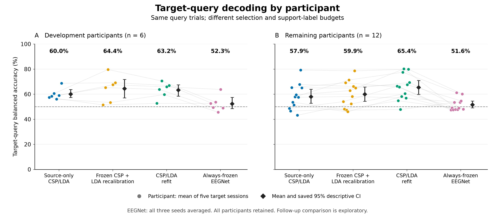
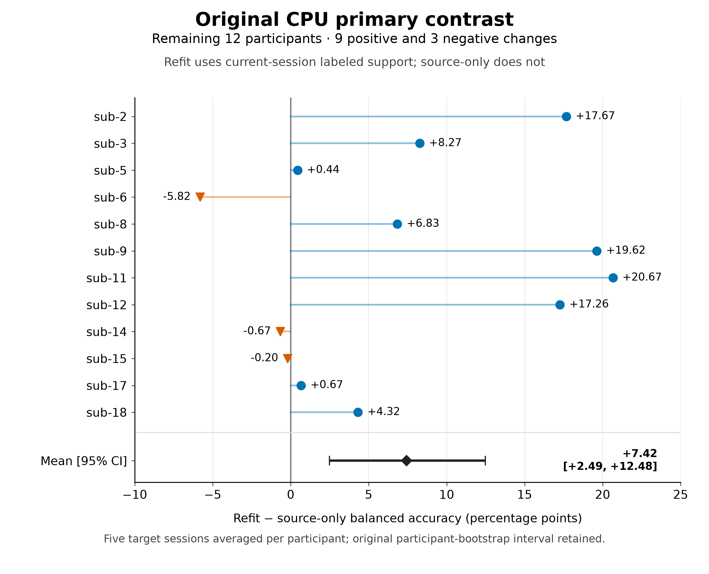
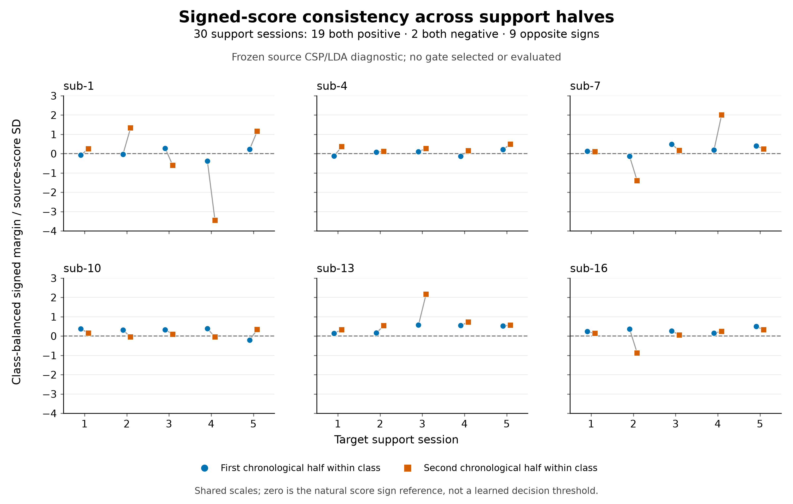

# Longitudinal Motor-Imagery EEG Decoding: Frozen Baselines, Supervised Recalibration, and Task-Measurement Reliability

**Ziyuan Zhu**

College of Artificial Intelligence Medicine, Chongqing Medical University, Chongqing, China

**Corresponding author:** Ziyuan Zhu — zzy2630816871@gmail.com

**ORCID:** [0009-0005-1153-4926](https://orcid.org/0009-0005-1153-4926)

**English working draft; evidence available on 2026-10-15.** This draft reports
completed offline baselines and measurement diagnostics. The historical project
direction, Task-Aware Adaptive Decoding for Longitudinal Motor-Imagery EEG,
remains distinct from the manuscript title; an effective task-aware adaptation
policy has not been demonstrated. This is an exploratory research draft, not a
submission-ready manuscript. The historical NETBCI manuscript is a separate
record and contributes no additional participants to the present analysis.

## Abstract

Longitudinal motor-imagery decoding requires distinguishing changes in the EEG
distribution from changes in information useful for a fixed task. We studied
18 published participant identities across six ordered sessions in Kumar2024
(NEMAR nm000177, version 1.0.5). A frozen within-participant protocol compared
source-only CSP/LDA, LDA recalibration with frozen CSP, and full CSP/LDA refitting.
An additional source-only EEGNet baseline retained three fixed random seeds for
every participant. All methods were evaluated on the same query identities;
their source-validation and target-label budgets differed and are reported
explicitly. The primary CPU contrast in the fixed remaining 12 participants
favored full refitting over source-only decoding by 7.42 percentage points
(95% participant-bootstrap interval 2.49–12.48), although three participants
worsened. Always-frozen EEGNet achieved mean target balanced accuracy of 51.58%
(49.08–54.51%) in this cohort, retaining class-collapsed outcomes. Development-only
reliability probes found heterogeneous task-direction reliability; they
did not validate an adaptation gate. Full CSP/LDA refitting improved the
cohort-average endpoint under the specified support-label budget, whereas the
LDA-only contrast remained uncertain. The source-only neural baseline was weak
in this small-source setting. Previously inspected test identities make subsequent
analyses exploratory. Offline decoding does not
establish human learning, skill retention or clinical benefit.

**Keywords:** motor imagery; longitudinal EEG; cross-session decoding;
supervised recalibration; measurement reliability; reproducibility.

## Introduction

Motor-imagery EEG decoding maps recorded activity to task labels using a
pipeline whose learned representation and decision rule may both depend on the
recording session. Reviews of EEG classification identify nonstationarity,
small training sets and evaluation design as recurring challenges [@lotte2018].
A decoder trained in an early session may therefore fail when signal statistics
change. Supervised recalibration can help, but additional labels and changes in
the fitted spatial representation must be distinguished from changes in the
classifier alone. Common spatial patterns (CSP) supplies a useful conventional
reference for this distinction [@ramoser2000; @blankertz2008].

Compact convolutional decoders such as EEGNet provide a complementary neural
baseline [@lawhern2018], rather than a guarantee of better transfer. Comparing
pipelines on identical held-out events controls the evaluation sample, but does
not equalize their training labels, checkpoint selection or optimization. A
rigorous longitudinal comparison must account for these information budgets and
retain unsuccessful fits and predictions instead of reporting only favorable
seeds or sessions.

We reanalyzed the released multi-session dataset associated with Kumar and
colleagues' study of transfer learning and BCI skill acquisition [@kumar2024;
@kumar2024correction; @nemar177]. The original study's online training and feedback provide acquisition
context; our secondary analysis evaluates offline left-versus-right imagery
classification. It neither reproduces the original interventions nor measures
participant skill acquisition. The distinction is especially important when
interpreting a frozen decoder's performance: failure of one mapping does not
identify a loss of human control or an absence of all task-related information.

Task-related measurements also require their own validation. A change in signal
covariance need not identify a change in information useful for classification.
Likewise, a source-discriminative feature can be unreliable when estimated from
a small support run. Before using a measurement to control adaptation, its
definition, run grouping and directional reliability must be established using
data allowed for model development. A favorable cohort average alone cannot
justify a session-level decision rule.

The present study separates three questions: whether conventional recalibration
improves longitudinal decoding under a fixed support budget; how a prespecified
source-only neural baseline transfers to later sessions; and whether available
task measurements justify a future adaptation rule. The first question has a
frozen primary CPU contrast. The latter analyses are exploratory diagnostics
and additional baselines. No task-aware policy is selected from the reported
query results. The contribution is a linked, auditable evaluation of conventional
recalibration, a frozen neural reference and measurement reliability under
explicit access rules, including their negative and heterogeneous outcomes.

## Methods

### Data, identity and chronological partition

The source was the already archived Kumar2024 derivative at NEMAR
`nm000177/v1.0.5`, licensed CC BY 4.0
([source release README](https://data.nemar.org/nm000177/v1.0.5/README.md)).
This is a MOABB-generated BIDS derivative [@jayaram2018], not a new recording
collection or an independent reproduction of the original acquisition pipeline.
The frozen selection contained 360 EDF
recordings, 18 published participant identities, six sessions and 7,200 event
identities. Forty-four partial events were preserved in the audit but excluded
from tensors without padding or replacement, leaving 7,156 complete
five-second windows. Published identities are the statistical units; numerical
duplicate checks do not independently verify biological identity.

Development identities were sub-1, sub-4, sub-7, sub-10, sub-13 and sub-16; the
other 12 identities formed the fixed remaining cohort. This assignment used
numeric identity order rather than performance. Session and run chronology
was checked against the derivative's acquisition timestamps. Their calendar
accuracy was not independently established.

In session 0, runs 0 and 1 supplied 40 source-training windows, run 2 supplied
20 source-validation windows, and run 3 supplied source query. In each of the
five later sessions, the first whole run (`run-0`) was the preassigned support
run; all other runs supplied target query. Partial events were excluded without
replacing the run or filling its missing windows. The support allowance was at most 20
events and 10 per class before partial-window exclusions; actual support was
19 or 20 events: 14 of the 90 target sessions had 19 and 76 had 20, totaling
1,786 support events. Updates used source training plus current-session support,
without accumulating previous or future target sessions. The same 4,290
included query events were evaluated by the CPU methods and EEGNet: 360 source
queries and 3,930 target queries. Thirty partial query events remained excluded.

### Preprocessing and quality qualifications

Each event independently underwent common-average referencing over 22 channels,
fourth-order 8–30 Hz Butterworth zero-phase filtering and polyphase resampling
from 512 to 128 Hz. Inputs were 22 × 640 float32 values in volts. These
epoch-local operations learned no held-out statistics. Zero-phase filtering
defines an offline analysis and does not establish real-time operation.

A fixed 250 µV raw peak-to-peak threshold flagged 1,512 of the 7,156 complete
windows. All flagged full windows remained in the primary analysis. There was
no expert artifact certification; decoding could reflect non-neural signal
components. Native CPz reference was a source-metadata declaration, and offline
common-average referencing cannot reconstruct or independently verify the
original acquisition reference.

### Decoders and explicit data budgets

The CPU pipeline used four-component CSP with Ledoit–Wolf regularization,
log mean-square features and `norm_trace=False`, followed by shrinkage LDA
(`solver=lsqr`, automatic shrinkage). One prespecified configuration was used.
Source-only CSP and LDA stayed fixed. Recalibration retained source CSP and
refitted LDA with source training plus current support; full refitting updated
both stages using that same union. Validation and query identities were
excluded from all CPU fitting and parameter selection.

EEGNet used the frozen Braindecode architecture (F1=4, D=2, F2=8, dropout 0.5),
Adam at learning rate 0.001, batch size 16 and a maximum of 100 epochs. Channel
means and scales were fitted to source training only. Source-validation
cross entropy selected the earliest best epoch with patience 15; the complete
selected state was restored. All three seeds—20261012, 20261013 and 20261014—
were retained for each participant. The 54 completed source fits used 2,871
epochs and 8,613 optimizer steps. No source fit was repeated for query evaluation.
Query inference used evaluation mode with fixed parameters, batch-normalization
buffers and normalization statistics, with zero optimizer or support updates.

**Table 1. Labeled-data use per participant.**

| Method | Source optimizer/estimator training | Source-validation use | Current target support for fitting |
| --- | --- | --- | --- |
| Source-only CSP/LDA | 40 labeled windows | No model or checkpoint selection | 0 |
| Frozen CSP + LDA recalibration | 40 labeled windows; LDA then refitted with current support | No model or checkpoint selection | 19/20 labeled windows |
| CSP/LDA refit | 40 labeled windows; both stages then refitted with current support | No model or checkpoint selection | 19/20 labeled windows |
| Always-frozen EEGNet | 40 labeled windows per seed | 20 labeled windows select stopping epoch | 0 |

Thus the two CPU update methods share the same adaptation label budget. Their
comparison with the frozen CPU model measures performance after adding the
specified support labels. Identical query samples do not make EEGNet and CPU
methods equal-budget architecture comparisons: EEGNet additionally uses the
source-validation labels for epoch selection, and only the CPU update methods
use target labels. No causal architecture or compute-efficiency ranking is
inferred from these differences. The architecture and implementation follow
EEGNet and Braindecode [@lawhern2018; @schirrmeister2017]; the exact executed
constructor and optimization settings are listed in Supplementary Methods S3.
The covariance regularization and LDA settings are implementation choices of
the frozen pipeline, rather than parameters selected using target outcomes
[@ledoit2004].

### Endpoints and statistical units

Balanced accuracy (BA) was the mean of the two class recalls. The primary
endpoint was each participant's mean BA over its five target sessions. The
primary contrast remained full CSP/LDA refitting minus source-only CSP/LDA in
the fixed remaining 12 identities. For EEGNet, all three seed scores were
averaged within participant/session before the five target sessions were
averaged within participant. Source query was reported separately. Neither
seeds, sessions nor trials increased the independent participant count.

Balanced-accuracy and participant-mean reliability summaries used 10,000
participant resamples with seed 42 for descriptive 95% percentile intervals;
paired CPU contrasts resampled paired participant differences. The separately
prespecified session-level drift associations used 2,000 participant-block
resamples with seed 42, retaining each sampled participant's five sessions.
Development and remaining cohorts were reported separately; all-18 summaries
were secondary. Cohort intervals containing 50% were not converted into a
new formal chance hypothesis test. Previously exposed test results preclude
describing subsequent same-dataset evaluations as untouched external confirmation.
Intervals condition on the observed cohort, preprocessing and fitted models;
they do not estimate uncertainty from alternative training datasets or
hyperparameter choices. No additional EEGNet-versus-CPU significance test was
introduced. Computational repetition and seeds do not supply new participants.

### Prespecified drift measures and development-only reliability probes

The descriptive drift analysis compared each target session with the independent
source query. A source-trained task axis was the normalized difference between
class means in standardized 44-dimensional mu/beta log-power coordinates;
one-dimensional Wasserstein distance measured change along that fixed axis.
Covariance-shape change was measured relative to a source-training Riemannian
reference in a fixed 21-dimensional common-average-reference basis, after trace
normalization and fixed shrinkage. This shape proxy does not measure all
distributional changes or absolute amplitude. Target labels did not define
either drift predictor. The outcome was target-minus-source frozen-decoder BA;
target-labeled class summaries were explicitly retrospective descriptions.

The task-measurement reliability probes used only development source training
and predeclared support. Fixed power, PCA and supervised CSP-score measurements
were evaluated with source-run grouping, support split halves and cyclic-label
controls. The controls are phase-alignment sensitivities, not formal
permutation p values. Separately, the remaining-cohort drift associations were
pre-frozen descriptive analyses, not policy selection. No diagnostic selected
an adaptation threshold or used query outcomes to choose a policy.

Source-run probes trained on one 20-event source run and evaluated the other,
then reversed the roles. Learned transformations were fitted within each source
training fold; a transform fitted on all 40 events was not reused to score a
held-out source run. The supervised diagnostic refitted both CSP and LDA within
each fold. For support descriptions, the existing 40-event source models and
source-fitted coordinate scales were held fixed. Each class was split into
chronological halves within the current support run, without query access.
Vector cosines and signed source-score contrasts summarized agreement between
the halves; agreement did not itself establish a useful adaptation decision.

Cyclic label controls retained the prescribed run grouping and enumerated
label phases. They were not random-label exchangeability tests. All 240
supervised CSP/LDA fold/rotation pipelines and all associated controls were
retained. Supplementary Methods S4–S6 define the coordinate scales, half sizes,
score orientation, control enumeration and handling of degenerate cases.

## Results

### Conventional CPU recalibration and the frozen neural baseline

Table 2 reports equally weighted participant target-session endpoints, rounded
to two decimal places; exact values remain in the linked machine-readable
saved-result comparison. CPU values derive from the original executed baseline
results; the newly tabulated all-18 combination and descriptive intervals do
not replace the original primary contrast. All three EEGNet seeds contribute
to every participant endpoint. Every bracketed interval is a descriptive 95%
participant-bootstrap interval.

**Table 2. Target-query balanced accuracy (%, mean across five sessions within participant).**

| Cohort | Participants | Source-only CSP/LDA | Frozen CSP + LDA recalibration | CSP/LDA refit | Always-frozen EEGNet |
| --- | ---: | ---: | ---: | ---: | ---: |
| Development | 6 | 59.97 [57.34, 63.70] | 64.37 [56.97, 71.75] | 63.22 [58.36, 67.40] | 52.31 [48.43, 57.36] |
| Fixed remaining cohort | 12 | 57.94 [52.65, 63.84] | 59.89 [54.30, 65.68] | 65.36 [59.81, 70.90] | 51.58 [49.08, 54.51] |
| All identities, secondary | 18 | 58.62 [54.88, 62.68] | 61.38 [56.79, 66.17] | 64.65 [60.53, 68.71] | 51.82 [49.59, 54.36] |

The original primary paired CPU contrast was +7.42 percentage points
[+2.49, +12.48] in the 12-participant cohort. Nine participants improved and
three worsened. The development contrast was +3.25 points [−0.90, +7.14].
In secondary remaining-cohort contrasts, LDA recalibration minus source-only
was +1.95 points [−0.98, +5.09], and full refitting minus LDA recalibration was
+5.47 points [+2.17, +8.91]. These secondary intervals do not provide a
multiplicity-adjusted confirmatory claim. The two update methods had the same
source and support label budget, so their difference is informative within the
frozen CPU comparison.

The all-18 row is a secondary combination rather than a new test cohort.
Table 3 keeps source query separate from the target endpoint. The three CPU
method labels use the same unchanged source-fit model at source query;
these are not three independent source estimates. All EEGNet target-cohort
intervals included 50%. Under the specified source-only protocol, the neural baseline
therefore showed weak average transfer rather than an established advantage.
This is not evidence that other architectures, training budgets or methods
cannot decode these data.

**Table 3. Source-query balanced accuracy (%, participant mean and descriptive 95% interval).**

| Cohort | Participants | CPU source model, shared by the three method labels | Always-frozen EEGNet |
| --- | ---: | ---: | ---: |
| Development | 6 | 60.83 [54.17, 68.33] | 52.78 [47.50, 59.44] |
| Fixed remaining cohort | 12 | 65.00 [56.67, 74.17] | 52.92 [48.89, 58.75] |
| All identities, secondary | 18 | 63.61 [57.50, 70.28] | 52.87 [49.44, 57.22] |

The query evaluation included all 54 checkpoints, producing 12,870 saved
prediction rows and 324 seed/session metric records. Every prescribed
participant, seed and session remained in the complete result inventory.

### Preserved heterogeneity and collapsed predictions

EEGNet produced 16 single-class model/session outcomes across seven models and
seven participants: two source-query outcomes and 14 target-query outcomes.
They remained in all means. These are model/session counts across seeds, not
16 independent participants. The original frozen CPU model also had three
single-class target-session outcomes across the full cohort, including two in
the remaining cohort; neither CPU update method had such an outcome. Collapse
and participant worsening were not reasons to exclude data or select seeds.

Epoch-selected source-validation scores were kept separate from query results.
The all-18 participant mean validation BA was 55.93%; the development mean was
53.06% and the remaining-cohort mean was 57.36%. Five of the 54 validation
fits predicted a single class. Within-participant seed BA ranges reached
45 percentage points. These selected validation scores describe training
behavior; they are not independent estimates of generalization and have no
new confidence interval or hypothesis test.

### Task measurement remains insufficient to release a policy

In the previously frozen remaining-cohort descriptive analysis, covariance
shape change and source-task-axis Wasserstein distance had session-level
Spearman associations of −0.007 and 0.197 with frozen BA change. Their
participant-block 95% intervals were [−0.505, 0.438] and [−0.240, 0.518],
respectively. These broad intervals provide no reliable ranking of the two
measurements as performance predictors.

Development-only low-dimensional power probes had mean source BA of 51.67%
for standardized 44-dimensional power, 50.00% for PCA4 and 54.17% for the
six sensorimotor-band features. Each feature set's participant-bootstrap
interval included 50%, and each support split-half cosine interval included
zero. The supervised CSP-score
diagnostic subsequently completed all 240 prescribed source-fold/label-rotation
pipeline attempts, retaining all controls. Its mean source twofold BA was
62.9167% [52.5, 71.6667]; mean participant-averaged support split-half vector
cosine was 0.295325 [0.032041, 0.573003].

The positive mean cosine did not establish reliable direction in every session.
Among 30 support sessions, signed frozen-score half-contrasts were both positive
in 19, both negative in two, and opposite in nine. In particular, a positive
product could arise when both halves pointed against the frozen source
direction. Five support sessions had frozen-score prediction collapse. These
diagnostics do not constitute a nested out-of-sample adaptation-policy test,
and no effective task-aware gate was declared.

## Discussion

The strongest completed comparison is conventional CSP/LDA recalibration under
a specified current-session label allowance. Full refitting improved the
remaining-cohort mean relative to source-only decoding, while preserving three
participants with worse outcomes. This combination motivates evaluating the
reliability of update decisions, but does not by itself establish that a
task-aware gate can improve them. The weaker and uncertain LDA-only contrast
also cautions against assuming a fixed source spatial representation is
sufficient for every later session.

The always-frozen EEGNet baseline remained close to chance on average across
later sessions, with collapsed cases retained. Its poor transfer is a finding
about this frozen architecture, source sample size, optimization rule and
dataset. Additional source-validation labels did not turn it into a successful
longitudinal baseline under the executed protocol. It does not demonstrate
that neural decoding is generally ineffective, nor explain whether the
limitation arose from sample size, signal quality or another mechanism.

The task diagnostics further distinguish task-discriminative source structure
from a dependable current-support decision signal. Supervised CSP source probes
showed stronger point estimates than the tested power probes, but the differing
measurements do not establish a new superior policy. Mixed signed directions,
class collapse, small support sets and uncertain drift associations remain
material constraints. Choosing a favorable feature, seed or threshold after
looking at these query scores would not resolve them.

The practical implication is conditional. With the specified small current-run
support allowance, refitting the conventional spatial and decision stages was
more effective on average than retaining the original mapping. Its benefit was
not universal, and neither a drift association nor a source-probe score
identified an independently tested rule for deciding when to update. The weak
EEGNet result is equally important to retain: it constrains the executed
small-source pipeline without inviting retrospective tuning to the held-out
cohort. Reporting the two outcomes together prevents a successful conventional
contrast from obscuring an unsuccessful neural baseline.

The measurement controls narrow interpretation rather than certify physiology.
Cyclic shifts retain aspects of label order, but circular boundaries and
run-specific temporal structure need not be exchangeable. A positive agreement
measure can also arise when both halves oppose the source direction. These
observations motivate checking sign, class predictions and participant-level
heterogeneity together. They do not supply a validated classifier of good or
bad adaptation opportunities.

## Limitations and remaining evidence

The sample comprises 18 published identities from one derivative dataset;
the development set has six independent units and the remaining cohort 12.
Biological identity, source timestamp provenance and demographic fields are
not independently established. An invalid `age=2020` field and unresolved
GR/PAR group mapping were not used for subgroup or covariate inference. Signal
quality was qualified rather than clinically certified, and retained amplitude
flags permit artifact-related decoding. The small, chronological runs may
confound task information with run-specific acquisition effects; cyclic-label
controls do not prove exchangeability or neural specificity.

The study has an internal analysis freeze, not external preregistration. Earlier
exposure of the same-dataset test results limits all later method development
to exploratory interpretation. The EEGNet/CPU comparison shares query events
but differs in validation use, target labels, optimization and hardware; it
does not identify an equal-budget architectural effect. No EEGNet adaptation
baseline, nested task-aware policy comparison, independent external confirmation
or prospective online evaluation was completed here.

A future policy would require a separately frozen development-only decision
rule and group-aware nested evaluation against always-freeze, conventional
update and equal-budget controls. Current query results cannot select that
rule, and this draft releases no experiment. Independent, qualified external
data would be needed for stronger confirmation. Human learning or retention
claims would additionally require relevant behavior, interventions and delayed
tests; the present task labels and offline decoder scores cannot supply them.

Author identity, affiliation and correspondence were carried forward from the
first manuscript at the author’s request. The author has now confirmed sole
authorship, contribution roles, no specific funding, no competing interests,
and PLOS ONE as the target journal. The institutional determination for this
secondary analysis remains unresolved. Final manuscript approval, reference
completeness and journal-format review remain outstanding; the author’s factual
declarations do not establish institutional approval or approval to submit.

## Conclusion

In this frozen offline analysis, full CSP/LDA refitting improved the
cohort-average endpoint under the specified support-label budget, whereas the
LDA-only contrast remained uncertain. Always-frozen EEGNet transferred weakly
under its separate source-validation and training budget. Retained participant
worsening, class collapse and mixed task-direction reliability limit a universal
update recommendation. The completed evidence supports transparent reporting of
conventional baselines and measurement limits; it does not establish an
effective task-aware gate, human skill retention or clinical benefit.

## Data and code availability

The source derivative is available from the official NEMAR release
`nm000177/v1.0.5` [@nemar177], with the associated original study and data linked
by the release [@kumar2024]. The frozen analysis uses that version rather than
an unspecified latest release. The local release metadata declare CC BY 4.0;
source attribution and applicable terms must accompany reuse. The 18 identities
were not pooled with another dataset, and original EEG and model weights are
excluded from this manuscript repository.

The original article's published correction revises descriptive CSP comparison
values in its own results [@kumar2024correction]. We cite the corrected source
record and do not import those published performance values into the present
tables; our numerical results derive from the frozen secondary-analysis
predictions and audits described above.

Analysis source, frozen configurations, small participant tables and audit
records are maintained in
[jackzhu119/few-shot-mi-eeg](https://github.com/jackzhu119/few-shot-mi-eeg)
on the `research/learning-preserving-bci` branch. The evidence section and
Supplementary Methods identify the actual execution commits and SHA256-bound
artifacts. Private full-byte backups support preservation but are not a public
data-access endpoint. The author reports no institutional or collaborator
restrictions on releasing the code or derived results. A specific software
reuse license and final public analysis-release designation still need to be
established; absence of reported restrictions does not itself grant a license.
Neither a new license nor a journal release is asserted here.

## Ethics and author declarations

This work analyzes released research data and involved no new participant
recruitment or intervention. The frozen NEMAR `dataset_description.json`
attributes the original study's ethics approval to the University of Texas at
Austin, protocol 2020-03-0073. This is a source-metadata statement, not a new
approval obtained for the present analysis. Original consent wording and the
institutional determination for this secondary use must be confirmed by the
authors before submission; they have not been independently certified here.

- **Author and correspondence:** Ziyuan Zhu is the sole author and corresponding
  author. The affiliation and contact information above follow the user-directed
  first-paper source. The author reports that the ORCID given/family fields have
  been corrected to Ziyuan/Zhu; the current profile was not independently checked.
- **Author contributions (CRediT):** Ziyuan Zhu: Conceptualization; Methodology;
  Software; Formal analysis; Validation; Visualization; Writing – original draft;
  Writing – review & editing. These roles reflect the author’s confirmation of
  sole responsibility for the work; no additional human author is reported.
- **Funding:** The author received no specific funding for this work. Funding
  of the original source study is not attributed to the present analysis.
- **Competing interests:** The author declares no competing interests.
- **Secondary-data institutional determination:** The author reports that no
  conclusion has yet been obtained. This item remains pending and is not described
  as an approval, exemption, waiver or determination that review is unnecessary.
- **Publication history:** The author reports no prior preprint or conference
  publication of this work and no concurrent journal consideration.
- **Target journal:** PLOS ONE, Research Article, as confirmed by the author.
  Final manuscript approval and submission declarations remain outstanding.
  This task has not submitted the manuscript.

**AI-assisted preparation — disclosure for author review.** OpenAI
ChatGPT/Codex assisted with software and validation code, preparation of saved-
result summaries and figures, reference checks, manuscript drafting and editing,
and document exports. These tools are not authors. Responsibility for the final
content rests with the human author; the author’s final review and approval of
the complete manuscript, analyses, references and this disclosure remain
outstanding. Sole human authorship does not imply that AI assistance was absent.

## Figures and legends

### Figure 1 — Target-query decoding by participant

{width=100%}

All 18 participants are retained, separated into the six development and 12 remaining participants. Each colored point is one participant's balanced accuracy (BA), with equal weight for the five target sessions. Always-frozen EEGNet uses the mean of all three fixed seeds within each session before averaging sessions; CPU methods each use their single frozen execution. Faint lines connect the same participant across methods. Black diamonds and bars reproduce the saved cohort means and 95% descriptive participant-bootstrap intervals (10,000 replicates, seed 42); intervals were not recomputed for this figure. Labels above each method show the saved mean. The 50% reference is descriptive and is not a new significance test. All methods use identical target-query trial identities, but their information and computation budgets differ: all fit on 40 source TRAIN trials, EEGNet selects an epoch using 20 additional source validation labels and receives no target support, whereas the adaptive CPU methods additionally fit with 19 or 20 labels from the current target support session. Thus these are descriptive comparisons, not a matched-budget ranking of model architectures. Previously exposed cohorts make the follow-up comparison exploratory; class-collapsed predictions remain included.

### Figure 2 — Original CPU primary paired contrast

{width=85%}

Participant-wise differences in five-target-session mean BA for CSP/LDA refitting minus source-only CSP/LDA, retaining the original primary cohort of 12 remaining participants. Participants are displayed by numeric identity, not ordered by effect size. Nine differences are positive and three are negative (sub-6, sub-14 and sub-15); none is removed. The black diamond and bar reproduce the original mean difference of +7.42 percentage points and 95% participant-bootstrap interval [+2.49, +12.48] (10,000 replicates, seed 42). This frozen primary contrast intentionally compares different target-label access: both methods begin with 40 source TRAIN trials, while refitting additionally uses the current session's 19 or 20 labeled support trials. The figure adds no hypothesis test and does not reinterpret this support-access contrast as a same-budget architecture comparison. These offline decoding changes do not establish human learning, skill preservation or clinical efficacy.

### Figure 3 — Signed-score consistency across target support halves

{width=100%}

The six development participants each contribute five target support sessions. Blue circles and vermilion squares show the first and second chronological halves within each class, connected only within the same session. Values are the saved class-balanced signed margin, (mean right-class source-LDA score − mean left-class score) / (2 × source-score standard deviation), with the source model and score normalization fixed. Shared axes retain all 60 half measurements, including negative margins; the natural zero line is a sign reference and is not a selected gate threshold. Of the 30 sessions, 19 have two positive margins, two have two negative margins and nine have opposite signs. In particular, a positive product of two half margins can also represent two negative orientations. These already audited support-only diagnostics do not establish a reliable adaptive gate; no query results, new threshold, refit or strategy search are used by this plotting task.

Detailed definitions and immutable evidence bindings are provided in the
[Supplementary Methods](kumar_supplementary_methods_20261015.md).

## Evidence and reproducibility

The methods and numerical statements above are tied to the following preserved
repository records. Older reports contain historical stage flags; later audit
and actual acceptance records append evidence rather than rewrite those flags.
This manuscript update itself runs no experiment.

- [Frozen CPU experiment protocol](../KUMAR_FROZEN_EXPERIMENT_PROTOCOL.md),
  [CPU configuration](../configs/kumar_cross_session_20261012.json), and
  [frozen split manifest](../research_logs/kumar_cross_session_20261012/protocol/split_manifest.json).
- [Original task-aware descriptive plan](../research_logs/kumar_cross_session_20261012/protocol/task_aware_analysis_plan_frozen_20261013.md)
  and [recorded research decisions](../TASK_AWARE_ADAPTATION_RESEARCH_PLAN.md).
- [Executed CPU baseline summary](../CROSS_SESSION_RESULTS.md),
  [original execution receipt](../research_logs/kumar_cross_session_20261012/baselines/cpu_run01_20261013T151445Z/execution_receipt.json),
  and [participant endpoints](../research_logs/kumar_cross_session_20261012/baselines/cpu_run01_20261013T151445Z/participant_endpoints.csv).
- [EEGNet training plan](../EEGNET_TRAINING_PLAN.md),
  [unchanged executed architecture/optimization configuration](../configs/kumar_eegnet_gpu_development_20261014.json),
  and [all-54 saved source-validation summary](../research_logs/kumar_all54_source_aggregation_20261015/run01/summary.json).
- [Frozen checkpoint query protocol](../docs/kumar_frozen_checkpoint_query_protocol_20261015.md),
  [actual query execution and independent audits](../research_logs/kumar_frozen_query_execution_audit_20261015/run01/REPORT.md),
  [query participant summary](../research_logs/kumar_frozen_query_execution_audit_20261015/run01/per_participant_frozen_query_summary.csv),
  and [subsequent actual query acceptance](../research_logs/kumar_frozen_query_acceptance_20261015/run01/parent_acknowledged.json).
- [Matched saved-query comparison table](../research_logs/kumar_frozen_query_comparison_20261015/run01/cohort_method_endpoint_summary.csv),
  [participant endpoints](../research_logs/kumar_frozen_query_comparison_20261015/run01/per_participant_endpoints.csv),
  and [comparison provenance and identity checks](../research_logs/kumar_frozen_query_comparison_20261015/run01/comparison_receipt.json).
- [Development low-dimensional reliability report](../research_logs/kumar_cross_session_20261012/lowdim_reliability_dev_run01_20261014/REPORT.md)
  and [complete supervised CSP signed-score diagnostic](../research_logs/kumar_csp_signed_score_execution_20261015/run02/REPORT.md).

The EEGNet query evaluation executed once at commit
`d34703ca5bccf7a5b88a91c2ffb2cba893f7cec8`; its audit delivery was fixed at
`ac5a1f6d014421f0adf6f924a58a7063558b89f7`. The original operator's private
result/evidence backup verified all 147 objects by full GET/SHA256. The actual
parent acceptance at 2026-10-15T09:49:05Z separately records reading and hashing
the complete receipt, metadata/result identity checks, and arithmetic
reconstruction of 18 participant means and six bootstrap summaries. It does
not claim a new parent R2 GET, second model forward or independent rehash of
all 147 original objects. Source
weights and original EEG remain private and are excluded from the manuscript
repository. Data redistribution remains subject to the source license.

## References

::: {#refs}
:::
