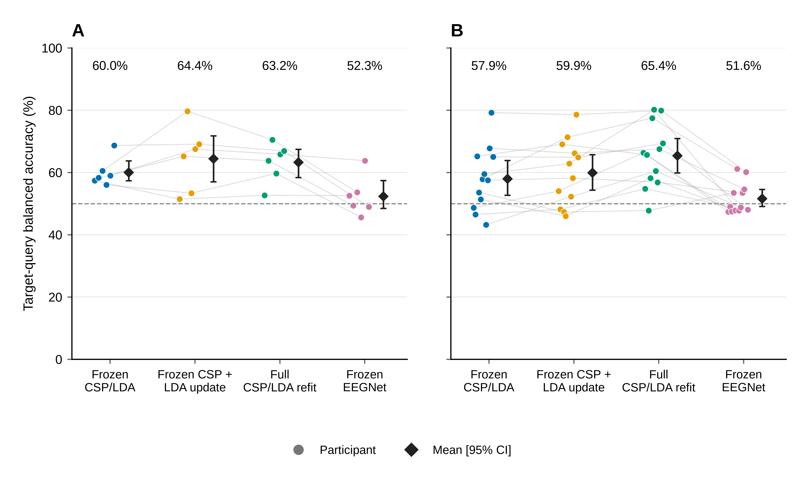
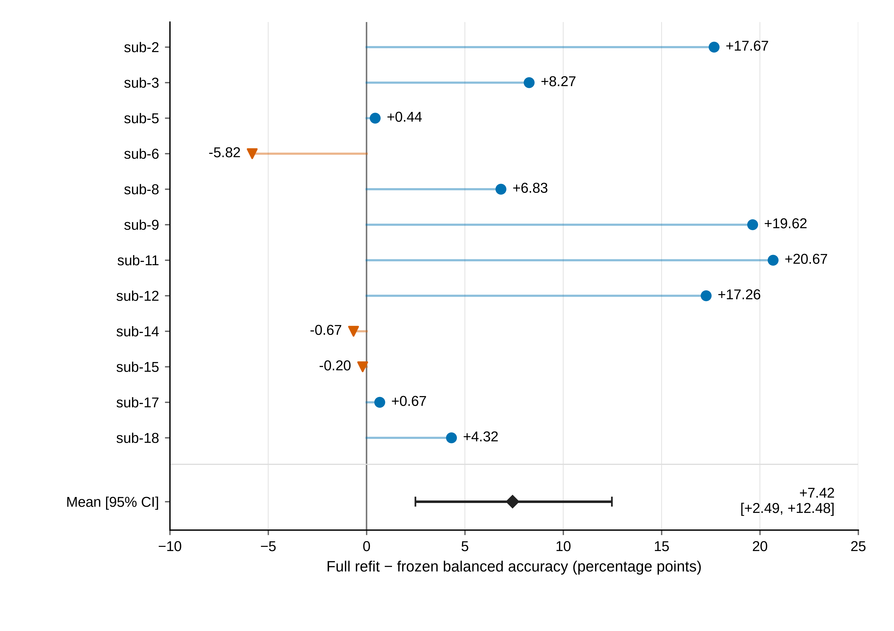

# Longitudinal motor-imagery EEG decoding: Frozen baselines, supervised recalibration, and task-measurement reliability

**Short title:** Longitudinal EEG decoding with limited recalibration labels

**Ziyuan Zhu**

College of Artificial Intelligence Medicine, Chongqing Medical University, Chongqing, China

**Corresponding author:** Ziyuan Zhu; zzy2630816871@gmail.com

**ORCID:** https://orcid.org/0009-0005-1153-4926

## Abstract

Supervised recalibration in motor-imagery brain–computer interfaces can update
both a classifier and its spatial representation, but a useful update decision
also requires reliable task measurements. We reanalyzed 18 published participant
identities across six sessions of Kumar2024 (NEMAR nm000177/v1.0.5). A frozen
protocol compared source-only CSP/LDA, classifier-only recalibration with frozen
CSP, and full CSP/LDA refitting using the same 19 or 20 current-session support
labels. An always-frozen EEGNet baseline retained three fixed seeds. The original
primary contrast in 12 remaining participants favored full refitting over frozen
decoding by 7.42 percentage points (95% participant-bootstrap interval 2.49–12.48).
The secondary same-label-budget contrast favored full refitting over LDA-only
updating by 5.47 points (2.17–8.91); it was not promoted to a primary endpoint.
Three individual decreases ranged from 0.20 to 5.82 points. An exploratory
amplitude-QC sensitivity retained a defined five-session endpoint for 10 of these
participants; its full-minus-frozen contrast was 5.96 points (0.99–11.24), with
substantial missing-class and selection limitations. EEGNet source-query balanced accuracy (BA) was
52.92% and target BA 51.58%, so weak target performance cannot chiefly be assigned
to cross-session drift. Source and support reliability probes did not validate
an adaptation gate. Event-code tracing identified cue-anchored exported
five-second windows rather than verified five-second continuous imagery;
online phase composition remains unquantified. Full CSP/LDA refitting improved the
cohort-average endpoint under the specified support-label budget, whereas the
LDA-only contrast remained uncertain. Prior test exposure makes the follow-up
analyses exploratory. These results concern released task-label windows, not
isolated imagery physiology, human skill retention or clinical efficacy.

## Introduction

Longitudinal motor-imagery brain–computer interface (BCI) decoding must account
for changes in recording distributions and in the relation between signals and
task labels. Nonstationarity, limited calibration data and evaluation design
remain recurring challenges [@lotte2018]. Common spatial patterns (CSP) and
linear discriminant analysis (LDA) offer a conventional setting in which spatial
representation and classification can be updated separately [@ramoser2000;
@blankertz2008]. A current-session label budget may improve decoding, but it
does not establish that every participant or session benefits from updating.

Kumar and colleagues already studied fixed and adaptive CSP in longitudinal
BCI training, including updates using labels from a session's first run
[@kumar2024; @kumar2024correction]. We therefore do not claim that recalibration,
first-run calibration followed by later-run evaluation, or adaptive CSP is a new
procedure. Our narrower question is whether updating the spatial filters in
addition to the classifier changes performance when both updates receive the
same approximately 20 target labels, and whether available task measurements
are reliable enough to inform an update decision. The original full-refit versus
frozen comparison remains primary; the full-refit versus classifier-only
comparison is an explicitly secondary, equal-label-budget contrast.

Distribution alignment is a related but different strategy. Euclidean alignment
and Riemannian transfer frameworks reduce between-domain mismatch before or
within decoding [@he2020alignment; @zanini2018alignment]. Such approaches are
relevant alternatives, not baselines that were implemented here. A covariance
distance or task-score measurement alone neither reproduces those methods nor
establishes that a policy based on it improves decoding. Likewise, decoder
accuracy is not interchangeable with a user's mental-imagery skill
[@lotte2018skills]. This secondary analysis evaluates stored task labels rather
than the original study's online interventions or acquired skills.

EEGNet supplies a compact neural reference [@lawhern2018], but identical query
trials do not equalize source-validation labels, target support or optimization.
We retain every fixed seed and class-collapsed outcome and examine saved learning
histories to interpret this small-source setting. We also trace the exported
events to their task semantics: a complete data window is not automatically a
complete imagery phase. The resulting contribution is a bounded comparison of
frozen and supervised conventional baselines, measurement reliability and
explicit sources of uncertainty, rather than a newly validated task-aware gate.

## Materials and methods

### Data source, original study and ethical status

We used the released Kumar2024 derivative, NEMAR nm000177/v1.0.5
[@nemar177], associated with the original study and its correction
[@kumar2024; @kumar2024correction]. The original Methods report University of
Texas at Austin protocol 2020-03-0073 and written informed consent before the
experiment. These statements were checked against accessible indexed original
Methods passages; downloading the complete original XML was unsuccessful.
They describe the original collection, not approval of this secondary analysis.
No new participants were recruited and no intervention was performed. The
responsible institution's determination for this secondary use remains pending
confirmation by the author; no approval, exemption, waiver or no-review conclusion
is asserted for this project.

The preserved derivative contains 18 published participant identities, six
sessions and 360 EDF recordings. It is not a new recording collection or an
independent reproduction of the acquisition pipeline. Published identities are
the statistical units; numerical duplicate checks do not independently verify
biological identity. Invalid age placeholders and unresolved original training-
protocol membership preclude demographic or intervention-subgroup claims.

### Exported windows, task-phase meaning and chronological partition

The frozen analysis identified 7,200 exported left/right event identities and
used five-second intervals beginning at their annotated onset. Forty-four
intervals ended at the recording boundary before five seconds; they were
preserved and excluded without padding or replacement, leaving 7,156 complete
windows. Completeness here refers to available recorded samples, not to five
seconds of continuous motor imagery.

The original author-supplied codebook defines 769/770 as left/right cue markers
and distinct 7691/7701 markers as task-period starts [@kumarcodebook]. The
preserved MOABB Kumar adapter [@jayaram2018] maps 769/770 to left/right and declares [0,5]
seconds; the derivative's class annotations and fixed/clipped durations agree
with this documented export convention. The precise historical converter commit
and the original trial-level marker arrays were not independently replayed.
The original Methods describe a
1.5-second cue preceding feedback, with an offline task duration of five seconds
and online feedback lasting at most seven seconds, followed by result and rest.
Thus the documented export chain supports **cue-anchored task-label windows**,
not isolation of a continuous five-second imagery phase. A nominal cue-anchored
window includes the cue interval and at most the subsequent 3.5 seconds; early
online termination could introduce later phases. Their trial-level proportions
cannot be measured without the original marker sequence and a verified clock
mapping. We did not reconstruct these phases from labels or alter any window.

All 44 short intervals occur on the last event of an online recording and stop
at the audited EDF end. This is a recording-boundary relationship, not evidence
that exactly 44 tasks ended early. Neither variable task duration by itself nor
this boundary check establishes a sample-indexing error. The original results
are retained as decoding of the released task-label windows. S1 Text gives the
event evidence and the minimum requirements for a future phase-specific amendment.

Development identities were sub-1, 4, 7, 10, 13 and 16; the remaining 12 formed
the fixed primary cohort, selected by numeric order rather than performance.
In session 0, runs 0/1 supplied 40 source TRAIN windows, run 2 supplied 20 source
validation windows and run 3 supplied source query. In each of five later
sessions, run 0 supplied support and the remaining whole runs supplied query.
Updates used source TRAIN plus current-session support without accumulating
future or earlier target labels. Partial exclusions left 19/20 support events
per target session (1,786 total) and 4,290 query events: 360 source and 3,930
target. Thirty partial query events remained excluded. Derivative timestamp
order was checked; absolute calendar accuracy was not independently established.

### Preprocessing and fixed amplitude-QC flag

Each event independently underwent common-average referencing across 22 channels,
fourth-order 8–30 Hz Butterworth zero-phase filtering and polyphase resampling
from 512 to 128 Hz, yielding 22 × 640 float32 values in volts. These epoch-local
operations learned no held-out statistics. Zero-phase filtering defines an
offline analysis; it neither proves real-time operation nor removes a cue or
feedback contribution. Native CPz reference remains a metadata declaration.

The existing 250 µV maximum raw channel peak-to-peak rule flagged 1,512/7,156
complete windows. Every flagged complete window remained in the primary analysis.
The rule is an amplitude flag, not expert artifact certification. Signal timing
and non-neural contributions are separate qualifications. No threshold or
preprocessing parameter was selected from the new sensitivity results.

### Decoders and information budgets

The CPU pipeline used four-component CSP with Ledoit–Wolf regularization,
log mean-square features and `norm_trace=False`, followed by shrinkage LDA
(`solver=lsqr`, automatic shrinkage). One prespecified configuration was used.
Source-only CSP and LDA stayed fixed. Recalibration retained source CSP and
refitted LDA with source training plus current support; full refitting updated
both stages using that same union. Validation and query identities were
excluded from all CPU fitting and parameter selection.

EEGNet used the frozen Braindecode architecture (F1=4, D=2, F2=8, dropout 0.5),
Adam at learning rate 0.001, batch size 16 and a maximum of 100 epochs. Channel
means and scales were fitted to source training only. Source-validation
cross entropy selected the earliest best epoch with patience 15; the complete
selected state was restored. All three seeds—20261012, 20261013 and 20261014—
were retained for each participant. The 54 completed source fits used 2,871
epochs and 8,613 optimizer steps. No source fit was repeated for query evaluation.
Query inference used evaluation mode with fixed parameters, batch-normalization
buffers and normalization statistics, with zero optimizer or support updates.

Table 1 summarizes the labeled-data use per participant.

**Table 1. Labeled-data use per participant.**

| Method | Source optimizer/estimator training | Source-validation use | Current target support for fitting |
| --- | --- | --- | --- |
| Source-only CSP/LDA | 40 labeled windows | No model or checkpoint selection | 0 |
| Frozen CSP + LDA recalibration | 40 labeled windows; LDA then refitted with current support | No model or checkpoint selection | 19/20 labeled windows |
| CSP/LDA refit | 40 labeled windows; both stages then refitted with current support | No model or checkpoint selection | 19/20 labeled windows |
| Always-frozen EEGNet | 40 labeled windows per seed | 20 labeled windows select stopping epoch | 0 |

Thus the two CPU update methods share the same adaptation label budget. Their
comparison with the frozen CPU model measures performance after adding the
specified support labels. Identical query samples do not make EEGNet and CPU
methods equal-budget architecture comparisons: EEGNet additionally uses the
source-validation labels for epoch selection, and only the CPU update methods
use target labels. No causal architecture or compute-efficiency ranking is
inferred from these differences. The architecture and implementation follow
EEGNet and Braindecode [@lawhern2018; @schirrmeister2017]; the exact executed
constructor and optimization settings are listed in Supplementary Methods S3.
The covariance regularization and LDA settings are implementation choices of
the frozen pipeline, rather than parameters selected using target outcomes
[@ledoit2004].

### Endpoints, statistical units and original comparisons

Balanced accuracy (BA) was the mean of the two class recalls. The primary
endpoint was each participant's mean BA over its five target sessions. The
primary contrast remained full CSP/LDA refitting minus source-only CSP/LDA in
the fixed remaining 12 identities. For EEGNet, all three seed scores were
averaged within participant/session before the five target sessions were
averaged within participant. Source query was reported separately. Neither
seeds, sessions nor trials increased the independent participant count.

Balanced-accuracy and participant-mean reliability summaries used 10,000
participant resamples with seed 42 for descriptive 95% percentile intervals;
paired CPU contrasts resampled paired participant differences. The separately
prespecified session-level drift associations used 2,000 participant-block
resamples with seed 42, retaining each sampled participant's five sessions.
Development and remaining cohorts were reported separately; all-18 summaries
were secondary. Cohort intervals containing 50% were not converted into a
new formal chance hypothesis test. Previously exposed test results preclude
describing subsequent same-dataset evaluations as untouched external confirmation.
Intervals condition on the observed cohort, preprocessing and fitted models;
they do not estimate uncertainty from alternative training datasets or
hyperparameter choices. No additional EEGNet-versus-CPU significance test was
introduced. Computational repetition and seeds do not supply new participants.

### Exploratory saved-prediction QC and influence analyses

After observing the original results, we wrote a separate sensitivity rule
before computing the new QC summaries. Saved predictions were joined to the
existing fixed QC flag by exact trial identity, role, true label and inclusion
status. The analysis used neither new EEG loading nor model inference. We
reported full and unflagged query BA, true-class counts and paired differences
for every participant/session, retaining empty or single-class rows as undefined.
BA required both true classes; the target endpoint required all five session
BAs. We did not silently average fewer sessions or count seeds as participants.

We separated the complete-case sensitivity from the original 12-person analysis
and compared subsets again within the same eligible participants. Participant
bootstrap settings remained 10,000 draws and seed 42. Additional pooled-query
BA is clearly labeled as a different endpoint. Leave-one-participant-out means
assessed influence without deleting any person from the reported primary result.
These are post-observation descriptive checks, not a change to the main analysis,
new QC threshold, confirmatory test or evidence that unflagged data are artifact-free.
The original source/support/validation data and fitted models were not cleaned
or retrained by this procedure.

### Task measurements and development-only reliability

The descriptive drift analysis compared each target session with the independent
source query. A source-trained task axis was the normalized difference between
class means in standardized 44-dimensional mu/beta log-power coordinates;
one-dimensional Wasserstein distance measured change along that fixed axis.
Covariance-shape change was measured relative to a source-training Riemannian
reference in a fixed 21-dimensional common-average-reference basis, after trace
normalization and fixed shrinkage. This shape proxy does not measure all
distributional changes or absolute amplitude. Target labels did not define
either drift predictor. The outcome was target-minus-source frozen-decoder BA;
target-labeled class summaries were explicitly retrospective descriptions.

The task-measurement reliability probes used only development source training
and predeclared support. Fixed power, PCA and supervised CSP-score measurements
were evaluated with source-run grouping, support split halves and cyclic-label
controls. The controls are phase-alignment sensitivities, not formal
permutation p values. Separately, the remaining-cohort drift associations were
pre-frozen descriptive analyses, not policy selection. No diagnostic selected
an adaptation threshold or used query outcomes to choose a policy.

Source-run probes trained on one 20-event source run and evaluated the other,
then reversed the roles. Learned transformations were fitted within each source
training fold; a transform fitted on all 40 events was not reused to score a
held-out source run. The supervised diagnostic refitted both CSP and LDA within
each fold. For support descriptions, the existing 40-event source models and
source-fitted coordinate scales were held fixed. Each class was split into
chronological halves within the current support run, without query access.
Vector cosines and signed source-score contrasts summarized agreement between
the halves; agreement did not itself establish a useful adaptation decision.

Cyclic label controls retained the prescribed run grouping and enumerated
label phases. They were not random-label exchangeability tests. All 240
supervised CSP/LDA fold/rotation pipelines and all associated controls were
retained. Supplementary Methods S4–S6 define the coordinate scales, half sizes,
score orientation, control enumeration and handling of degenerate cases.

### Saved training review and AI-assisted preparation

We examined all saved epoch-level training/validation histories, selected epochs,
fixed seeds and existing source/target query metrics without loading checkpoints
or repeating inference. Training losses were accumulated in training mode while
parameters changed; validation losses were computed after the epoch in evaluation
mode. Their gap is not a calibrated measure of generalization. Model-level
summaries describe the fixed fits rather than increase the participant count.

OpenAI ChatGPT/Codex assisted with code, validation, saved-result aggregation,
figures, source and reference checks, and manuscript drafting/editing. Checks
included exact identity joins and hashes, original-endpoint reconstruction,
separately implemented arithmetic checks, a public-input replay of the text-only
postprocessor and visual document/figure review. These computational checks
were themselves AI-assisted; they are not an independent human replication or
proof of biological validity. The human author must personally review and approve
the final methods, references, results and interpretations before submission.
The final approval and account of personal checks remain author-provided facts.

## Results

### Original decoding endpoints and the same-label-budget secondary contrast

All three fixed EEGNet seeds contributed to every participant endpoint. Table 2
retains the original target results; Fig 1 shows participants rather than only
cohort means. Each bracketed interval is a descriptive participant-bootstrap interval.

**Table 2. Target-query balanced accuracy (%, mean across five sessions within participant).**

| Cohort | Participants | Source-only CSP/LDA | Frozen CSP + LDA recalibration | CSP/LDA refit | Always-frozen EEGNet |
| --- | ---: | ---: | ---: | ---: | ---: |
| Development | 6 | 59.97 [57.34, 63.70] | 64.37 [56.97, 71.75] | 63.22 [58.36, 67.40] | 52.31 [48.43, 57.36] |
| Fixed remaining cohort | 12 | 57.94 [52.65, 63.84] | 59.89 [54.30, 65.68] | 65.36 [59.81, 70.90] | 51.58 [49.08, 54.51] |
| All identities, secondary | 18 | 58.62 [54.88, 62.68] | 61.38 [56.79, 66.17] | 64.65 [60.53, 68.71] | 51.82 [49.59, 54.36] |

{width=100%}

**Fig 1. Target-query decoding by participant.**

(A) Six development participants. (B) Twelve remaining participants. Each colored
point is one participant's balanced accuracy (BA), with equal weight for five
target sessions. EEGNet averages all three fixed seeds within session before the
session mean; CPU methods use their single frozen execution. Faint lines connect
the same participant across methods. Diamonds and bars reproduce saved means and
95% descriptive participant-bootstrap intervals (10,000 resamples, seed 42), not
new intervals. All methods use the same query trial identities, but information
budgets differ: each learns from 40 source TRAIN labels; EEGNet also uses 20 source
validation labels for epoch selection, while the two updating CPU baselines use
19 or 20 labeled support trials from the current target session. This is not a
matched-budget architecture ranking. The follow-up comparison is exploratory;
all seeds, participants and class-collapsed predictions are retained.

The original primary full-refit minus frozen contrast was +7.42 percentage points
[+2.49, +12.48] in the remaining 12 participants. The development contrast was
+3.25 points [−0.90, +7.14]. In the original secondary remaining-cohort
comparisons, LDA-only minus frozen was +1.95 points [−0.98, +5.09], whereas full
refit minus LDA-only was +5.47 points [+2.17, +8.91]. Both updating pipelines
used the same source/current-support labels, making their secondary difference
informative about this implementation under a matched label budget. Their
computation differs, and the secondary interval is not a multiplicity-adjusted
confirmatory result or a newly promoted primary endpoint.

Nine primary participant differences were positive and three negative (Fig 2).
The decreases were sub-6 −5.82, sub-14 −0.67 and sub-15 −0.20 points. The latter
two are small observed differences and do not establish substantial individual
harm. The largest gains were sub-11 +20.67, sub-9 +19.62 and sub-2 +17.67 points.
Leaving out one original participant at a time gave cohort mean differences
between +6.22 and +8.62 points, without a sign reversal. This is an influence
check, not evidence that all individual effects are reliable or beneficial.

{width=100%}

**Fig 2. Original primary CPU contrast by participant.**

Full CSP/LDA refitting minus frozen CSP/LDA for the original remaining-12 primary
cohort, after equal averaging of five target sessions. Numeric participant order
is retained. Nine differences are positive and three negative. The negative
changes are sub-6 −5.82, sub-14 −0.67 and sub-15 −0.20 percentage points; these
descriptive decreases differ in magnitude and are not individual significance
claims. The mean and original 95% participant-bootstrap interval are +7.42
[+2.49, +12.48] percentage points. Refit has access to current-session support
labels whereas frozen does not. This figure adds no hypothesis test and does
not establish learning, skill retention or clinical efficacy.

### Weak source-session EEGNet discrimination precedes target transfer

Table 3 separates the independent source query from later target sessions. The
three CPU labels refer to the same source model on source query, not three
independent source estimates. In the remaining cohort, EEGNet source-query BA
was 52.92%, already near chance, versus 51.58% on the target endpoint. The
−1.34-point difference is descriptive and cannot identify a drift effect.
Weak target performance therefore cannot chiefly be attributed to cross-session
change. This statement concerns the fixed 40-TRAIN-trial implementation, not
all neural architectures or motor-imagery decoding in general.

**Table 3. Source-query balanced accuracy (%, participant mean and descriptive 95% interval).**

| Cohort | Participants | CPU source model, shared by the three method labels | Always-frozen EEGNet |
| --- | ---: | ---: | ---: |
| Development | 6 | 60.83 [54.17, 68.33] | 52.78 [47.50, 59.44] |
| Fixed remaining cohort | 12 | 65.00 [56.67, 74.17] | 52.92 [48.89, 58.75] |
| All identities, secondary | 18 | 63.61 [57.50, 70.28] | 52.87 [49.44, 57.22] |

All 54 saved JSON histories were complete (2,871 epochs/8,613 optimizer steps).
Twelve models selected epoch 1 and 11 reached the 100-epoch cap; 53/54 had lower
final than initial training CE, whereas 29/54 had higher final than initial
validation CE. In the remaining 36 fits, the corresponding counts were 8, 10,
35 and 19. Their median training CE changed from 0.704246 to 0.596543; median
validation CE was 0.693048 initially, 0.691847 at the selected epoch and
0.692351 finally. Training improvement without consistent
validation improvement is compatible with limited generalization, but the
training/evaluation-mode difference prevents a simple loss-gap diagnosis.

No seed was discarded: remaining-cohort target means for seeds 20261012,
20261013 and 20261014 were 52.42%, 49.94% and 52.37%. The mean participant target
BA range across seeds was 8.06 points, with a maximum of 24.62 points. Source-
validation selection scores are not independent generalization estimates.
EEGNet retained 16 single-class seed/session query outcomes across seven models
and seven participants (2 source, 14 target). The CPU frozen baseline retained
three collapsed target sessions across the full cohort, two in the remaining
cohort; neither update had collapse. These outcomes stayed in all means.

### Task measurements do not establish a reliable update decision

The pre-frozen remaining-cohort descriptive associations of covariance-shape
change and source-task-axis Wasserstein distance with frozen BA change were
Spearman −0.007 [−0.505, 0.438] and 0.197 [−0.240, 0.518]. They did not establish
reliable performance prediction or superiority of a task-dependent measure.
Development power/PCA/motor-band probes averaged source BA 51.67/50.00/54.17%,
with intervals including 50%; support split-half cosine intervals included zero.

All 240 prescribed supervised CSP/LDA fold/rotation attempts were retained.
Mean source twofold BA was 62.9167% [52.5, 71.6667] and participant-averaged support
vector cosine 0.295325 [0.032041, 0.573003]. Among 30 support sessions, frozen-score
half-contrasts were positive in both halves for 19, negative in both for two,
and opposite for nine (Fig 3). Five support sessions had frozen-score collapse.
A positive cosine or product does not ensure the correct task orientation.
These diagnostics are not a nested out-of-sample policy comparison.

{width=100%}

**Fig 3. Signed-score consistency across target support halves.**

Each development participant contributes five target support sessions. Circles
and squares show the first and second chronological halves within class. Values
are the saved class-balanced contrast of frozen source-LDA scores divided by
twice their source-score standard deviation. All 60 values use shared axes.
Of 30 sessions, 19 have two positive margins, two have two negative margins and
nine have opposite signs. The zero line indicates score orientation, not a
selected gate. These support-only diagnostics do not validate an update policy.

### Longitudinal heterogeneity and exploratory amplitude-QC sensitivity

Fig 4 retains the paired changes for every participant and target session
for both full-minus-frozen and full-minus-LDA-only contrasts. Substantial
session-level variation is visible even when participant averages are positive;
the sessions are not additional independent participants.

{width=100%}

**Fig 4. Longitudinal paired changes for every participant and target session.**

Each cell is a difference in balanced accuracy for identical saved query trials:
(A) full CSP/LDA refit minus frozen CSP/LDA (the original primary contrast);
(B) full refit minus LDA-only recalibration (the secondary same-support-label
contrast). Both panels contain all 18 participants and five target sessions.
Development and remaining cohorts are separated by a horizontal line; participant
identities are numeric within each cohort, without effect-size sorting. The
symmetric color scale is shared, and every signed cell value is displayed in
percentage points to one decimal. Exact values and trial counts are in the
matching source-data CSV. These session values describe heterogeneity; sessions
are not treated as independent participants. The original primary endpoint and
all inferential comparisons remain unchanged. No new model, query inference,
gate, bootstrap or significance test is performed to produce this figure.

Table 4 reports the target-endpoint sensitivity, including its changed denominator.
The exact QC join contained 25,740 saved prediction rows and 4,290 unique query
identities; all 144 reconstructed original participant endpoints matched the
saved values. The existing rule flagged 922 query windows (36 source and
886 target), leaving 3,368 unflagged. Sub-8 had zero unflagged queries in target
sessions 3/4 and sub-12 retained only four target queries, all left class.
Their five-session endpoints were undefined rather than silently deleted or
averaged over a different session count. Other low-count sessions, including
2-left/1-right groups, remained visible in S1 Data.

**Table 4. Exploratory amplitude-QC sensitivity of target-session BA (%, descriptive participant intervals).**

| Method | All included queries, original 12 participants | Unflagged queries, 10 eligible participants |
| --- | ---: | ---: |
| Frozen CSP/LDA | 57.94 [52.65, 63.84] | 60.14 [54.75, 66.02] |
| Frozen CSP + LDA-only recalibration | 59.89 [54.30, 65.68] | 62.28 [56.21, 67.91] |
| Full CSP/LDA refit | 65.36 [59.81, 70.90] | 66.10 [59.84, 71.94] |
| Always-frozen EEGNet | 51.58 [49.08, 54.51] | 51.80 [48.34, 55.28] |

The columns have different participant denominators and are not a paired QC
change. Sub-8 and sub-12 lack one or more defined unflagged session BAs and
remain in the supporting missing-class tables. All five target sessions and
all three EEGNet seeds are required. The same-ten paired changes are reported
below; unflagged does not mean artifact-free.

For the ten eligible participants, unflagged full-minus-frozen was +5.96 points
[+0.99, +11.24] and full-minus-LDA-only +3.82 [+1.11, +6.72]. The same ten
participants' full-query contrasts were +6.50 and +4.53 points. The paired
unflagged-minus-full changes were −0.54 [−1.30, +0.16] and −0.71 [−2.11, +0.42]
points, respectively. These subset-conditioned findings do not show that the
mean contrast was solely carried by flagged queries, but do not establish
artifact robustness or full-cohort coverage.

Pooling all source and target query trials within each participant, a distinct
supplementary endpoint with 12 eligible participants in both subsets, produced
full/unflagged means of 58.41/57.58% frozen, 60.58/59.77% LDA-only,
65.43/65.95% full refit and 51.81/51.99% EEGNet. The source-only and target-pooled
endpoints, every session's class counts and missingness are supplied separately.
Filtering query predictions did not remove the 76 flagged source TRAIN,
36 source-validation or 478 target-support windows from historical fitting
or checkpoint selection. Unflagged windows remain unreviewed for other artifacts.

## Discussion

### Increment beyond established supervised recalibration

The findings extend an existing longitudinal resource by separating two updates
under the same small current-session label allowance. The original study already
used adaptive CSP and first-run labels; reproducing that broad design is not a
novel algorithm [@kumar2024]. The secondary +5.47-point full-versus-LDA-only
contrast suggests that retaining the source spatial representation can limit
this conventional pipeline, even after classifier recalibration. It does not
uniquely identify a physiological mechanism, establish compute efficiency or
replace the original primary comparison. Development/remaining differences and
individual variation also prevent a universal recommendation to refit.

Useful adaptation requires more than a cohort-average improvement. The observed
task-score orientation was inconsistent within some support runs, and the
prespecified drift proxies had wide associations with performance. No threshold,
gate or new strategy was chosen from these data. Alignment methods remain
important comparators for a separately reviewed study [@he2020alignment;
@zanini2018alignment]; they cannot be retrospectively credited to this benchmark.
Reliable individual update decisions would require a separately frozen,
group-aware nested development evaluation against equal-label-budget controls.

### Window semantics and signal quality limit interpretation

The strongest qualification is that the recorded endpoint labels classify
cue-anchored windows in a motor-imagery experiment, not a verified sustained
imagery segment. Cue perception, feedback, ocular/muscle activity and online
termination-related phases could contribute. The recording-boundary exclusion
of 44 short events neither repairs nor estimates those contributions. A future
phase-specific analysis would first require matched original task-start/end
markers and sample clocks, a preserved new eligibility ledger and a separately
reviewed fixed window. It must not search window positions for better scores
or overwrite the present benchmark.

The amplitude sensitivity directly addresses saved decoding outcomes, unlike a
power-only QC description. Its positive complete-case contrasts and lack of a
single-participant sign reversal narrow some simple influence explanations.
However, two of twelve primary participants lose a valid five-session endpoint,
conditioning on amplitude changes the sample and small class counts remain.
Flagged fit and validation examples still influence the stored models. These
limitations preclude labeling the results artifact-free or robust to all
signal-quality problems. The substantially different cue/task meanings also
cannot be resolved by an amplitude threshold.

### Neural baseline and statistical scope

EEGNet's weak held-out source-session score is the first interpretive constraint.
Its target score should not be presented as mainly a consequence of cross-session
drift. Saved histories show training loss reduction without consistent validation
benefit, heterogeneous stopping and seed variation. These support a limited
small-source benchmark, without proving a unique cause or that deep learning is
unsuitable for this task. Parameter choice, additional source labels or alignment
would be new experiments, not permissible post-query fixes.

There are 18 published participant identities, 12 in the primary comparison and
six in reliability probes, not 54 independent participants. Bootstrap intervals
condition on these participants, fixed windows and fitted models. Earlier test
exposure makes follow-up QC, neural comparisons and manuscript-driven summaries
exploratory. Source metadata, protocol membership and biological independence
also have unresolved qualifications. Offline task-label accuracy does not
measure acquired BCI skill, human learning or clinical benefit [@lotte2018skills].

## Conclusions

Full CSP/LDA refitting improved the cohort-average endpoint under the specified
support-label budget, whereas the LDA-only contrast remained uncertain. The
secondary same-label-budget advantage over LDA-only updating and retained
individual/session variation motivate measuring when adaptation is useful, but
no reliable task-aware gate was validated. Weak independent source-query
EEGNet performance precedes its weak target result. New QC sensitivity is
qualified by incomplete class coverage and unchanged fitting artifacts. The
present evidence supports transparent interpretation of released cue-anchored
task-label windows, not isolated sustained imagery, skill retention or clinical
validity.

## Data and code availability

The analyzed public source is the exact NEMAR release nm000177/v1.0.5,
DOI 10.82901/nemar.nm000177.v1.0.5, under its stated CC BY 4.0 terms [@nemar177].
Its original study and correction are cited separately. S1 Data contains the
minimal saved predictions, fixed trial/QC metadata, participant/session tables,
training curves and figure data needed to reproduce this paper's saved-result
arithmetic without raw EEG, checkpoint weights or a second inference pass.
The new postprocessor accepts portable explicit inputs and fresh output paths.
S1 Text provides scientific details; S2 Text describes provenance and reproduction.

Code, configurations, tests and text audit evidence are maintained at
https://github.com/jackzhu119/few-shot-mi-eeg on research/learning-preserving-bci,
with the exact source-code/data commit and export-file hashes in the
accompanying release manifest.
The snapshot is not a minted DOI or a submitted journal release. The revised
package awaits synchronization and a fixed public archive/version link before
submission; its presence in the local author-review package is not public release. Private R2
backups preserve original EEG/weights/evidence and are not public data endpoints.
The concrete proposal is MIT for original project code and CC BY 4.0 for original
derived content, with explicit third-party exclusions; the author's license
selection and activation remain pending. No software license is silently granted.

## Author contributions and declarations

Ziyuan Zhu: Conceptualization; Methodology; Software; Formal analysis; Validation;
Visualization; Writing – original draft; Writing – review & editing.
The author declares no competing interests. ORCID name-field correction is
reported by the author; this task did not independently recheck the profile.
Funding information and manuscript-specific portal declarations are supplied in
the separate author worksheet. Final author approval, institutional determination
and license selection remain explicit pre-submission items. This task has not
submitted the manuscript.

## References

::: {#refs}
:::

## Supporting information captions

**S1 Text. Detailed scientific methods and sensitivity definitions.**
Preprocessing, frozen decoders and budgets, participant statistics, event-phase
evidence, QC class eligibility, training interpretation and limits.

**S2 Text. Audit and saved-result reproduction.**
Source/version identities, saved-output reconstruction, exact data dictionary,
portable commands, and a compact account of preservation/recovery checks,
separated from the scientific claims.

**S1 Data. Minimal saved results and underlying figure data.**
Saved CPU/EEGNet predictions, frozen event/QC lookup, original and sensitivity
participant/session counts and endpoints, training histories and exact plot
values. No EEG arrays, learned weights, source-paper full texts or bundled
third-party software are included.
