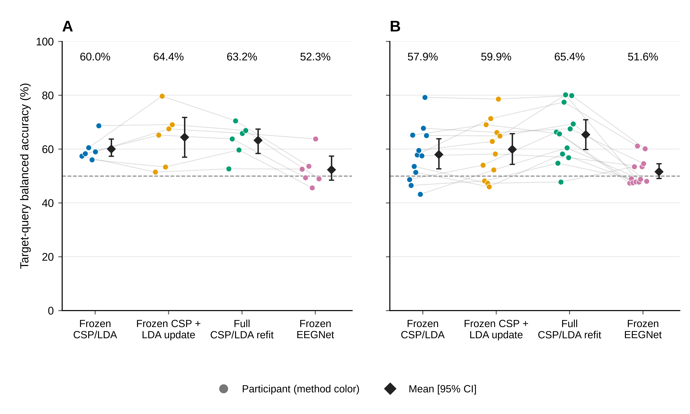
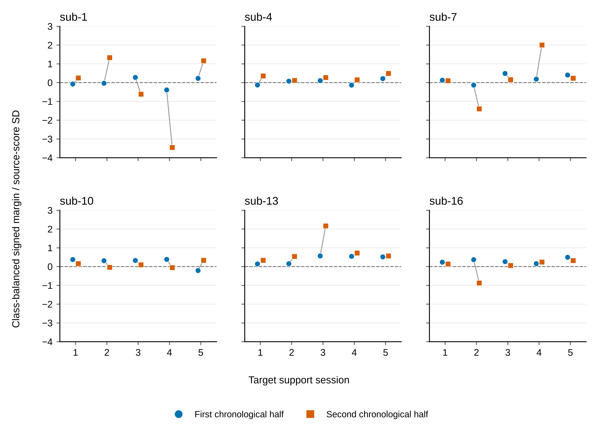
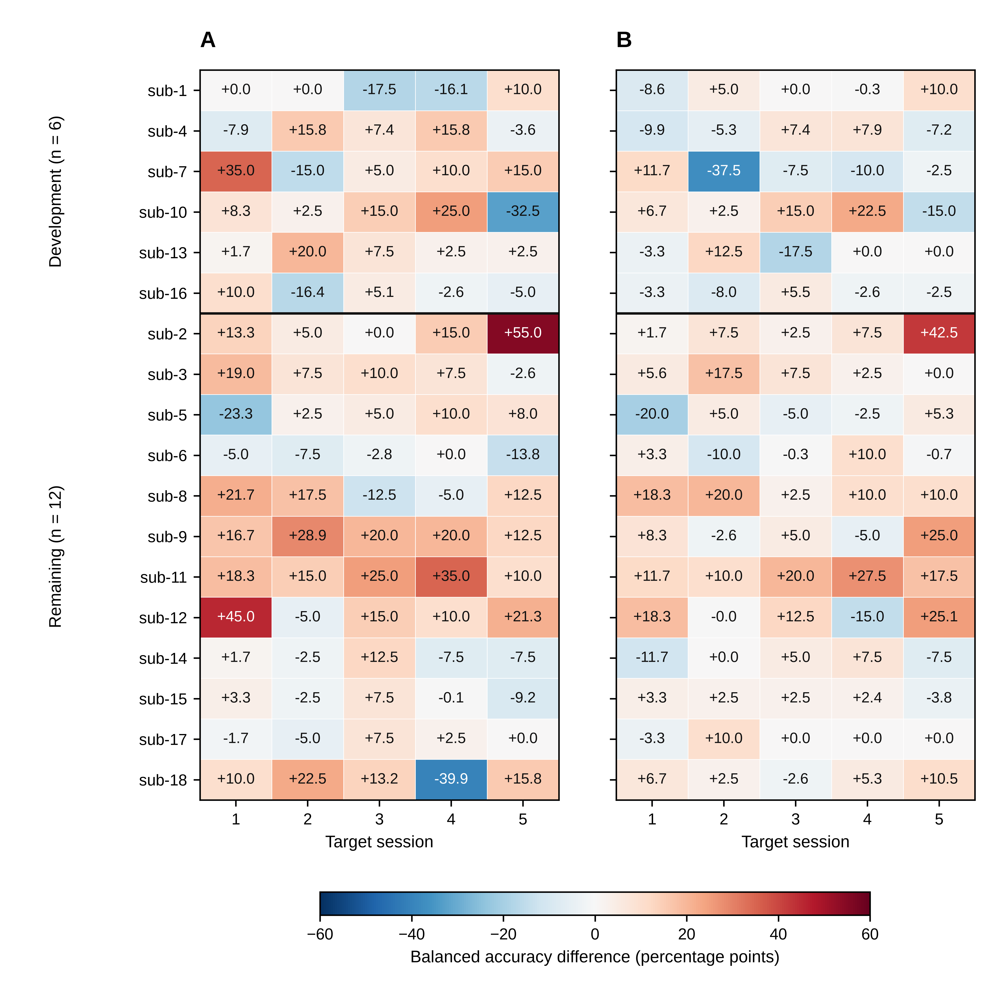

# Updating spatial filters improves limited-label recalibration in a longitudinal motor-imagery EEG dataset

**Short title:** Spatial-filter updating with limited calibration labels

**Ziyuan Zhu**

College of Artificial Intelligence Medicine, Chongqing Medical University, Chongqing, China

**Corresponding author:** Ziyuan Zhu; zzy2630816871@gmail.com

**ORCID:** https://orcid.org/0009-0005-1153-4926

## Abstract

Limited calibration time makes the choice of which decoder components to update a central problem in longitudinal brain–computer interfaces. We evaluated the added value of updating spatial filters when classifier recalibration already uses the available new labels. Using Kumar2024 (NEMAR nm000177/v1.0.5), we compared frozen common spatial patterns and linear discriminant analysis (CSP/LDA), LDA-only recalibration, and full CSP/LDA refitting across 18 participants and six sessions. Both updating methods used identical source training data and 19 or 20 labels from the current session. A predefined split assigned six participants to development and 12 to the primary analysis. In the primary cohort, full refitting achieved 65.36% balanced accuracy, compared with 57.94% for frozen decoding and 59.89% for LDA-only recalibration. The primary full-refit gain was 7.42 percentage points (95% participant-bootstrap interval 2.49–12.48); the secondary gain over LDA-only recalibration was 5.47 points (2.17–8.91). Nine of 12 participants improved over freezing, while session-level changes showed substantial variability. Development-only reliability probes found opposite task-score orientations between support halves in nine of 30 sessions, identifying a practical obstacle to selecting updates from small calibration sets. The analysis used released five-second cue-anchored windows; supplementary analyses examined amplitude sensitivity, a frozen EEGNet reference, and statistical uncertainty. The findings identify spatial-filter updating as a valuable component of limited-label recalibration in the primary cohort and establish a concrete next objective: predicting the benefit of each update action from the calibration data available at decision time.

## Introduction

Longitudinal motor-imagery brain–computer interfaces (BCIs) face a recurring design choice: how much of a decoder should be updated when only a short calibration run is available? Changes in EEG distributions and in the relationship between signals and task labels can reduce transfer across sessions [@lotte2018]. Recalibration can revise the decision boundary, the spatial representation, or both. These choices consume the same scarce labels in different ways, making the component selected for updating an important experimental question.

Common spatial patterns (CSP) followed by linear discriminant analysis (LDA) provides a direct setting for this comparison [@ramoser2000; @blankertz2008]. LDA-only recalibration adjusts classification in a fixed feature space. Full refitting re-estimates the spatial filters that determine that feature space. A comparison using identical source and target support labels therefore measures the additional value of updating the representation within this pipeline.

Existing adaptation methods address several parts of this problem. Unsupervised LDA adaptation updates classifier parameters [@vidaurre2011lda]. EEG data-space adaptation estimates channel-space transformations, including a setting using the first 20 target trials [@arvaneh2013dsa]. Euclidean alignment and Riemannian transfer reduce mismatch between recording domains [@he2020alignment; @zanini2018alignment]. The Kumar acquisition study used incremental covariance recentering and a Riemannian minimum-distance-to-mean classifier. Its personally adjusted recentering framework added supervised prototype updates during each session's first run, while a pseudo-online extension combined recentering with CSP and a linear classifier [@kumar2024; @kumar2024correction]. Together, these studies motivate examining which part of an established decoding pipeline benefits from a small current-session label budget.

Here we evaluate three update choices across six sessions of Kumar2024: preserve the source CSP/LDA model, update LDA alone, or refit both CSP and LDA. The predefined primary contrast quantifies the total gain of full supervised recalibration over freezing. The secondary contrast holds labeled information constant and quantifies the added value of spatial-filter refitting over classifier-only recalibration. This distinction connects a practical intervention, allocating approximately 20 new labels, to a specific component choice.

We also examine the variation behind the cohort averages. Participant and session trajectories reveal when observed update gains change direction. Development-only reliability probes then test the consistency of task measurements computed from the available calibration data. A compact EEGNet reference [@lawhern2018] provides context for the same small-source setting, with its information budget reported explicitly. The study thus links a controlled comparison of decoder components to the measurement requirements for deciding when an update is useful. Its empirical contribution is the combination of a matched-label component contrast, longitudinal gain profiles, and an assessment of calibration-measurement reliability.

## Materials and methods

### Data source and ethics

We analyzed the public Kumar2024 EEG derivative, NEMAR nm000177/v1.0.5 [@nemar177], associated with the original study and its correction [@kumar2024; @kumar2024correction]. The original study reported University of Texas at Austin ethical approval under protocol 2020-03-0073 and written informed consent before data collection.

The author reports that the research administration office at Chongqing Medical University confirmed on 16 October 2026 that this secondary analysis qualified for exemption from additional ethical review under Article 32, item (1), of China's *Measures for Ethical Review of Life Science and Medical Research Involving Human Participants* (2023) [@china2023ethics]. No reference number was issued. The confirmation covered the use of lawfully obtained public data under the provision's conditions concerning harm, sensitive personal information and commercial interests.

The released records use coded participant identifiers. The analysis involved existing data, with no new participant recruitment, contact, intervention or re-identification. The original collection's approval and consent, and the institutional confirmation for the present secondary use, apply to their respective stages of the research.

### Analysis windows and chronological partition

The derivative contains 18 participant identifiers, six sessions and 360 EDF recordings. Of 7,200 exported left/right events, 7,156 provided complete five-second windows. The remaining 44 reached the recording boundary before five seconds and were excluded without padding. All 44 occurred at the last event of an online recording.

The analyzed windows began at the exported class annotation. The original codebook assigns 769/770 to left/right cues and 7691/7701 to task starts [@kumarcodebook]. The documented MOABB adapter maps the cue codes to a [0,5]-second interval [@jayaram2018]. This establishes the cue-anchored convention used to interpret the released windows. The original task included a 1.5-second cue before feedback, with a five-second offline task period and up to seven seconds of online feedback. Accordingly, the analysis endpoint is task-label decoding over the released cue windows. Exact trial-level phase composition was outside the reported decoding analysis; the source evidence and subsequent partial event mapping are documented in S1 Text, S7.

Participants sub-1, 4, 7, 10, 13 and 16 formed the development group. The remaining 12 formed the predefined primary cohort, allocated by numeric identifier before examination of these results. In session 0, runs 0 and 1 supplied 40 source training windows, run 2 supplied 20 source-validation windows, and run 3 supplied source query. In each of five later sessions, run 0 supplied support and the remaining whole runs supplied query.

Each recalibration used source training plus the current session's support. Previous target-session labels were not accumulated. After exclusion of partial windows, support comprised 19 or 20 events per target session, totaling 1,786. The query set contained 4,290 events: 360 source and 3,930 target. Thirty partial query events were excluded. The chronological partition followed the released recording order and was checked against the derivative timestamps.

### Preprocessing and amplitude flag

Each epoch underwent common-average referencing across 22 channels, fourth-order 8–30 Hz Butterworth zero-phase filtering, and polyphase resampling from 512 to 128 Hz. The resulting tensor contained 22 × 640 float32 values in volts. These epoch-local operations used fixed settings; learned transformations were fitted within the training partitions described below. The zero-phase filter defines an offline decoding procedure.

An existing threshold of 250 µV for the maximum raw channel peak-to-peak amplitude flagged 1,512 of 7,156 complete windows. The primary analysis retained all complete windows. A subsequent sensitivity analysis used the same flag to evaluate saved predictions on unflagged queries. This flag identifies high amplitude; expert artifact adjudication was outside its scope.

### Decoders and label budgets

The CPU pipeline combined four-component CSP with Ledoit–Wolf covariance regularization, log mean-square features and norm_trace=False, followed by shrinkage LDA (solver=lsqr, automatic shrinkage) [@ledoit2004]. A single configuration defined all CPU comparisons:

- **Frozen CSP/LDA:** both components were fitted to the 40 source training windows and then held fixed.
- **LDA-only recalibration:** source CSP was retained and LDA was refitted using source training plus current support.
- **Full CSP/LDA refitting:** both components were refitted using the same source-training/current-support union.

CPU fitting and parameter selection used training/support identities exclusively. The identical labeled fitting sets in the two updating methods make their contrast a direct comparison of the added spatial-filter update within CSP/LDA.

EEGNet used the Braindecode implementation [@lawhern2018; @schirrmeister2017], with F1=4, D=2, F2=8 and dropout 0.5. Optimization used Adam, a learning rate of 0.001, batch size 16 and at most 100 epochs. Channel means and scales were fitted on source training. Source-validation cross entropy selected the earliest best epoch with patience 15, and the selected model state was restored. Three seeds (20261012, 20261013 and 20261014) were retained for every participant. Query inference used evaluation mode with model parameters, batch-normalization buffers and normalization statistics fixed.

**Table 1. Labeled-data use per participant.**

| Method | Source training | Source-validation use | Current target support for fitting |
| --- | --- | --- | --- |
| Frozen CSP/LDA | 40 labeled windows | None | 0 |
| LDA-only recalibration | 40 labeled windows, combined with current support for LDA | None | 19/20 labeled windows |
| Full CSP/LDA refitting | 40 labeled windows, combined with current support for both stages | None | 19/20 labeled windows |
| Frozen EEGNet | 40 labeled windows per seed | 20 labeled windows for epoch selection | 0 |

The two CPU update methods share the adaptation budget. Their comparison with freezing measures the benefit of adding support labels and refitting the specified components. EEGNet is a source-only neural reference with an additional validation budget, so its comparison provides context for the executed configurations rather than an equal-budget ranking of model families. S1 Text, S3 gives the complete implementation settings.

### Endpoints and statistical analysis

Balanced accuracy (BA) was the mean of the two class recalls. The primary endpoint was each participant's mean BA over five target sessions, and the primary contrast was full CSP/LDA refitting minus frozen CSP/LDA in the 12-person primary cohort. Full refitting minus LDA-only recalibration was the predefined secondary component contrast. For EEGNet, seed scores were averaged within participant/session before averaging the five sessions. Source-query performance was reported separately.

Participants were the independent statistical units. We used 10,000 participant bootstrap resamples with seed 42 for 95% percentile intervals, resampling paired participant differences for method contrasts. The development and primary cohorts were reported separately; all-18 summaries were secondary. Session-level drift associations used 2,000 participant-block resamples, retaining each sampled participant's five sessions. These intervals describe uncertainty conditional on the observed participants, preprocessing and fitted models.

The original endpoint hierarchy and cohort allocation preceded the reported results. Later QC, influence and post-review statistical checks were exploratory after inspection of those results. The latter checks enumerated all $2^n$ sign assignments for four saved participant-level contrasts: full minus frozen, full minus LDA-only, and LDA-only minus frozen in the primary cohort, plus full minus frozen in the ten-person unflagged sensitivity. The statistic was the absolute mean paired difference, with a $10^{-12}$ tolerance in BA units at the tail boundary. This reference construction assumes independent participant differences with sign symmetry about zero. We report unadjusted values and Holm adjustment across the four checks. S1 Text, S11 specifies the enumeration and its relationship to the original bootstrap intervals.

### Sensitivity and influence analyses

Saved predictions were joined to the existing amplitude flag by exact trial identity, role, true label and inclusion status. BA required both true classes in each session; the participant target endpoint required valid BA in all five sessions. Empty or single-class subsets remained explicitly undefined. We reported the unflagged complete-case results and paired full-query/unflagged differences within the same eligible participants.

These computations reused saved predictions and the original fitted models. Source training, validation and support data were unchanged. Supplementary pooled-query endpoints used their own stated denominators. Leave-one-participant-out means assessed the influence of each participant on the primary estimate. Full definitions and class counts appear in S1 Text and S1 Data.

### Task measurements and calibration reliability

We assessed two measures of session change relative to source query. The task-axis measure used the source-trained, normalized difference between class means in standardized 44-dimensional mu/beta log-power coordinates; one-dimensional Wasserstein distance measured change along this axis. The covariance-shape measure used a source-training Riemannian reference in a fixed 21-dimensional common-average-reference basis, with trace normalization and fixed shrinkage. It captures normalized covariance shape. Target labels entered the BA outcome, while the drift predictors used the corresponding signal distributions.

The outcome was target-minus-source frozen-decoder BA. Associations pooled within- and between-participant variation and shared a source-query reference across each participant's five target sessions. The participant-block bootstrap preserved that clustering. These query-distribution associations served as retrospective descriptions.

Development-only reliability probes used source training and current support. Fixed power, PCA and supervised CSP-score measurements were evaluated using source-run grouping, chronological support halves and cyclic-label controls. Each source-run probe trained on one 20-event run and evaluated the other, then reversed the roles. All learned transformations, including CSP and LDA, were fitted within the training fold.

Support measurements used the source models fitted on 40 training events, with source-fitted coordinate scales. Each class was divided into chronological halves within the support run. Vector cosines and signed source-score contrasts measured agreement and class orientation. Cyclic controls enumerated prescribed label phases within run grouping and were interpreted as alignment sensitivities. All 240 supervised fold/rotation pipelines were retained. S1 Text, S4–S6 specifies half sizes, score orientation, controls and degenerate cases.

### Training-history review and AI assistance

We examined all saved EEGNet training/validation histories, selected epochs, seed-level outcomes and source/target query metrics. Training loss was accumulated while parameters changed in training mode; validation loss was evaluated after each epoch. Their different computation conditions informed interpretation of the histories.

OpenAI ChatGPT/Codex assisted with software, validation, saved-result aggregation, figures, source and reference checks, manuscript drafting and editing, and document exports. Verification included identity joins and hashes, reconstruction of original endpoints, separately implemented arithmetic checks, public-input replay of the saved-result postprocessor, and visual document/figure review. These checks were AI-assisted. The author is responsible for the manuscript's content.

## Results

### Full refitting increased decoding accuracy under limited calibration

Full CSP/LDA refitting achieved the highest cohort-average target BA in the predefined primary cohort (Table 2). Its 65.36% BA exceeded frozen decoding at 57.94%, giving the primary gain of 7.42 percentage points (95% interval 2.49–12.48). Under the same source and current-support labels, full refitting exceeded LDA-only recalibration at 59.89% by 5.47 points (2.17–8.91). LDA-only recalibration improved the mean over freezing by 1.95 points (−0.98–5.09). The matched-label comparison identifies additional value from refitting the spatial representation within the evaluated pipeline.

**Table 2. Target-query balanced accuracy (%, mean across five sessions within participant).**

| Cohort | n | Frozen CSP/LDA | LDA-only recalibration | Full CSP/LDA refitting | Frozen EEGNet |
| --- | ---: | ---: | ---: | ---: | ---: |
| Development | 6 | 59.97 [57.34, 63.70] | 64.37 [56.97, 71.75] | 63.22 [58.36, 67.40] | 52.31 [48.43, 57.36] |
| Predefined primary cohort | 12 | 57.94 [52.65, 63.84] | 59.89 [54.30, 65.68] | 65.36 [59.81, 70.90] | 51.58 [49.08, 54.51] |
| All participants, secondary | 18 | 58.62 [54.88, 62.68] | 61.38 [56.79, 66.17] | 64.65 [60.53, 68.71] | 51.82 [49.59, 54.36] |

n denotes participants. Brackets give 95% participant-bootstrap intervals. EEGNet averages all three seeds within session. Labeled-data budgets are specified in Table 1.

{width=100%}

**Fig 1. Target-query decoding by participant.**

\(A) Six development participants. (B) Twelve primary participants. Each colored point represents one participant's mean BA over five target sessions; faint lines connect the same participant across methods. EEGNet averages three seeds within session. Diamonds and bars show cohort means and 95% participant-bootstrap intervals (10,000 resamples, seed 42). All methods were evaluated on the same query identities. The two CPU updating methods used identical source-training and current-support labels; the other information budgets are given in Table 1.

### Update gains varied across participants and sessions

Nine primary participants improved with full refitting over freezing, and three had decreases (Fig 2). The observed decreases were −5.82 points for sub-6, −0.67 for sub-14 and −0.20 for sub-15. The largest gains were +20.67 for sub-11, +19.62 for sub-9 and +17.67 for sub-2. Removing one participant at a time yielded cohort mean gains from +6.22 to +8.62 points, showing that the positive average persisted across all leave-one-participant-out summaries.

For the component contrast, full refitting exceeded LDA-only recalibration in ten of 12 primary participants. The six-person development group showed a different pattern: full refitting exceeded freezing by 3.25 points (−0.90–7.14) but averaged 1.15 points below LDA-only recalibration, with two positive and four negative component differences. These are descriptive differences between the predefined groups.

Across the primary cohort's 60 target sessions, full refitting exceeded freezing in 39 sessions, fell below it in 18 and tied in three (Fig 4). These trajectories locate the variability underlying the participant averages and motivate evaluating the benefit of an update at the session level.

{width=100%}

**Fig 2. Full-refit gain over frozen decoding in the primary cohort.**

Each value is a participant's mean paired BA difference across five target sessions. Participants appear in numeric order. Nine differences are positive and three negative, with a cohort mean of +7.42 percentage points and a 95% participant-bootstrap interval of +2.49 to +12.48. Full refitting used 19/20 current-session support labels in addition to the 40 source training labels. The figure displays observed individual differences; statistical checks concern participant-level cohort contrasts (Table 5).

### The frozen neural reference showed limited source-session discrimination

EEGNet's held-out source-query BA in the primary cohort was 52.92%, compared with 51.58% for the target endpoint (Table 3). Its limited discrimination was therefore already evident within the source session. The corresponding CPU source model achieved 65.00% source-query BA.

**Table 3. Source-query balanced accuracy (%, participant mean and 95% interval).**

| Cohort | n | CPU source model, shared across the three update conditions | Frozen EEGNet |
| --- | ---: | ---: | ---: |
| Development | 6 | 60.83 [54.17, 68.33] | 52.78 [47.50, 59.44] |
| Predefined primary cohort | 12 | 65.00 [56.67, 74.17] | 52.92 [48.89, 58.75] |
| All participants, secondary | 18 | 63.61 [57.50, 70.28] | 52.87 [49.44, 57.22] |

The 54 completed fits comprised 2,871 epochs and 8,613 optimizer steps. Training cross entropy decreased in 53 fits, while final validation cross entropy exceeded its initial value in 29. The primary cohort's seed-specific target means were 52.42%, 49.94% and 52.37%. All seed outcomes, including single-class predictions, contributed to the endpoints. These histories support the interpretation of EEGNet as a limited-source reference in the executed configuration. Detailed stopping, loss and collapse summaries are provided in S1 Text and S1 Data.

### Support measurements revealed instability in task-score orientation

In the primary cohort, the Spearman associations of covariance-shape change and source-task-axis Wasserstein distance with frozen BA change were −0.007 (−0.505–0.438) and 0.197 (−0.240–0.518), respectively. The broad intervals indicate limited precision for linking these drift summaries to performance change.

Development power, PCA and motor-band probes achieved mean source BA of 51.67%, 50.00% and 54.17%, with intervals including 50%. Supervised CSP/LDA source-run probes achieved 62.9167% (52.5–71.6667). The participant-averaged support-vector cosine was 0.295325 (0.032041–0.573003). The signed score analysis revealed a distinction between vector agreement and useful class orientation. Among 30 support sessions, both half-contrasts were positive in 19, both were negative in two, and the signs differed in nine (Fig 3). Five support sessions had single-class source-score predictions. The estimated class-score contrast changed sign between halves in nine sessions, motivating evaluation of score-direction stability in future update-selection methods.

{width=100%}

**Fig 3. Task-score orientation across chronological support halves.**

Each development participant contributes five target support sessions. Circles and squares represent the first and second halves within class. Values are class-balanced contrasts of frozen source-LDA scores divided by twice their source-score standard deviation. The shared zero line separates positive and reversed class orientation. Nineteen sessions have two positive margins, two have two negative margins and nine have opposite signs. The analysis uses source/support data to describe calibration-measurement reliability.

### Longitudinal profiles and amplitude sensitivity

Fig 4 displays the full set of participant/session gains for both the total refit contrast and the matched-label component contrast. The session profiles extend the cohort summary by showing positive, negative and zero changes under the same comparison.

{width=100%}

**Fig 4. Session-level gains from full CSP/LDA refitting.**

Cells show BA differences on identical query trials: (A) full refitting minus freezing and (B) full refitting minus LDA-only recalibration. Both panels include 18 participants and five target sessions. A horizontal line separates development and primary cohorts. Participants remain in numeric order within each cohort. The symmetric color scale is shared, and values are displayed in percentage points to one decimal. Exact differences and query counts are supplied in the figure source-data CSV. Participant-level averages define the inferential endpoints.

The amplitude sensitivity identified 922 flagged query windows (36 source and 886 target), leaving 3,368 unflagged. Ten primary participants retained valid BA for all five target sessions. Sub-8 had no unflagged queries in sessions 3 and 4; sub-12 retained only four target queries, all from the left class. Their unflagged five-session endpoints were therefore undefined under the specified class-coverage rule.

**Table 4. Exploratory amplitude-QC sensitivity of target-session BA (%, participant intervals).**

| Method | All queries, original 12 participants | Unflagged queries, 10 eligible participants |
| --- | ---: | ---: |
| Frozen CSP/LDA | 57.94 [52.65, 63.84] | 60.14 [54.75, 66.02] |
| LDA-only recalibration | 59.89 [54.30, 65.68] | 62.28 [56.21, 67.91] |
| Full CSP/LDA refitting | 65.36 [59.81, 70.90] | 66.10 [59.84, 71.94] |
| Frozen EEGNet | 51.58 [49.08, 54.51] | 51.80 [48.34, 55.28] |

The columns describe different participant sets. Paired sensitivity changes were calculated within the same ten eligible participants.

In those ten participants, the unflagged full-minus-frozen contrast was +5.96 points (0.99–11.24), and full-minus-LDA-only was +3.82 (1.11–6.72). Their full-query contrasts were +6.50 and +4.53 points. Thus, restricting queries to the unflagged subset changed the contrasts by −0.54 (−1.30–0.16) and −0.71 (−2.11–0.42) points, respectively. Positive mean gains were retained in this eligible subset. Session class counts, low-count subsets and the distinct pooled-query endpoints are documented in S1 Text and S1 Data.

### Exploratory paired checks quantified statistical uncertainty

The post-review sign-flip checks are summarized in Table 5. The primary contrast had an unadjusted p value of 0.01953 and a four-comparison Holm value of 0.05859. The matched-label component contrast had corresponding values of 0.01025 and 0.04102. Both remained in their original endpoint hierarchy.

**Table 5. Post-review exploratory participant-level sign-flip checks.**

| Paired contrast and subset | n | Unadjusted two-sided p | Holm p, four checks |
| --- | ---: | ---: | ---: |
| Full refit − frozen, original primary cohort | 12 | 0.01953 | 0.05859 |
| Full refit − LDA-only, same primary cohort | 12 | 0.01025 | 0.04102 |
| LDA-only − frozen, same primary cohort | 12 | 0.26123 | 0.26123 |
| Full refit − frozen, unflagged eligible subset | 10 | 0.07617 | 0.15234 |

All sign assignments were enumerated using the stated numerical tolerance. The unflagged ten-person contrast had a positive percentile-bootstrap interval and an unadjusted sign-flip p value of 0.07617; the interval and test use different reference constructions. These exploratory checks complement the effect estimates and their uncertainty.

## Discussion

### Spatial-filter updating contributed additional value at the same label budget

The principal finding is that updating the spatial representation added value beyond classifier recalibration in the predefined primary cohort. With the same 19/20 current-session labels, full CSP/LDA refitting gained 5.47 percentage points over LDA-only recalibration. Its total gain over freezing was 7.42 points. The distinction matters: the primary comparison measures the practical benefit of full recalibration, while the matched-label secondary comparison identifies the additional value of re-estimating CSP within the pipeline.

This evidence makes component choice a concrete design consideration under limited calibration. Retaining the original spatial filters is a substantive restriction, even when the classifier receives all available new labels. In the primary cohort, revising that representation yielded a larger average gain than revising the classifier alone. The study therefore provides an empirical basis for evaluating spatial and classifier updates separately when designing short recalibration procedures.

The comparison complements established adaptation research. Kumar's GR and PAR methods used online covariance recentering, with PAR also updating Riemannian class prototypes; its pseudo-online GR-CSP extension adapted the data before decoding [@kumar2024; @kumar2024correction]. LDA adaptation, data-space adaptation and alignment similarly act on different stages [@vidaurre2011lda; @arvaneh2013dsa; @he2020alignment; @zanini2018alignment]. Our contribution is the controlled, same-label comparison of classifier-only and full component refitting across repeated sessions, together with the gain profiles and calibration-reliability measurements needed to interpret it.

### Heterogeneity defines the next adaptation problem

The longitudinal results show why the next question should concern the expected benefit of a particular update action. Full refitting improved nine of 12 primary participant averages, but produced lower BA in 18 of their 60 target sessions. The component contrast also changed direction across the predefined groups: +5.47 points in the primary cohort and −1.15 in development. These observations make selective updating a well-motivated research objective.

Drift prediction and update-benefit prediction answer different questions. The former asks how a frozen decoder's performance changes; the latter asks whether a candidate update improves the current session relative to another action. A future selection rule should target the gains of LDA-only or full refitting relative to freezing, using features available from source and current support at decision time.

The reliability probes identify an immediate design requirement for such a rule. Nine of 30 development support sessions had opposite task-score orientations across chronological halves, and two had matching but reversed orientations. A positive agreement measure can therefore coexist with an unfavorable class orientation. This result supports evaluating both sampling stability and score direction before using short-run measurements to select an update.

The present work supplies the component contrasts and reliability diagnostics for that next step. A label-budget curve and participant-separated comparisons against always-freeze, always-update and support-validation rules would test whether the gains can be predicted. Confirmation of a selected policy requires data independent of the current outcome-informed development process.

### Interpretation and scope

The effects apply to offline classification of the released cue-anchored task windows. Those windows may combine cue processing, motor imagery, feedback and later trial phases; the complete-recording criterion addresses available samples. Source event semantics and subsequent partial metadata mapping provide a path to a planned phase-specific decoding analysis. The current component comparison concerns the predictive pipeline rather than an isolated imagery mechanism or an effect on acquired BCI skill [@lotte2018skills].

The amplitude sensitivity retained positive mean update gains in ten participants with complete class coverage. Its interpretation is conditional on that subset: two primary participants lacked eligible endpoints, some sessions had small class counts, and flagged training/support/validation examples still contributed to the models. Consequently, the analysis quantifies sensitivity to the stated amplitude rule; other sources of signal contamination require additional assessment.

The primary sample of 12 participants yields an interval spanning approximately 2.5–12.5 points for the total gain. Individual effects and the difference between the two predefined groups remain imprecisely estimated. Follow-up analyses retain their exploratory status, and the released demographic and original intervention-group metadata limit subgroup interpretation.

EEGNet's 52.92% source-query BA places its 51.58% target BA in context. The reference exposes limited source-session discrimination in the executed 40-training-trial configuration. Broader conclusions about neural decoding would require suitably designed source-budget and optimization comparisons. Its complete histories and all seed outcomes are retained to support that evaluation.

## Conclusions

Full CSP/LDA refitting improved longitudinal task-label decoding in the predefined primary cohort, with a 7.42-point gain over freezing and a 5.47-point secondary gain over classifier-only recalibration using identical labels. The matched-label result makes spatial-filter updating a meaningful component of limited-label adaptation. Participant/session gain profiles and support-measurement instability sharpen the next research objective: selecting the update action with the greatest expected benefit from the calibration data available at the start of each session.

## Data and code availability

The source EEG is available as NEMAR nm000177/v1.0.5, DOI 10.82901/nemar.nm000177.v1.0.5, under CC BY 4.0 [@nemar177]. S1 Data contains saved predictions, trial/QC metadata, participant and session summaries, training histories, reliability/drift records, statistical checks and figure data. Its scripts reproduce saved-result arithmetic from these inputs. S1 Text defines the methods; S2 Text provides data provenance and reproduction instructions.

Code, configurations and versioned materials are available at https://github.com/jackzhu119/few-shot-mi-eeg. The scientific results are preserved at the tag paper2-plos-source-20261016, with the institutional-exemption revision at paper2-plos-ethics-20261016. This manuscript and its supplements form the dated 17 October 2026 editorial revision in manuscript/plos_one_revision_20261017/. Its README identifies the source versions and generated files.

Original project software is licensed under MIT; original manuscript content, figures and derived results are licensed under CC BY 4.0. LICENSING.md describes the scope and third-party terms. Source annotations retain their NEMAR attribution.

## Author contributions and declarations

Ziyuan Zhu: Conceptualization; Methodology; Software; Formal analysis; Validation; Visualization; Writing – original draft; Writing – review & editing.

The author declares no competing interests and received no specific funding for this work.

## References

::: {#refs}
:::

## Supporting information captions

**S1 Text. Detailed scientific methods and sensitivity analyses.**

Data partitions, preprocessing, decoder settings and label budgets, participant-level statistics, calibration-reliability measures, event-phase evidence, amplitude sensitivity and training summaries.

**S2 Text. Data provenance and reproducibility.**

Source versions, data-package contents, saved-output reconstruction, reproduction commands and verification records.

**S1 Data. Saved results and underlying figure data.**

Predictions, event/QC metadata, endpoints, training histories, reliability/drift results, statistical checks, figure data and reproduction code.
