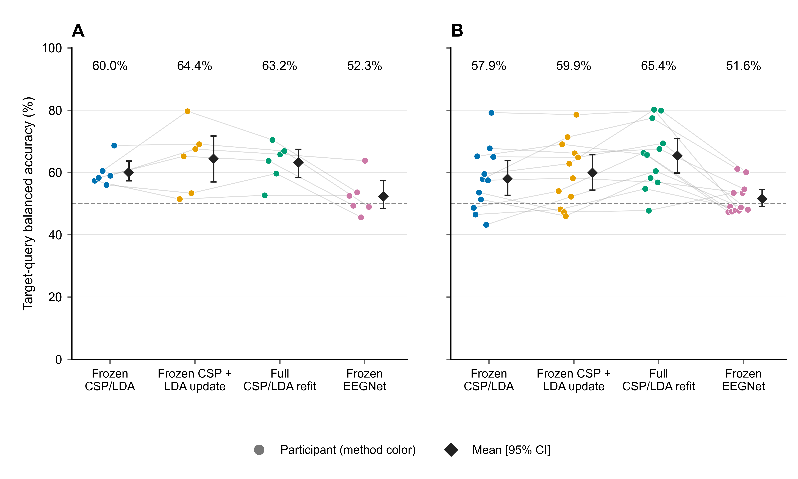
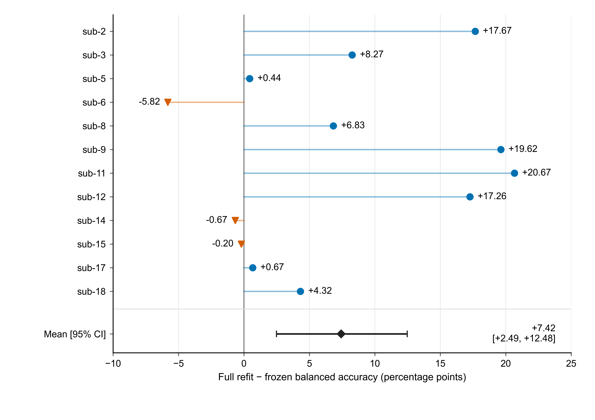
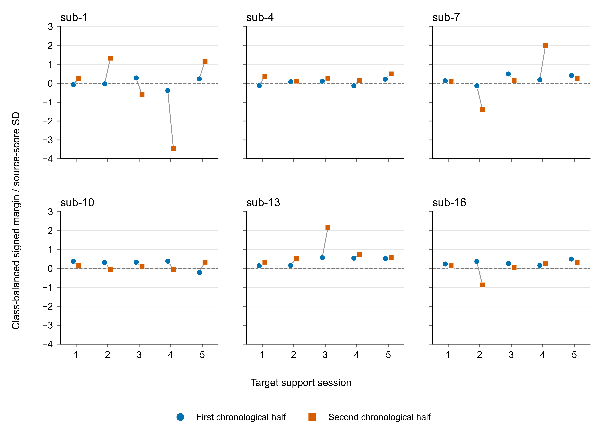
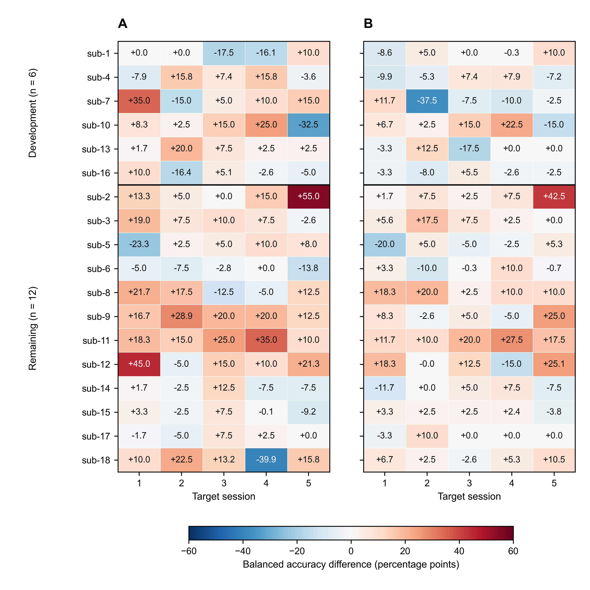
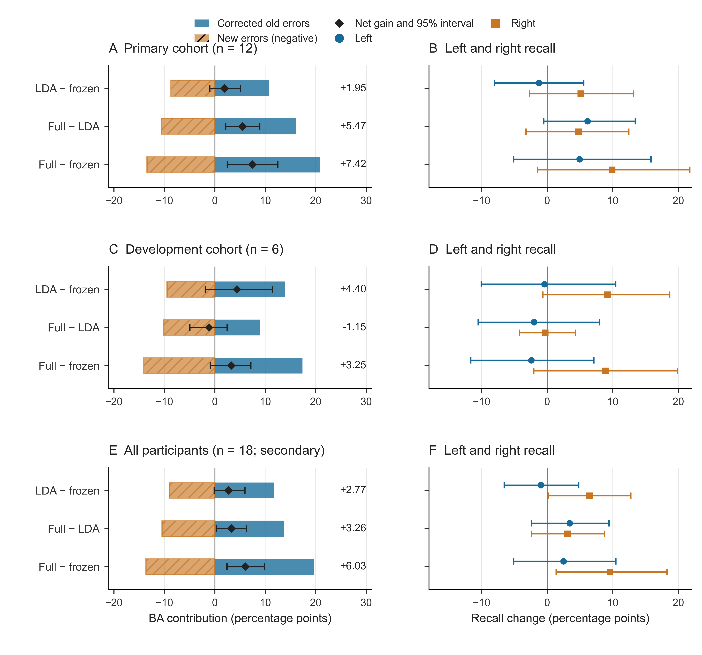
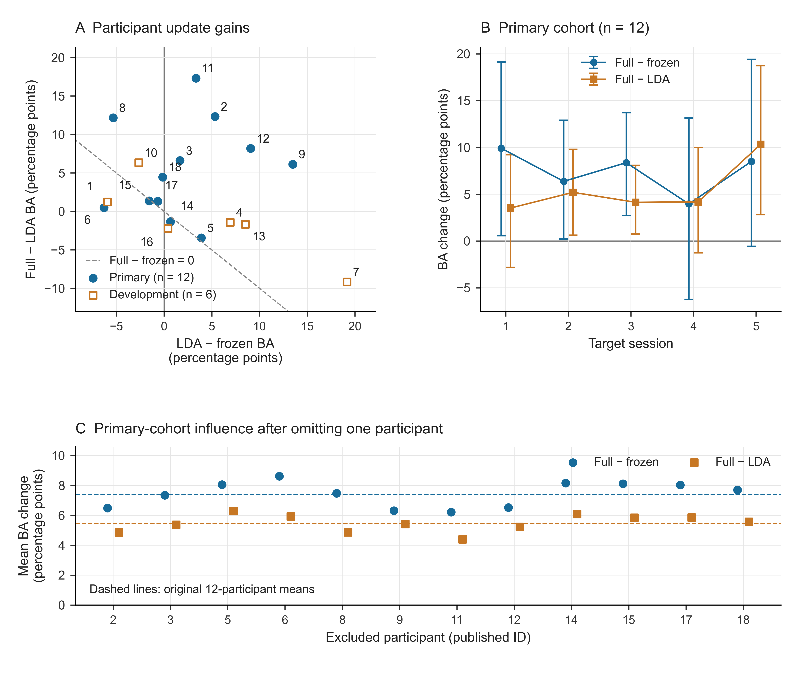

# Spatial-filter refitting improves limited-label recalibration in longitudinal motor-imagery EEG

**Short title:** Spatial-filter updating with limited calibration labels

**Ziyuan Zhu**

College of Artificial Intelligence Medicine, Chongqing Medical University, Chongqing, China

**Corresponding author:** Ziyuan Zhu; zzy2630816871@gmail.com

**ORCID:** https://orcid.org/0009-0005-1153-4926

## Abstract

Short calibration runs force longitudinal EEG decoders to learn from few new labels. We quantified the value of updating the spatial representation after accounting for classifier recalibration and examined the prediction changes producing that value. Using Kumar2024, we compared frozen common spatial patterns and linear discriminant analysis (CSP/LDA), LDA-only recalibration, and full CSP/LDA refitting across 18 participants and six sessions. Both updating methods used the same 40 source labels and 19 or 20 current-session labels. Six predefined participants formed the development group and 12 the primary cohort. In the primary cohort, full refitting achieved 65.36% balanced accuracy, exceeding frozen decoding by 7.42 percentage points (95% participant-bootstrap interval 2.49–12.48) and LDA-only recalibration by 5.47 points (2.17–8.91). The latter accounted for 73.7% of the mean total gain. An additional prediction-transition analysis resolved this component gain into 16.04 points of corrected errors and 10.57 points of newly introduced errors. Mean left- and right-class recall increased by 6.16 and 4.78 points, respectively. The component gain was positive in ten of 12 participant averages, in each of the five target-session cohort averages, and across all single-participant deletion summaries. Development measurements distinguished calibration-subset agreement from correct task-score orientation: nine of 30 support sessions had opposite orientations between halves. Chronological evaluation, participant-level inference, amplitude sensitivity and complete neural-reference histories supported the comparisons. Spatial-filter refitting therefore contributed most of the observed recalibration gain under matched labels, with mean recall improvements in both classes. The findings identify update location and calibration-measurement direction as concrete targets for efficient longitudinal EEG recalibration.

## Introduction

Longitudinal motor-imagery brain–computer interfaces (BCIs) repeatedly face the same practical constraint: a decoder must be recalibrated with a short run of new labeled EEG. Changes in signal distributions and in their relationship to task labels affect transfer between sessions [@lotte2018]. The available labels can update the classifier, the signal representation, or both. Identifying which component delivers the gain is therefore central to using a small calibration set effectively.

Common spatial patterns (CSP) and linear discriminant analysis (LDA) make these choices directly testable [@ramoser2000; @blankertz2008]. CSP determines the spatial combinations from which class-discriminative power features are extracted; LDA maps those features to a class decision. Refitting LDA changes the decision rule in the source feature space. Refitting both stages also changes the spatial representation. Holding the fitting labels and query trials constant makes the difference between these actions an experimentally defined measure of the added spatial update.

Adaptation research has established several ways to update EEG decoders. Unsupervised LDA adaptation revises classifier parameters [@vidaurre2011lda], while data-space adaptation estimates channel transformations and has been evaluated with the first 20 target trials [@arvaneh2013dsa]. Adaptive CSP updates spatial filters [@song2015acsp]; Euclidean and Riemannian alignment address domain mismatch through signal or covariance transformations [@he2020alignment; @zanini2018alignment]. The Kumar acquisition study combined covariance recentering with a Riemannian classifier, added supervised prototype updates in its personally adjusted recentering method, and examined a recentering-based CSP extension [@kumar2024; @kumar2024correction]. These approaches make update location a meaningful axis for a controlled comparison.

Recent longitudinal work has examined how decoders retain and use information from previous sessions. Wimpff et al. compared continual fine-tuning strategies and combined them with online test-time adaptation [@wimpff2025continual]. A recent preprint compared frozen, expanding-window, rolling-window and cold-start pipelines as labels became available during prequential evaluation [@kozyrskiy2026updates]. These studies examine the timing and history of adaptation. Here, we hold the calibration information fixed and ask how much is gained by re-estimating the spatial filters when the classifier already receives the same new labels.

We evaluate this question across six sessions of Kumar2024, using 40 source-training trials and the first 19 or 20 complete trials of each later session for recalibration. Frozen CSP/LDA, LDA-only recalibration and full CSP/LDA refitting are evaluated on identical subsequent query trials. The predefined primary contrast measures full refitting against freezing; the secondary contrast measures full refitting against LDA-only recalibration under matched labels. Our contributions are as follows:

1. **Quantifying the value of the spatial update.** In the 12-participant primary cohort, full refitting added 5.47 percentage points beyond LDA-only recalibration, accounting for 73.7% of its 7.42-point total mean gain over freezing. This result identifies spatial-filter updating as a major contributor to effective short-run recalibration.
2. **Explaining the gain at the prediction level.** We decompose paired accuracy changes into corrected and newly introduced errors on the same query trials. The spatial update improved mean recall for both task classes, clarifying how its net benefit arose beyond the aggregate accuracy score.
3. **Testing the consistency of the component advantage.** Participant-level inference, five target-session profiles, single-participant deletion summaries and amplitude-based sensitivity assess the gain across complementary views of the longitudinal data. The spatial-refit advantage remained positive in every target-session cohort average and every participant-deletion summary.
4. **Distinguishing measurement agreement from task orientation.** Source/support-only probes show that agreement between calibration subsets and alignment with the intended class direction are separate properties. Their joint assessment provides a concrete diagnostic basis for developing session-specific update decisions.

The analysis connects an interpretable component comparison with trial-level error accounting and longitudinal checks. A fully reported source-only EEGNet reference [@lawhern2018] and public saved-result reconstruction complement this evidence.

## Materials and methods

### Data source and ethics

We analyzed the public Kumar2024 EEG derivative, NEMAR nm000177/v1.0.5 [@nemar177], associated with the original study and its correction [@kumar2024; @kumar2024correction]. The original study reported University of Texas at Austin ethical approval under protocol 2020-03-0073 and written informed consent before data collection.

For this secondary analysis, the research administration office at Chongqing Medical University confirmed on 16 October 2026 an exemption from additional ethical review under Article 32, item (1), of China's *Measures for Ethical Review of Life Science and Medical Research Involving Human Participants* (2023) [@china2023ethics]. The confirmation, recorded through the author's report, covered lawfully obtained public data under the provision's conditions concerning harm, sensitive personal information and commercial interests. It carried no reference number.

Dataset metadata were accessed on 10 October 2026, and the selected EEG recordings and accompanying metadata were retrieved on 11 October 2026. This secondary analysis used the released coded participant identifiers; no participants were contacted and no re-identification was attempted. Original collection approval and consent and the institutional secondary-use confirmation are documented separately in S2 Text.

### Analysis windows and chronological partition

The derivative contains 18 participant identifiers, six sessions and 360 EDF recordings. Of 7,200 exported left/right events, 7,156 provided complete five-second windows. The remaining 44 reached the recording boundary before five seconds and were excluded without padding. All 44 occurred at the last event of an online recording.

The analyzed windows began at the exported class annotation. The original codebook assigns 769/770 to left/right cues and 7691/7701 to task starts [@kumarcodebook]. The documented MOABB adapter maps the cue codes to a [0,5]-second interval [@jayaram2018]. This establishes the cue-anchored convention used to interpret the released windows. The original task included a 1.5-second cue before feedback, with a five-second offline task period and up to seven seconds of online feedback. Accordingly, the analysis endpoint is task-label decoding over the released cue windows. S1 Text, S7 documents the source event definitions, acquisition schedule and subsequent event mapping.

Participants sub-1, 4, 7, 10, 13 and 16 formed the development group. The remaining 12 formed the predefined primary cohort, allocated by numeric identifier before examination of these results. In session 0, runs 0 and 1 supplied 40 source training windows, run 2 supplied 20 source-validation windows, and run 3 supplied source query. In each of five later sessions, run 0 supplied support and the remaining whole runs supplied query.

Each recalibration used source training plus the current session's support. Previous target-session labels were not accumulated. After exclusion of partial windows, support comprised 19 or 20 events per target session, totaling 1,786. The query set contained 4,290 events: 360 source and 3,930 target. Thirty partial query events were excluded. The chronological partition followed the released recording order and was checked against the derivative timestamps.

### Preprocessing and amplitude flag

Each epoch underwent common-average referencing across 22 channels, fourth-order 8–30 Hz Butterworth zero-phase filtering, and polyphase resampling from 512 to 128 Hz. The resulting tensor contained 22 × 640 float32 values in volts. These epoch-local operations used fixed settings; learned transformations were fitted within the training partitions described below. The zero-phase filter defines an offline decoding procedure.

An existing threshold of 250 µV for the maximum raw channel peak-to-peak amplitude flagged 1,512 of 7,156 complete windows. The primary analysis retained all complete windows. A subsequent sensitivity analysis used the same flag to evaluate saved predictions on unflagged queries. S1 Text reports the flag prevalence in every data partition and the retained class counts.

### Decoders and label budgets

The CPU pipeline combined four-component CSP with Ledoit–Wolf covariance regularization, log mean-square features and norm_trace=False, followed by shrinkage LDA (solver=lsqr, automatic shrinkage) [@ledoit2004]. A single configuration defined all CPU comparisons:

- **Frozen CSP/LDA:** both components were fitted to the 40 source training windows and then held fixed.
- **LDA-only recalibration:** source CSP was retained and LDA was refitted using source training plus current support.
- **Full CSP/LDA refitting:** both components were refitted using the same source-training/current-support union.

CPU fitting and parameter selection used training/support identities exclusively. The identical labeled fitting sets in the two updating methods make their contrast a direct comparison of the added spatial-filter update within CSP/LDA.

EEGNet used the Braindecode implementation [@lawhern2018; @schirrmeister2017], with F1=4, D=2, F2=8 and dropout 0.5. Optimization used Adam, a learning rate of 0.001, batch size 16 and at most 100 epochs. Channel means and scales were fitted on source training. Source-validation cross entropy selected the earliest best epoch with patience 15, and the selected model state was restored. Three seeds (20261012, 20261013 and 20261014) were retained for every participant. Query inference used evaluation mode with model parameters, batch-normalization buffers and normalization statistics fixed.

Table 1 summarizes the labeled data used by each method.

**Table 1. Labeled-data use per participant.**

| Method | Source training | Source-validation use | Current target support for fitting |
| --- | --- | --- | --- |
| Frozen CSP/LDA | 40 labeled windows | None | 0 |
| LDA-only recalibration | 40 labeled windows, combined with current support for LDA | None | 19/20 labeled windows |
| Full CSP/LDA refitting | 40 labeled windows, combined with current support for both stages | None | 19/20 labeled windows |
| Frozen EEGNet | 40 labeled windows per seed | 20 labeled windows for epoch selection | 0 |

The two CPU update methods share the adaptation budget. Their comparison with freezing measures the benefit of adding support labels and refitting the specified components. EEGNet supplies a source-only neural reference with the additional validation budget shown in Table 1. S1 Text, S3 gives the complete implementation settings.

### Endpoints and statistical analysis

Balanced accuracy (BA) was the mean of the two class recalls. The primary endpoint was each participant's mean BA over five target sessions, and the primary contrast was full CSP/LDA refitting minus frozen CSP/LDA in the 12-person primary cohort. Full refitting minus LDA-only recalibration was the predefined secondary component contrast. For EEGNet, seed scores were averaged within participant/session before averaging the five sessions. Source-query performance was reported separately.

Participants were the independent statistical units. We used 10,000 participant bootstrap resamples with seed 42 for 95% percentile intervals, resampling paired participant differences for method contrasts. The development and primary cohorts were reported separately; all-18 summaries were secondary. Session-level drift associations used 2,000 participant-block resamples, retaining each sampled participant's five sessions. The resampling unit and endpoint weighting were retained for every cohort summary.

The original endpoint hierarchy and cohort allocation preceded the reported results. Later QC, influence and post-review statistical checks were exploratory after inspection of those results. The latter checks enumerated all $2^n$ sign assignments for four saved participant-level contrasts: full minus frozen, full minus LDA-only, and LDA-only minus frozen in the primary cohort, plus full minus frozen in the ten-person unflagged sensitivity. The statistic was the absolute mean paired difference, with a $10^{-12}$ tolerance in BA units at the tail boundary. This reference construction assumes independent participant differences with sign symmetry about zero. We report unadjusted values and Holm adjustment across the four checks. S1 Text, S11 specifies the enumeration and its relationship to the original bootstrap intervals.

### Sensitivity and influence analyses

Saved predictions were joined to the existing amplitude flag by exact trial identity, role, true label and inclusion status. BA required both true classes in each session; the participant target endpoint required valid BA in all five sessions. Empty or single-class subsets remained explicitly undefined. We reported the unflagged complete-case results and paired full-query/unflagged differences within the same eligible participants.

These computations reused saved predictions and the original fitted models. Source training, validation and support data were unchanged. Supplementary pooled-query endpoints used their own stated denominators. Leave-one-participant-out means assessed the influence of each participant on the primary estimate. Full definitions and class counts appear in S1 Text and S1 Data.

### Task measurements and calibration reliability

We assessed two measures of session change relative to source query. The task-axis measure used the source-trained, normalized difference between class means in standardized 44-dimensional mu/beta log-power coordinates; one-dimensional Wasserstein distance measured change along this axis. The covariance-shape measure used a source-training Riemannian reference in a fixed 21-dimensional common-average-reference basis, with trace normalization and fixed shrinkage. It captures normalized covariance shape. Target labels entered the BA outcome, while the drift predictors used the corresponding signal distributions.

The outcome was target-minus-source frozen-decoder BA. Associations pooled within- and between-participant variation and shared a source-query reference across each participant's five target sessions. The participant-block bootstrap preserved that clustering. These query-distribution associations served as retrospective descriptions.

Development-only reliability probes used source training and current support. Fixed power, PCA and supervised CSP-score measurements were evaluated using source-run grouping, chronological support halves and cyclic-label controls. Each source-run probe trained on one 20-event run and evaluated the other, then reversed the roles. All learned transformations, including CSP and LDA, were fitted within the training fold.

Support measurements used the source models fitted on 40 training events, with source-fitted coordinate scales. Each class was divided into chronological halves within the support run. Vector cosines and signed source-score contrasts measured agreement and class orientation. Cyclic controls enumerated prescribed label phases within run grouping and were interpreted as alignment sensitivities. All 240 supervised fold/rotation pipelines were retained. S1 Text, S4–S6 specifies half sizes, score orientation, controls and degenerate cases.

### Prediction-transition and component-consistency analyses

We added an exploratory analysis of the saved CPU predictions to explain how each update changed class decisions. For two methods A and B evaluated on the same trials, the correction contribution was one half of the sum, over the two true classes, of the fraction classified incorrectly by A and correctly by B. The introduced-error contribution used the reverse transition. Their difference equals BA(B) − BA(A) exactly. We computed all three contrasts: frozen to LDA-only, LDA-only to full refitting, and frozen to full refitting. Left- and right-class recalls were also analyzed separately.

Within each participant, the five session contributions received equal weight. Cohort means and paired percentile intervals then used 10,000 participant bootstrap resamples with seed 42. Development, primary and all-participant results were retained. Single-participant deletion summaries assessed the influence of each primary participant on the component contrast; separate cohort means for each target session described its time profile. The ratio of the mean component gain to the mean total gain reports their arithmetic decomposition. S1 Text, S12 defines the identities, denominators, reconstruction checks and complete outputs. This analysis was specified after the original results were available and supplements the original endpoint hierarchy.

### Training-history review and AI assistance

We examined all saved EEGNet training/validation histories, selected epochs, seed-level outcomes and source/target query metrics. Training loss was accumulated while parameters changed in training mode; validation loss was evaluated after each epoch. Their different computation conditions informed interpretation of the histories.

OpenAI ChatGPT/Codex assisted with software, validation, saved-result aggregation, figures, source and reference checks, manuscript drafting and editing, and document exports. Verification included trial-identity joins and hashes, reconstruction of the original endpoints, independent implementations of the prediction-transition arithmetic, public-input replay, and visual review of the documents and figures. The software and editorial checks were AI-assisted. The author is responsible for the manuscript's content.

## Results

### Full refitting increased decoding accuracy under limited calibration

Full CSP/LDA refitting achieved the highest cohort-average target BA in the predefined primary cohort (Table 2). Its 65.36% BA exceeded frozen decoding at 57.94%, giving the primary gain of 7.42 percentage points (95% interval 2.49–12.48). Under the same source and current-support labels, full refitting exceeded LDA-only recalibration at 59.89% by 5.47 points (2.17–8.91). LDA-only recalibration improved the mean over freezing by 1.95 points (−0.98–5.09). The matched-label comparison identifies additional value from refitting the spatial representation within the evaluated pipeline.

**Table 2. Target-query balanced accuracy (%, mean across five sessions within participant).**

| Cohort | n | Frozen CSP/LDA | LDA-only recalibration | Full CSP/LDA refitting | Frozen EEGNet |
| --- | ---: | ---: | ---: | ---: | ---: |
| Development | 6 | 59.97 [57.34, 63.70] | 64.37 [56.97, 71.75] | 63.22 [58.36, 67.40] | 52.31 [48.43, 57.36] |
| Predefined primary cohort | 12 | 57.94 [52.65, 63.84] | 59.89 [54.30, 65.68] | 65.36 [59.81, 70.90] | 51.58 [49.08, 54.51] |
| All participants, secondary | 18 | 58.62 [54.88, 62.68] | 61.38 [56.79, 66.17] | 64.65 [60.53, 68.71] | 51.82 [49.59, 54.36] |

n denotes participants. Brackets give 95% participant-bootstrap intervals. EEGNet averages all three seeds within session. Labeled-data budgets are specified in Table 1. Fig 1 shows the participant-level distributions.

{width=100%}

**Fig 1. Target-query decoding by participant.**

\(A) Six development participants. (B) Twelve primary participants. Each colored point represents one participant's mean BA over five target sessions; faint lines connect the same participant across methods. EEGNet averages three seeds within session. Diamonds and bars show cohort means and 95% participant-bootstrap intervals (10,000 resamples, seed 42). All methods were evaluated on the same query identities. The two CPU updating methods used identical source-training and current-support labels; the other information budgets are given in Table 1. Figure preparation used OpenAI ChatGPT/Codex assistance with the saved numerical inputs.

### Update gains varied across participants and sessions

Full refitting improved nine of 12 primary participant averages (Fig 2). The largest gains were +20.67 points for sub-11, +19.62 for sub-9 and +17.67 for sub-2; the other three participants had changes of −5.82, −0.67 and −0.20 points for sub-6, sub-14 and sub-15, respectively. Removing one participant at a time yielded cohort mean gains from +6.22 to +8.62 points, showing that the positive average persisted across all leave-one-participant-out summaries.

The component contrast favored full refitting in ten of 12 primary participants. Development-cohort means were +3.25 points (−0.90–7.14) for full versus frozen and −1.15 points for full versus LDA-only, with two positive and four negative participant component differences. Table 2 retains the two predefined cohorts and the all-participant summary.

Across the primary cohort's 60 target sessions, full refitting exceeded freezing in 39 sessions, fell below it in 18 and tied in three. These observations describe the distribution underlying the participant-level means.

{width=100%}

**Fig 2. Full-refit gain over frozen decoding in the primary cohort.**

Each value is a participant's mean paired BA difference across five target sessions. Participants appear in numeric order. Nine differences are positive and three negative, with a cohort mean of +7.42 percentage points and a 95% participant-bootstrap interval of +2.49 to +12.48. Full refitting used 19/20 current-session support labels in addition to the 40 source training labels. The figure displays observed individual differences; statistical checks concern participant-level cohort contrasts. Figure preparation used OpenAI ChatGPT/Codex assistance with the saved numerical inputs.

### The neural reference retained all scheduled fits and seed outcomes

All 54 scheduled EEGNet fits contributed to the source-only neural reference. Primary-cohort BA was 52.92% on held-out source query and 51.58% across target sessions; the corresponding CPU source-query BA was 65.00% (Table 3).

**Table 3. Source-query balanced accuracy (%, participant mean and 95% interval).**

| Cohort | n | CPU source model, shared across the three update conditions | Frozen EEGNet |
| --- | ---: | ---: | ---: |
| Development | 6 | 60.83 [54.17, 68.33] | 52.78 [47.50, 59.44] |
| Predefined primary cohort | 12 | 65.00 [56.67, 74.17] | 52.92 [48.89, 58.75] |
| All participants, secondary | 18 | 63.61 [57.50, 70.28] | 52.87 [49.44, 57.22] |

All 54 fits and all three seeds contributed to the reported neural endpoints. S1 Text and S1 Data provide the complete training histories, stopping records and seed-specific results.

### Calibration agreement and task orientation carried distinct information

In the primary cohort, the Spearman associations of covariance-shape change and source-task-axis Wasserstein distance with frozen BA change were −0.007 (−0.505–0.438) and 0.197 (−0.240–0.518), respectively. These measures summarize the relation between signal-distribution change and frozen-decoder performance.

Development power, PCA and motor-band probes achieved mean source BA of 51.67%, 50.00% and 54.17%, with intervals including 50%. Supervised CSP/LDA source-run probes achieved 62.9167% (52.5–71.6667). The participant-averaged support-vector cosine was 0.295325 (0.032041–0.573003). Signed scores separated two properties of short-run calibration: agreement between subsets and class orientation relative to the source decoder. Among 30 support sessions, both half-contrasts were positive in 19, both were negative in two, and the signs differed in nine (Fig 3). Five support sessions had single-class source-score predictions. The two double-negative sessions demonstrate that agreement can coexist with reversed class orientation; the nine opposite-sign sessions identify changes in the sampled direction. Both quantities are needed to characterize the task information available from a short support run.

{width=100%}

**Fig 3. Task-score orientation across chronological support halves.**

Each development participant contributes five target support sessions. Circles and squares represent the first and second halves within class. Values are class-balanced contrasts of frozen source-LDA scores divided by twice their source-score standard deviation. The shared zero line separates positive and reversed class orientation. Nineteen sessions have two positive margins, two have two negative margins and nine have opposite signs. The analysis uses source/support data to describe calibration-measurement reliability. Figure preparation used OpenAI ChatGPT/Codex assistance with the saved numerical inputs.

### Longitudinal profiles and amplitude sensitivity

Fig 4 displays the full set of participant/session gains for both the total refit contrast and the matched-label component contrast. The session profiles extend the cohort summary by showing positive, negative and zero changes under the same comparison.

{width=100%}

**Fig 4. Session-level gains from full CSP/LDA refitting.**

Cells show BA differences on identical query trials: (A) full refitting minus freezing and (B) full refitting minus LDA-only recalibration. Both panels include 18 participants and five target sessions. A horizontal line separates development and primary cohorts. Participants remain in numeric order within each cohort. The symmetric color scale is shared, and values are displayed in percentage points to one decimal. Exact differences and query counts are supplied in the figure source-data CSV. Participant-level averages define the inferential endpoints. Figure preparation used OpenAI ChatGPT/Codex assistance with the saved numerical inputs.

The amplitude sensitivity in Table 4 identified 922 flagged query windows (36 source and 886 target), leaving 3,368 unflagged. Ten primary participants retained valid BA for all five target sessions. Sub-8 had no unflagged queries in sessions 3 and 4; sub-12 retained only four target queries, all from the left class. Their unflagged five-session endpoints were therefore undefined under the specified class-coverage rule.

**Table 4. Exploratory amplitude-QC sensitivity of target-session BA (%, participant intervals).**

| Method | All queries, original 12 participants | Unflagged queries, 10 eligible participants |
| --- | ---: | ---: |
| Frozen CSP/LDA | 57.94 [52.65, 63.84] | 60.14 [54.75, 66.02] |
| LDA-only recalibration | 59.89 [54.30, 65.68] | 62.28 [56.21, 67.91] |
| Full CSP/LDA refitting | 65.36 [59.81, 70.90] | 66.10 [59.84, 71.94] |
| Frozen EEGNet | 51.58 [49.08, 54.51] | 51.80 [48.34, 55.28] |

The columns describe different participant sets. Paired sensitivity changes were calculated within the same ten eligible participants.

In those ten participants, the unflagged full-minus-frozen contrast was +5.96 points (0.99–11.24), and full-minus-LDA-only was +3.82 (1.11–6.72). Their full-query contrasts were +6.50 and +4.53 points. Thus, restricting queries to the unflagged subset changed the contrasts by −0.54 (−1.30–0.16) and −0.71 (−2.11–0.42) points, respectively. Positive mean gains were retained in this eligible subset. Session class counts, low-count subsets and the distinct pooled-query endpoints are documented in S1 Text and S1 Data.

### Paired statistical checks supported assessment of the component contrast

The post-review sign-flip checks are summarized in Table 5. The matched-label component contrast had an unadjusted two-sided p value of 0.01025 and a four-comparison Holm value of 0.04102. The primary total-gain contrast had corresponding values of 0.01953 and 0.05859. Table 5 presents the complete four-contrast family in its original order.

**Table 5. Post-review exploratory participant-level sign-flip checks.**

| Paired contrast and subset | n | Unadjusted two-sided p | Holm p, four checks |
| --- | ---: | ---: | ---: |
| Full refit − frozen, original primary cohort | 12 | 0.01953 | 0.05859 |
| Full refit − LDA-only, same primary cohort | 12 | 0.01025 | 0.04102 |
| LDA-only − frozen, same primary cohort | 12 | 0.26123 | 0.26123 |
| Full refit − frozen, unflagged eligible subset | 10 | 0.07617 | 0.15234 |

All sign assignments were enumerated using the stated numerical tolerance. The unflagged ten-person contrast had a positive percentile-bootstrap interval and an unadjusted sign-flip p value of 0.07617; the interval and test use different reference constructions. These exploratory checks complement the effect estimates and their uncertainty.

### Spatial refitting increased mean recall for both task classes

The prediction-transition analysis explains the 5.47-point component gain on identical query trials (Fig 5). Relative to LDA-only recalibration, full refitting contributed 16.04 BA points by correcting prior errors and 10.57 points in the reverse direction, leaving the observed net gain. For the primary cohort, the two successive contrasts were +1.95 points from frozen to LDA-only and +5.47 from LDA-only to full refitting. The spatial-update contrast thus accounted for 73.7% of the 7.42-point mean total gain.

{width=100%}

**Fig 5. Prediction changes underlying recalibration gains.**

Rows show the primary cohort (12 participants), development cohort (six), and their all-participant union (18). (A, C, E) Blue bars show class-balanced correction contributions and hatched orange bars show introduced errors with negative sign; their sum is the net BA change. Diamonds and bars indicate the net means and 95% participant-bootstrap intervals. (B, D, F) Left- and right-class recall changes use the same weighting. All three contrasts are displayed. Each participant contributes the equal mean of five target sessions; intervals use 10,000 resamples with seed 42. These are exploratory analyses of saved predictions. Figure preparation used OpenAI ChatGPT/Codex assistance and checked numerical inputs.

Class-specific recalls show how the additional spatial update distributed its benefit (Table 6). LDA-only recalibration changed left recall by −1.23 points and right recall by +5.13 points relative to freezing. Adding spatial refitting increased mean left and right recall, by +6.16 and +4.78 points. The resulting full-refit gains over freezing were +4.93 and +9.91 points. The component advantage therefore accompanied higher cohort-average recall for both labels.

**Table 6. Primary-cohort class recall changes and their balanced-accuracy mean.**

| Contrast | Left recall change | Right recall change | BA change |
| --- | ---: | ---: | ---: |
| LDA-only − frozen | −1.23 [−8.03, 5.59] | 5.13 [−2.67, 13.15] | 1.95 [−0.98, 5.09] |
| Full refit − LDA-only | 6.16 [−0.51, 13.42] | 4.78 [−3.21, 12.44] | 5.47 [2.17, 8.91] |
| Full refit − frozen | 4.93 [−5.10, 15.83] | 9.91 [−1.46, 21.75] | 7.42 [2.49, 12.48] |

Values are percentage points, averaged equally across five sessions within participant and then across 12 participants. BA change equals the average of the two class-recall changes. Brackets give pointwise 95% participant-bootstrap intervals (10,000 resamples, seed 42). Complete cohort-specific values are supplied in S1 Data.

### The component advantage extended across all five target-session averages

The primary-cohort mean full-minus-LDA-only gain was positive in each target session: +3.52, +5.20, +4.13, +4.18 and +10.33 points in sessions 1–5 (Fig 6). Recomputing the five-session cohort endpoint after deleting each participant in turn gave means from +4.39 to +6.28 points. These profiles show that the average component benefit extended across the session sequence and was retained after removal of every individual participant. The corresponding joint-gain and complete cohort tables preserve the participant and session variation around these averages.

{width=100%}

**Fig 6. Consistency of the spatial-update advantage.**

(A) Each point gives one participant’s mean LDA-only-minus-frozen gain (horizontal) and full-minus-LDA-only gain (vertical) across five sessions. Circles show the primary cohort and open squares the development cohort; numbers identify participants. The dashed line marks zero total gain. (B) Primary-cohort session means for the full-minus-frozen and full-minus-LDA-only contrasts, with 95% participant-bootstrap intervals (12 participants; 10,000 resamples; seed 42). (C) Cohort means after deleting each indicated primary participant, with 11 participants per point; dashed lines give the original 12-participant means. The session profiles and deletion summaries describe repeated-session variation and participant influence. All values are supplied in S1 Data. Figure preparation used OpenAI ChatGPT/Codex assistance and checked numerical inputs.

## Discussion

### Spatial refitting supplied the larger mean recalibration increment

Spatial-filter refitting contributed 5.47 percentage points beyond LDA-only recalibration in the primary cohort, while the total improvement over freezing was 7.42 points. The 73.7% share places the component choice at the center of the result: the larger part of the mean gain appeared when the spatial representation was re-estimated using the same labeled examples already available to the classifier. With a short current-session run, those labels supported a useful change in the feature space as well as in the decision rule.

The three-arm design is important for interpreting this result. Frozen versus full refitting quantifies the practical gain from supervised recalibration. LDA-only versus full refitting compares two ways to use identical fitting information. Their paired contrast isolates the added spatial update within the CSP/LDA pipeline, including the subsequent LDA fit in the revised feature space. The gain decomposition follows directly from those contrasts and makes the contribution of update location explicit.

### Prediction transitions linked the gain to higher mean recall for both classes

Aggregate accuracy combines beneficial and adverse prediction changes. Accounting for those changes on the same trials shows how the spatial-refit advantage arose: 16.04 points of corrected errors outweighed 10.57 points of newly introduced errors. The net result was +5.47 points. This accounting can be reproduced exactly from the saved class decisions, giving a direct connection between the summary gain and the trials contributing to it.

The class-specific analysis further distinguishes the two updating actions. LDA-only recalibration produced a predominantly right-class gain, whereas adding spatial refitting improved cohort-mean recall for both labels. Inspecting correction contributions alongside class recalls provides a useful way to compare recalibration methods whenever a single accuracy average could conceal different changes in the two classes.

### Longitudinal and sensitivity checks reinforced the cohort finding

The spatial-refit advantage was present in ten of 12 primary participant means and in all five target-session cohort averages. Every single-participant deletion summary also retained a positive mean, between +4.39 and +6.28 points. Together, these checks show that the component finding extended across the measured session sequence and persisted throughout the participant-influence analysis.

The component gain also remained positive under the specified query-amplitude restriction in participants with complete class coverage.

The development group, participant differences and session trajectories remain informative for choosing future updates. The mean component contrast was −1.15 points in development and +5.47 in the primary cohort; individual target-session gains also changed direction. These data support treating the expected benefit of an action as a distinct quantity to estimate. A useful selection target is the gain from an LDA-only or full update relative to the available alternatives, with current source/support information supplying the decision inputs.

### Short-run measurements require both agreement and class orientation

The support analysis identifies two complementary properties for those decision inputs. Nineteen development sessions had positive task-score contrasts in both chronological halves, two had negative contrasts in both, and nine had opposite signs. The double-negative cases show that agreement alone can describe a consistently reversed task direction. The opposite-sign cases reveal sensitivity of the estimated direction to which calibration trials are used.

This distinction gives the reliability analysis a concrete role in recalibration research. A calibration measurement should be examined for agreement across subsets and for orientation relative to the intended class labels. Combining those diagnostics with the observed component gains creates a clear basis for testing support-driven update selection. The present results also make the fixed comparators explicit: preserve the source model, recalibrate the classifier, or refit both stages.

### Scope and further evaluation

The present evidence comes from cue-anchored offline decoding in one 18-participant dataset, with the added decompositions and sensitivity checks treated as exploratory; phase-specific signals, independent cohorts and prospective update selection define the next validation targets, while the neural reference is tied to its recorded source-only budget.

## Conclusions

Spatial-filter refitting contributed most of the observed limited-label recalibration gain in the primary longitudinal EEG cohort. Full CSP/LDA refitting improved BA by 7.42 points over freezing and by 5.47 points over classifier-only recalibration with identical labels. Prediction-transition analysis linked the component advantage to net error correction and higher mean recall for both task classes, and its positive cohort mean persisted across all five target sessions and every participant-deletion summary. These findings make update location a central design choice for short-run recalibration and identify calibration agreement and task-score orientation as complementary measurements for developing session-specific update decisions.

## Data and code availability

The source EEG is available as NEMAR nm000177/v1.0.5, DOI 10.82901/nemar.nm000177.v1.0.5, under CC BY 4.0 [@nemar177]. S1 Data contains saved predictions, trial/QC metadata, participant and session summaries, training histories, reliability/drift records, statistical checks and figure data. Its scripts reproduce saved-result arithmetic from these inputs. S1 Text defines the methods; S2 Text provides data provenance and reproduction instructions.

Code, configurations and versioned materials are available at https://github.com/jackzhu119/few-shot-mi-eeg. The scientific results are preserved at the tag paper2-plos-source-20261016, with the institutional-exemption revision at paper2-plos-ethics-20261016. This manuscript and its supplements form the 17 October 2026 extended analysis in manuscript/plos_one_innovation_20261017/. Its README identifies the source versions, new prediction-transition code, figure inputs and generated files. S1 Data includes the original saved-result package together with the new component analyses and complete cohort tables.

Original project software is licensed under MIT; original manuscript content, figures and derived results are licensed under CC BY 4.0. LICENSING.md describes the scope and third-party terms. Source annotations retain their NEMAR attribution.

## Author contributions

Ziyuan Zhu: Conceptualization; Methodology; Software; Formal analysis; Validation; Visualization; Writing – original draft; Writing – review & editing.

## Acknowledgments

The author acknowledges the researchers who made the Kumar2024 EEG records and accompanying documentation publicly available.

## References

::: {#refs}
:::

## Supporting information captions

**S1 Text. Detailed scientific methods and sensitivity analyses.**

Data partitions, preprocessing, decoder settings and label budgets, participant-level statistics, calibration-reliability measures, event-phase evidence, amplitude sensitivity, training summaries and prediction-transition definitions.

**S2 Text. Data provenance and reproducibility.**

Source versions, data-package contents, saved-output reconstruction, reproduction commands and verification records.

**S1 Data. Saved results and underlying figure data.**

Predictions, event/QC metadata, endpoints, training histories, reliability/drift results, statistical checks, prediction-transition and class-recall tables, component-consistency summaries, six figure datasets and reproduction code.
