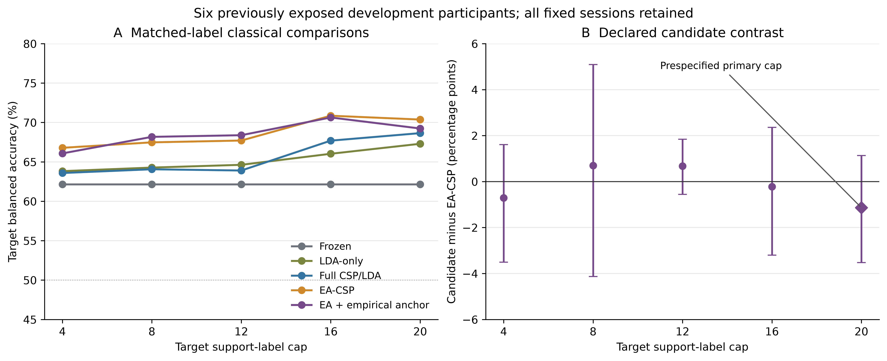
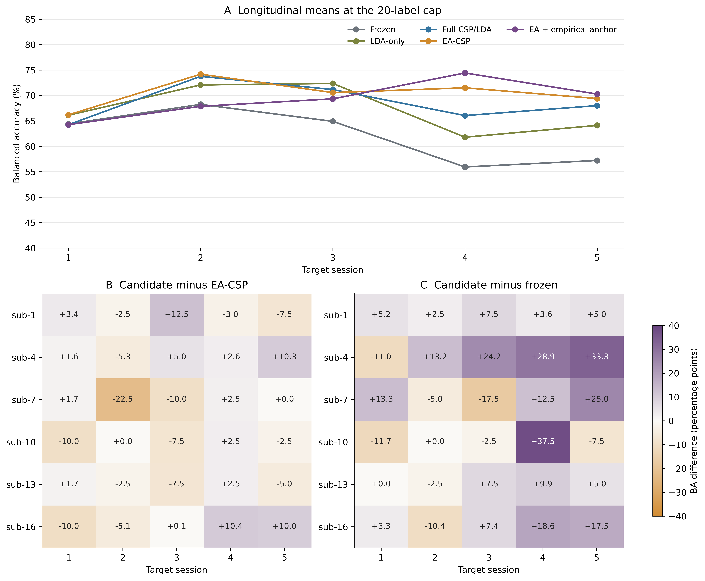
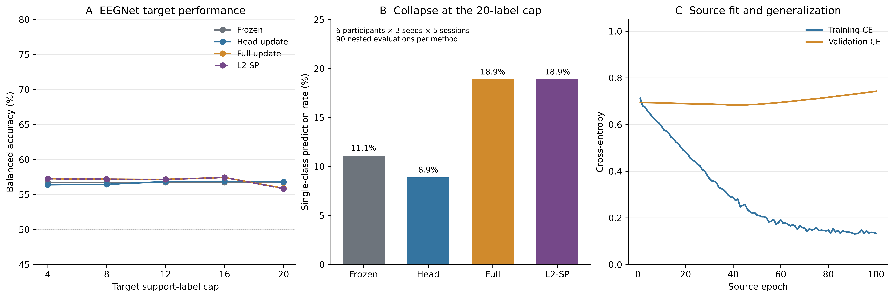
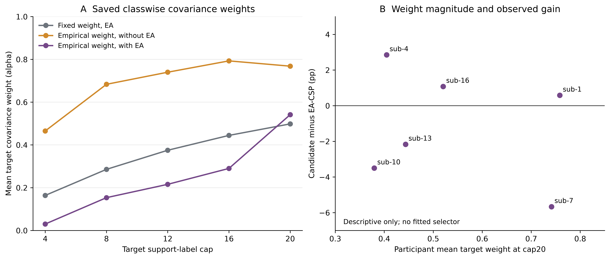

# 本次学校HPC实验分析：重校准有收益，经验锚定尚未超过EA强对照

日期：2026-10-26。数据版本：`paper2-kumar-dev-recalibration-v2-20261023`，完整结果包 `f1689db3941ae31757442698`。

这次实验支持三个结论：**少量目标标签用于经典模型重校准有实际收益；新增经验锚定权重没有表现出相对EA-CSP的额外优势；EEGNet已经在源会话独立query上偏弱，更新网络没有稳定改善。** 这些结论分别来自预设对照、全部固定种子和保存的训练/预测记录。

## 1. 分析范围和可核查性

本次独立统计单位为原开发组6人：sub-1/4/7/10/13/16。6个经典任务与18个神经任务（6人×3个固定种子）组成24项任务；神经任务包含18个新V2源模型和1,350个已保存适配阶段。每人5个目标会话，标签预算4/8/12/16/最多20（上限处实际19或20）。源run0/1拟合，run2验证，run3为独立source query；目标run0的时间顺序前缀用于support，其余完整run作为固定query。BA为两类召回率均值。

所有固定种子先在参与者×会话内平均，再等权平均五会话，最后对参与者配对差计算均值和区间。沿用10,000次参与者bootstrap、seed20261023、原字典序参与者顺序；区间为点态95%区间，无多重比较校正。会话切片、逐一剔除参与者和额外对比明确作为事后描述性分析，不更换主终点。6人此前已暴露，结果属于探索性；24任务、3,024指标或130,980条重复预测评估行都不是新增独立参与者。

原包8,983个payload逐成员长度/SHA256通过；3,024份指标从保存预测独立复算，BA与已记录accuracy最大差均为0；原统计七份CSV完整重现，无缺失cell。见[接收审计](../paper2_hpc_v2_results_received_20261026/REPORT.md)。本分析没有加载EEG、权重、运行forward或新fit，原54模型账本、历史结果及学校任务不变。

## 2. 最大20标签预算下，各方法到底达到多少

| 方法 | 目标BA均值 | 95%参与者bootstrap区间 |
| --- | ---: | ---: |
| 冻结模型 | 62.15% | [57.36,67.04] |
| 仅LDA重校准 | 67.30% | [61.57,73.18] |
| 完整CSP/LDA重校准 | 68.65% | [62.62,75.34] |
| EA-CSP | 70.37% | [64.12,76.27] |
| 固定权重锚定CSP | 69.18% | [63.42,74.61] |
| 经验权重锚定CSP | 65.37% | [60.68,70.06] |
| EA＋固定权重锚定 | 70.35% | [64.16,76.54] |
| EA＋经验权重锚定（新方法） | 69.24% | [63.56,74.65] |
| EEGNet冻结 | 56.74% | [54.60,59.27] |
| EEGNet仅分类头更新 | 56.81% | [54.61,59.35] |
| EEGNet全网络更新 | 55.89% | [53.24,57.90] |
| EEGNet L2-SP | 55.83% | [53.20,57.84] |

区间重叠本身不决定方法差异；下文使用配对差区间。经典/神经的家族内对照和适配实现分别解释，不将全部模型当作一次同质模型排行榜。新V2使用独立架构和实现，不把它与原12人/原54模型的历史均值直接相减当作算法改进。

## 3. 主要阳性结果成立，但不能替代新方法的主要对照

新方法相对冻结模型平均增加 **7.09个百分点 [4.12,11.55]**，6人平均差全部为正，范围+3.17至+17.72pp。去掉收益最大的sub-4后，其余5人的平均收益仍为 **+4.96pp**；因此这项收益并非只由一个参与者支撑。完整CSP/LDA重校准相对冻结同样改善 **+6.50pp [3.24,9.39]**。

真正针对新增经验权重的预设主比较是 **新方法−EA-CSP，20标签上限：−1.14pp [−3.52,+1.14]**。6人中3人提高、3人下降，1人下降至少5pp；逐一去掉任意一人后，均值仍在−1.93至−0.23pp之间。现有证据没有证明新增经验权重优于EA-CSP；区间也没有证明两者等效。

同样EA之下，新方法相对固定权重锚定为 **−1.11pp [−4.27,+2.07]**，没有显示动态经验权重的增量收益。对完整CSP/LDA的平均差虽为 **+0.59pp [−4.77,+6.52]**，但仅2人提高、4人下降，其中2人下降至少5pp；去掉单人后均值可正可负，不能只报告这个微小正平均。

补充描述性比较：完整CSP−仅LDA为 **+1.35pp [−1.57,+4.99]**；EA-CSP−完整CSP为 **+1.72pp [−1.88,+5.76]**。本次6人数据没有精确分离这两项增量，也不覆盖原12人历史主比较的结论。

## 4. 预算曲线表明“标签更多”不是单调保证

| 标签上限 | 冻结 | 仅LDA | 完整CSP | EA-CSP | 新方法 | 新方法−EA-CSP |
| --- | ---: | ---: | ---: | ---: | ---: | ---: |
| 4 | 62.15% | 63.82% | 63.59% | 66.79% | 66.08% | −0.71pp |
| 8 | 62.15% | 64.28% | 64.06% | 67.48% | 68.18% | +0.70pp |
| 12 | 62.15% | 64.63% | 63.91% | 67.71% | 68.39% | +0.67pp |
| 16 | 62.15% | 66.03% | 67.70% | 70.86% | 70.64% | −0.22pp |
| 20 | 62.15% | 67.30% | 68.65% | 70.37% | 69.24% | −1.14pp |

新方法−EA的五个预算区间全部跨零。16标签处的某些均值高于20，可能来自时序support内容、样本波动及模型估计差异；这些已见数据不能用于事后将16选为新最优预算。冻结模型重复预算行是相同预测的对照副本，不产生额外信息。



图1：A为六人平均BA点估计；绝对BA区间保留在原cohort表。B为新方法−EA的参与者配对差及固定bootstrap区间；菱形仅标记预设20标签上限，不表示显著性。

## 5. 纵向收益集中后期，平均数会掩盖某些会话的下降

新方法−冻结在五个目标会话的平均差依次为 **−0.14、−0.37、+4.43、+18.49、+13.06pp**。后两个会话的冻结BA较低，重校准方法维持了更高BA，是五会话平均收益的重要组成部分。会话序号本身不能证明漂移的生理机制。

相对EA，新方法的会话平均差为 **−1.93、−6.32、−1.23、+2.92、+0.88pp**；它没有在全部时段一致胜出。即使六个人五会话平均都优于冻结，30个参与者×会话单元仍有 **8个下降，其中6个下降至少5pp**。因此“六人平均都受益”与“每个会话都受益”是不同结论。−5pp是预先指定的描述性阈值，不是临床损害阈值。



图2：A为20标签上限各会话的参与者均值。B/C保留每个人×会话的实际配对差，两幅热图使用相同对称色标。会话切片属于事后描述性结果，详细区间保存在`classical/classical_session_contrasts.csv`。

## 6. EEGNet的问题首先是小源样本下的泛化，而不是缺少训练步骤

18个源模型均有100epoch完整记录，1,350个适配阶段均有20epoch；全体记录为28,800epoch/37,800optimizer steps。这排除了缺失已记录优化步骤的解释；它不是重新读取权重完成独立重放的证明。

源训练CE均值从 **0.712降至0.134**，而最终validation CE平均 **0.742**，已选最佳epoch的validation CE为 **0.661**；15/18模型最终验证损失高于其已记录最小值。最佳epoch中位数45、范围1–100。模型拟合了训练样本，但泛化表现有限；训练CE含训练/dropout模式，validation在eval模式，二者差值不是完全同条件风险估计。

源会话独立query BA为 **56.11%**，冻结目标为 **56.74%**。弱表现已在跨会话迁移前出现，数据不支持将目标弱表现主要解释为纵向漂移。只延长训练或仅加入参数锚定，当前结果没有显示会自然解决这一问题，也不能外推为深度学习普遍不适合MI EEG。

20标签处，相对冻结的配对差为：head **+0.07pp [−0.34,+0.50]**，full **−0.85pp [−2.45,+0.64]**，L2-SP **−0.91pp [−2.49,+0.57]**。三种更新均未显示稳定改善。三个固定种子的冻结目标BA分别为 **51.11%、60.91%、58.20%**，种子间样本SD为5.06pp；选最有利种子会大幅改变观感，本分析保留全部种子。

20标签处单类预测塌缩为：冻结 **10/90（11.11%）**，head **8/90（8.89%）**，full及L2-SP各 **17/90（18.89%）**。每个90是6人×3种子×5会话的嵌套评估，不是90名独立参与者；冻结 across-budget副本不重复计作独立塌缩。全更新塌缩更多是观察结果，尚不能单独归因于权重或BN：head固定feature的BN/dropout，full/L2-SP采用训练模式并可更新BN buffers，两者改变的不只一个机制。

full和L2-SP虽然450对记录model-state hash均不同，保存预测仅在 **8/19,575条重复query评估行** 改变标签，只有6/450cell的BA不同；每预算平均概率绝对差约0.000101–0.000237。当前配置下两种输出几乎重合；未保存更新范数/逐步惩罚项，不能把这直接解释为L2-SP失效的已证实原因。静态实现的L2-SP锚定named parameters而非BN buffers，这也是解释其作用范围时需要保留的事实。



图3：A保留所有种子/预算；B描述20标签上限的嵌套评估塌缩比例；C先平均种子、再平均参与者的完整源训练/验证曲线。比例没有将90个cell视为独立样本计算推断。

## 7. 经验权重确实随预算改变，但这不是有效可靠性门控的证据

| 标签上限 | 新方法平均目标权重α | α=0的类别估计数/60 | 固定权重平均α |
| --- | ---: | ---: | ---: |
| 4 | 0.030 | 48/60 | 0.164 |
| 8 | 0.153 | 27/60 | 0.286 |
| 12 | 0.216 | 16/60 | 0.375 |
| 16 | 0.290 | 10/60 | 0.444 |
| 20 | 0.541 | 3/60 | 0.498 |

每个预算的60为6人×5会话×2类别的权重，不是60独立参与者。小预算下该规则经常保留源类别协方差。**α=0不等于整个模型冻结或跳过更新**：当前support仍影响EA，LDA仍用source+support重拟合。

未加EA时，经验权重均值为0.465/0.683/0.740/0.793/0.768，与加EA后的数值明显不同。权重规则依赖对齐后的协方差几何；包内未保存每类方差项和源目标距离分项，无法分辨哪个分项驱动变化。20标签处类别权重跨度0–0.9945、参与者均值0.380–0.758，却没有对应的可靠增益规律；例如sub-1/sub-7的平均α都约0.75，二者相对EA分别为+0.58/−5.67pp。

固定权重控制只确认一处预算4的缺失support类别（sub-13/ses-5/class1）。其余经验α=0不能直接解释为缺失类别；单类仅1例、高估计方差或零距离都可能产生零值。公式估计的是目标协方差均值的方差，有限源样本不确定性并未进入该项，且没有在当前数据上验证生理可靠性或负迁移保护。



图4：A显示参与者等权的已保存类别权重均值。B仅描述六人权重与收益的对应关系，未拟合选择器、计算最优阈值或从query建立gate。

## 8. 对论文和下一步研究的含义

论文可以据此加强“标签预算与更新范围”的证据：经典重校准相对冻结有可量化收益，个体与会话变化必须一起报告，弱源网络上的全面微调并不自动有效。当前新增经验锚定方案尚未证明超越强EA对照，不能将次要的冻结对比包装为已验证的新算法优势。

下一步若以方法创新和推广性为目标，最有价值的是**在已提出的独立外部队列中冻结原样对比，检验强基线与候选规则是否复现**，而非用这六人的query改α、预算或种子。BNCI/OpenBMI仍是分开的待准备外部方案；本分析没有将它们变成已完成验证，也没有启动任何新实验。若另行改进权重估计，应建立新科学版本并明确处理源/目标估计不确定性，在新的query暴露前固定方案。

本次不修改原论文主终点/数值、不把历史12人与本次6人混算、不把离线BA改善表述为技能保持或临床有效。完整数据、区间、负结果和机制缺项共同构成此次实验的实际结论。

## 9. 文件与复现

- 原始固定包：[0050449](https://github.com/jackzhu119/few-shot-mi-eeg/tree/0050449a0e61cc357a497dc9939adc4fd1d7519b/training_status/paper2-recalibration-v2/result_exports/f1689db3941ae31757442698)。
- 冻结依据：[研究设计](../../docs/paper2_hpc_v2_literature_and_scientific_design_20261023.md)和[原配置](../../experiments/hpc_recalibration_v2/configs/kumar_dev.json)。
- `classical/`：所有预算/参与者/会话的BA、配对差、区间、剔除单人影响与复现脚本。
- `neural/`：完整源曲线、全部种子、塌缩、full/L2-SP预测差及复现脚本。
- `mechanism/`：类别α、参与者均值、fallback可见范围和原始元数据对应。
- `figures/`：4组600dpi PNG、SVG及[矢量图表PDF](figures/V2_Analysis_Figures.pdf)。

在已验证并解包的`paper2_results`目录上依次执行以下命令（普通CPU，不提交Slurm）：

```bash
python classical/analyze_classical.py /path/to/paper2_results
python neural/analyze_neural.py /path/to/paper2_results
python mechanism/analyze_anchor_metadata.py /path/to/paper2_results
python build_figures.py /path/to/paper2_results
```

这些是后处理复现命令，不是新增训练入口；依赖NumPy与Matplotlib，输入文件SHA及产物清单见各JSON和`ANALYSIS_MANIFEST.json`。
